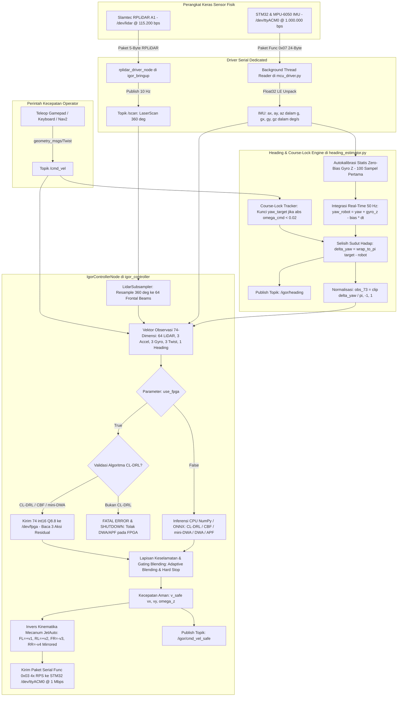

> **Verified direct FPGA link:** Jetson `/dev/ttyTHS1` at **921600 baud**
> passed **98/98 physical inference checks** (mean 4.59 ms, max 5.92 ms).
> See [tested UART run instructions](docs/direct_uart_runbook.md).
> Keep KEY1 released and reset with KEY0 to clear the E-stop latch.

> **Current Ethernet setup:** follow [eth_direction.md](eth_direction.md) and
> [connection instructions](docs/connect_de10.md). The supported endpoint is
> `udp://192.168.50.2:8080`, with Jetson `192.168.50.1/24` on its actual wired
> interface (`enP8p1s0` on this Jetson). Older examples below using
> `192.168.1.50`, daemon `--hw`/`--mock`, or an HPS DDR/DMA bridge are obsolete.
> The deployed path requires HPS Linux plus an HPS-local USB-to-3.3 V UART
> adapter to the FPGA. Programming a SOF alone does not start Ethernet.
> See [Jetson diagnostic results](docs/jetson_de10_diagnosis.md).

# IGOR: software, RTL terverifikasi, dan DE10-Nano

Seluruh hasil implementasi ada di folder **`./fpga`** pada root workspace.
`./src` tetap referensi software asli dan `./peruri-iseedesign` referensi awal.
Software dengan perbaikan integrasi tersedia di `fpga/software_integration/`.

Implementasi RTL yang mengikuti software workspace ini ada di
[`fpga/rtl/igor_src_policy/`](fpga/rtl/igor_src_policy/README.md).
Buka proyek Quartus 25
[`fpga/fpga_de10_nano/src_policy/igor_src_policy.qpf`](fpga/fpga_de10_nano/src_policy/igor_src_policy.qpf).
Pin planning sudah disertakan dan dijelaskan lengkap di
[README board](fpga/fpga_de10_nano/src_policy/README.md).
Semua persyaratan, edge case, serta A1–A14/B1–B6/D1–D7 dari dokumen checklist
dipetakan pada [kesiapan implementasi](fpga/docs/IMPLEMENTATION_READINESS.md).

**Dua model yang berbeda harus dibedakan.** Software `src` saat ini memakai
PPO residual **74 → 128 → 64 → 3**. Proyek legacy dalam `fpga`
memakai SAC **24 → 64 → 64 → 4** dan planner peta 128×128.
Angka 18.192 siklus/400 keluaran pada dokumentasi legacy bukan hasil jaringan
74 input. Core baru mengukur 54.348 siklus untuk inferensi Q8.8; kesamaan yang
diuji adalah RTL terhadap model integer independen dari bobot yang sama.
Galat terhadap model FP32 dilaporkan terpisah dalam hasil suite.

Arsitektur aktual jalur source: ROS menerima 64 beam LiDAR, 6 IMU, 3 perintah
twist, dan 1 heading → host membentuk 74 int16 Q8.8 → frame UART 153 byte
dengan CRC8 Maxim → FPGA memvalidasi frame/domain → ROM bobot + serial MAC
signed 16×16/akumulator 40 bit → ReLU 128/64 neuron → tiga residual dibatasi
[-256,256] → frame respons 11 byte → host blending/filter → kinematika empat
roda → STM32. UART default proyek baru **921600 8N1**.

Pada jalur planner legacy: host menulis seluruh peta ke bank tidak aktif →
validasi urutan/kelengkapan → commit atomik → empat tile memeriksa 512×20 pose →
selector dengan tie-break indeks → safety gate → `motor_enable`, `v_command`,
`omega_command`, kode gangguan, penghitung kejadian, dan last fault.
E-stop, peta tidak valid/usang, konfigurasi berubah, timeout, hasil tidak valid,
overflow serta batas kecepatan/perubahan menutup gate dan menolkan output.
Abort menyimpan penyebab awal sampai reset agar log tetap dapat menjelaskan
penolakan. Opcode 15/16 membaca penghitung/penyebab tersimpan melalui UART.

**Batas integrasi:** protokol observasi 74 input tidak membawa costmap.
`safety_permit` pada core neural berarti residual valid dan segar; izin motor
dengan pemeriksaan peta adalah keluaran gate planner legacy. Belum ada klaim
bahwa model baru, pemeriksa peta, dan aktuator motor sudah menyatu di FPGA.
Controller source masih melakukan blending/filter di Jetson. Checklist A4/A5
kurir tanpa keputusan memerlukan implementasi dan uji integrasi berikutnya.

Perbaikan fail-closed software: mode hardware tidak otomatis berubah menjadi
mock jika port hilang; timeout/CRC salah/frame salah/residual di luar rentang
melempar error dan controller mengirim **empat RPS nol**. Hal ini diperlukan
karena residual AI nol masih dapat menyisakan perintah operator nonnol.
Perintah tidak finite/di luar batas, perintah kedaluwarsa, serta LiDAR hilang
atau kedaluwarsa juga menghentikan motor. Mock harus dipilih secara eksplisit.

Verifikasi dapat diulang dari `fpga`:

```powershell
python verification/src_policy/run.py --check
python verification/run_safety_regression.py
python verification/run_host_regression.py
python verification/run.py all
python verification/run.py tt_generic
```

Suite safety baru membandingkan **111.210 vektor** dengan oracle Python,
menjangkau seluruh kode fault 0–11, seluruh kombinasi kontrol yang dienumerasi,
batas aritmetika, urutan map/config, freshness, deadline, E-stop saat run/result,
serta malformed UART. Daftar batas pengujian dan SHA source berada di
`fpga/evidence/current_safety/summary.json`. Ini bukan pembuktian
formal seluruh state/peta/urutan temporal yang mungkin.

Untuk melihat **titik persis di GTKWave**, dari folder `fpga`:

```powershell
gtkwave evidence/current_safety/top.vcd evidence/current_safety/top.gtkw
gtkwave evidence/current_safety/gate.vcd evidence/current_safety/gate.gtkw
gtkwave evidence/current_safety/uart.vcd evidence/current_safety/uart.gtkw
```

Gunakan satuan **ns** pada tabel berikut (VCD menyimpan resolusi ps). Sinyal
`core` berada pada `tb_safety_top.core`; CSV juga menyebut instance varian
deadline/freshness agar tidak salah membaca output.

| Bukti | Waktu ns | Yang harus terlihat |
|---|---:|---|
| `top.vcd`: hasil normal | 814531 | enable=1, v=15, omega=0, fault=0 |
| E-stop di antara clock | 814535 | enable=0, v=0, omega=0, fault=2 langsung |
| Log E-stop pada clock berikut | 814551 | event_count=3, last_fault=2 |
| E-stop dilepas | 814572 | output tetap nol; perlu reset |
| Peta tidak valid | 2931031 | output nol, fault=5, last_fault=5 |
| Deadline komputasi, `deadline_core` | 3904291 | output nol, fault=8, last_fault=8 |
| Peta tepat kedaluwarsa, `freshness_core` | 3945471 | output nol saat map_age=10000 |
| `gate.vcd`: batas kecepatan | 11 | output nol, fault=10 |
| `gate.vcd`: perubahan mendadak | 12 | output nol, fault=11 |

Seluruh **111 checkpoint** dan konteks lainnya ada pada
[`cases.csv`](fpga/evidence/current_safety/cases.csv),
[`top_checkpoints.csv`](fpga/evidence/current_safety/top_checkpoints.csv),
dan log suite. Untuk neural baru, buka `verification/src_policy/artifacts/`
dengan save file `.gtkw` dan `*_checkpoints.csv` yang dijelaskan pada
[README RTL](fpga/rtl/igor_src_policy/README.md).

GitHub Actions tersedia di [workflow workspace](.github/workflows/rtl-verification.yml)
dan workflow repository RTL. Job Quartus memakai runner Windows dengan Quartus
25 terpasang; simulator memakai Icarus. Workflow mengunggah log, waveform,
hasil numerik, dan provenance. Dua folder memiliki repository Git masing-masing;
lihat instruksi checkout berpasangan pada checklist sebelum publikasi.

**Status hardware:** sesi ini mendeteksi **No JTAG hardware available**.
Simulasi dan kompilasi tidak menggantikan uji board. Belum diklaim: pengukuran
STOP roda, video E-stop, daya board, latency Jetson-FPGA fisik, atau lintasan
robot baru. Skrip capture safety dan prosedur penerimaan tersedia di checklist.

---

# JetAuto Mecanum AMR Autonomous Navigation & Obstacle Avoidance Suite

**Project IGOR** adalah sistem navigasi dan penghindaran rintangan (*obstacle avoidance*) otonom berbasis *Curriculum-Learned Deep Reinforcement Learning* (CL-DRL) dengan lapisan keselamatan formal (*Control Barrier Function* & *mini-DWA Shield*) untuk robot fisik **Hiwonder JetAuto Mecanum AMR**.

Workspace ini didesain secara modular untuk berjalan pada **ROS 2 Humble** di atas **NVIDIA Jetson Orin Nano**, terintegrasi langsung dengan mikrokontroler sasis **STM32**, sensor **Slamtec RPLiDAR A1**, serta akselerator hardware **Terasic DE10-Nano FPGA**.

---

## 📑 Daftar Isi
1. [Arsitektur Paket Workspace](#1-arsitektur-paket-workspace)
2. [Alur Data Sistem (Dataflow Pipeline)](#2-alur-data-sistem-dataflow-pipeline)
3. [Integrasi Hardware & Port Serial](#3-integrasi-hardware--port-serial)
4. [Cara Menjalankan (Single-Command Bringup)](#4-cara-menjalankan-single-command-bringup)
5. [Cara Mengendalikan Robot](#5-cara-mengendalikan-robot)
6. [Monitoring & Telemetri Real-Time](#6-monitoring--telemetri-real-time)
7. [Pelatihan Ulang Model (Retraining AI)](#7-pelatihan-ulang-model-retraining-ai)

---

## 1. Arsitektur Paket Workspace

```
igor_ws/
├── README.md                        # Panduan integrasi & operasional sistem
└── src/
    ├── igor_navigation/             # [Pustaka Algoritma & Bobot Model]
    │   ├── package.xml              # Manifest paket ROS 2
    │   ├── setup.py                 # Instalasi modul & console script
    │   ├── retrain_ai.py -> ...     # Symlink skrip retraining otomatis
    │   └── igor_navigation/
    │       ├── retrain_ai.py        # Skrip otomatis retraining PPO & evaluasi 5 algoritma
    │       ├── controllers/         # 5 Algoritma (cl_drl, cl_drl_cbf, cl_drl_dwa, dwa, apf)
    │       ├── drivers/             # Resampling LiDAR 360° -> 64 berkas frontal
    │       ├── utils/               # Kinematika Mecanum, GlobalPath, LookaheadCarrotTracker
    │       ├── weights/             # Bobot inferensi bit-true (.json, .onnx, .zip, .h, .mem)
    │       └── evaluations/         # Grafik komparatif & 5 animasi GIF durasi penuh
    │
    ├── igor_controller/             # [Node Kontroler ROS 2 & Driver Perangkat Keras]
    │   ├── package.xml
    │   ├── setup.py
    │   └── igor_controller/
    │       ├── controller_node.py   # Node pengendali utama 50 Hz & Strict FPGA Guard
    │       ├── heading_estimator.py # Autokalibrasi Gyro Z, Integrasi Yaw & Course-Lock Tracker
    │       ├── mcu_driver.py        # Driver serial STM32 /dev/ttyACM0 @ 1 Mbps (IMU RX & Motor TX)
    │       └── fpga_bridge.py       # Driver serial UART DE10-Nano FPGA (Q8.8 framing)
    │
    └── igor_bringup/                # [Orkestrasi Peluncuran & Driver Sensor]
        ├── package.xml
        ├── setup.py
        ├── igor_bringup/
        │   └── rplidar_driver_node.py # Driver serial RPLiDAR A1/A2 (/dev/lidar -> /scan)
        ├── launch/
        │   └── bringup.launch.py    # Master launch file single-command
        └── config/
            ├── igor_params.yaml     # Parameter konfigurasi sistem
            └── 99-jetauto-devices.rules # Udev rules untuk port serial robot
```

---

## 2. Alur Data Sistem (Dataflow Pipeline)

Pipeline data berjalan secara deterministik pada frekuensi **50 Hz** ($dt = 0.02\text{ s}$):



---

## 3. Integrasi Hardware & Port Serial

### Pemetaan Port Default pada Jetson Orin Nano
* **STM32 Sub-Controller**: `/dev/ttyACM0` @ **1.000.000 bps** (bidirectional: IMU 6-DOF & perintah motor 4-roda).
* **Slamtec RPLiDAR A1**: `/dev/lidar` atau `/dev/ttyUSB0` @ **115.200 bps** (protokol biner scan kontinu).
* **Terasic DE10-Nano FPGA**: `/dev/fpga` atau `/dev/ttyUSB1` @ **115.200 bps** / **921.600 bps** (UART Q8.8 framing).

### Konfigurasi Akses Serial (Dilakukan Sekali pada Jetson)
Pastikan user Linux Anda memiliki izin akses ke port dialout/serial:
```bash
sudo usermod -a -G dialout $USER
# Terapkan rules udev JetAuto jika belum terpasang:
sudo cp src/igor_bringup/config/99-jetauto-devices.rules /etc/udev/rules.d/
sudo udevadm control --reload-rules && sudo udevadm trigger
```

---

## 4. Cara Menjalankan (Single-Command Bringup)

### A. Kompilasi Workspace
Sebelum menjalankan sistem untuk pertama kali (atau setelah retraining), kompilasi workspace:
```bash
cd ~/peruri-ai-final/igor_ws
source /opt/ros/humble/setup.bash
colcon build --symlink-install
source install/setup.bash
```

---

### B. Perintah Eksekusi Berdasarkan Skenario

#### Skenario 1: Menjalankan CL-DRL + CBF Safety Filter pada CPU (Rekomendasi Utama)
Sistem menjalankan model CL-DRL yang diperkuat sertifikat Lyapunov Nagumo *Control Barrier Function* (QP filter) langsung pada prosesor Jetson:
```bash
ros2 launch igor_bringup bringup.launch.py algorithm:=cl_drl_cbf use_fpga:=false
```

#### Skenario 2: Menjalankan dengan Akselerasi Hardware DE10-Nano FPGA
Inferensi neural network dieksekusi oleh IP Core pada FPGA DE10-Nano dalam format fixed-point signed 16-bit Q8.8:
```bash
ros2 launch igor_bringup bringup.launch.py algorithm:=cl_drl_cbf use_fpga:=true fpga_port:=/dev/fpga
```

#### Skenario 3: Menjalankan Algoritma DWA atau APF Standalone pada CPU
Untuk benchmarking perbandingan dengan algoritma navigasi reaktif klasik:
```bash
# Dynamic Window Approach (Anti-Freeze Rollout):
ros2 launch igor_bringup bringup.launch.py algorithm:=dwa use_fpga:=false

# Artificial Potential Field (64 Beams Repulsion):
ros2 launch igor_bringup bringup.launch.py algorithm:=apf use_fpga:=false
```

#### Skenario 4: Mode Simulasi / Headless (Uji Coba Tanpa Robot Fisik)
Menjalankan bringup lengkap tanpa perlu mencolokkan perangkat keras serial:
```bash
ros2 launch igor_bringup bringup.launch.py algorithm:=cl_drl_cbf use_mock_serial:=true
```

---

### C. Daftar Parameter Launch yang Tersedia

| Parameter | Tipe | Nilai Default | Deskripsi |
| :--- | :---: | :---: | :--- |
| `algorithm` | string | `cl_drl_cbf` | Pilihan: `cl_drl`, `cl_drl_cbf`, `cl_drl_dwa`, `dwa`, `apf`. |
| `use_fpga` | bool | `false` | Mengaktifkan akselerator DE10-Nano FPGA (khusus varian CL-DRL). |
| `mcu_port` | string | `/dev/ttyACM0` | Port serial mikrokontroler sasis STM32 (@ 1 Mbps). |
| `fpga_port` | string | `/dev/fpga` | Port serial UART akselerator DE10-Nano FPGA. |
| `lidar_port` | string | `/dev/lidar` | Port serial sensor Slamtec RPLiDAR A1 (@ 115.200 bps). |
| `launch_lidar` | bool | `true` | Menentukan apakah driver LiDAR diluncurkan otomatis. |
| `use_mock_serial` | bool | `false` | Mode emulasi sensor jika port fisik belum terpasang. |
| `control_rate_hz` | double | `50.0` | Frekuensi loop kontrol utama (Hz). |

> [!IMPORTANT]
> **Strict FPGA Guard**:
> Jika Anda menyetel `use_fpga:=true` tetapi memilih algoritma non-neural seperti `dwa` atau `apf`, sistem **seketika menolak eksekusi dan melakukan shutdown terarah (FATAL ERROR)** untuk mencegah perilaku perangkat keras yang tidak terdefinisi.

---

## 5. Cara Mengendalikan Robot

Controller Project IGOR menerima perintah gerak melalui topik standar **`/cmd_vel`** (`geometry_msgs/msg/Twist`). Anda dapat mengendalikan robot menggunakan beberapa metode berikut:

### Metode A: Teleoperasi Keyboard (Komputer atau Terminal Jetson)
Jalankan node keyboard standar ROS 2 di terminal terpisah:
```bash
ros2 run teleop_twist_keyboard teleop_twist_keyboard
```
* `i` : Maju linier ($+v_x$)
* `,` : Mundur linier ($-v_x$)
* `j` : Belok kiri di tempat ($+\omega_z$)
* `l` : Belok kanan di tempat ($-\omega_z$)
* `J` (Shift+j) : Geser samping holonomik ke kiri (*strafe left*, $+v_y$)
* `L` (Shift+l) : Geser samping holonomik ke kanan (*strafe right*, $-v_y$)
* `k` : Berhenti darurat

### Metode B: Joystick Gamepad (Bluetooth / USB Wireless Dongle)
Jika menggunakan controller nirkabel bawaan JetAuto:
```bash
ros2 run joy joy_node
ros2 run teleop_twist_joy teleop_twist_joy --ros-args -p enable_button:=4
```

### Metode C: Navigasi Otonom Nav2 (Autonomous Global Planning)
Saat paket Nav2 dijalankan, controller server Nav2 mempublikasikan perintah ke `/cmd_vel`. Controller IGOR menyaring perintah dengan pengereman asimetris adaptif; keselamatan lintasan fisik tetap perlu divalidasi terhadap sensor, peta, pengereman, dan fixture robot sebenarnya.

### Metode D: Uji Perintah Langsung via CLI ROS 2
```bash
# Perintah maju lurus 0.35 m/s:
ros2 topic pub --once /cmd_vel geometry_msgs/msg/Twist "{linear: {x: 0.35, y: 0.0, z: 0.0}, angular: {x: 0.0, y: 0.0, z: 0.0}}"

# Perintah geser diagonal (Maju 0.25 m/s + Geser Kanan 0.20 m/s):
ros2 topic pub --once /cmd_vel geometry_msgs/msg/Twist "{linear: {x: 0.25, y: -0.20, z: 0.0}, angular: {x: 0.0, y: 0.0, z: 0.0}}"
```

> [!TIP]
> **Fitur Keselamatan Watchdog 0.5 Detik**:
> Jika tidak ada perintah baru yang masuk di `/cmd_vel` selama lebih dari **0.5 detik**, sasis secara otomatis berhenti seketika (*zero-velocity brake*) untuk mencegah robot bergerak liar jika sinyal komunikasi terputus.

---

## 6. Monitoring & Telemetri Real-Time

Buka terminal baru untuk memantau status operasional robot secara langsung:

### 1. Memantau Sudut Haluan & Heading Error
```bash
ros2 topic echo /igor/heading
```
* Menampilkan nilai selisih sudut haluan $\Delta \theta$ dalam radian ($[-\pi, \pi]$). Ketika robot melaju translasi murni, *Course-Lock* aktif mempertahankan haluan lurus stabil.

### 2. Memantau Perintah Kecepatan Aman Hasil Filter
```bash
ros2 topic echo /igor/cmd_vel_safe
```
* Menampilkan kecepatan $[v_x, v_y, \omega]$ aktual yang telah disesuaikan dengan amplop keselamatan (*asymmetric braking* dan *Nagumo barrier filter*).

### 3. Memantau Telemetri Lengkap Sistem (JSON)
```bash
ros2 topic echo /igor/diagnostics
```
Output menyediakan telemetri diagnostik komprehensif:
```json
{
  "algo": "cl_drl_cbf",
  "fpga": false,
  "d_min": 1.45,
  "cmd": [0.35, 0.0, 0.0],
  "safe": [0.35, 0.0, 0.0],
  "rps": [1.15, 1.15, -1.15, -1.15],
  "heading": {
    "calibrated": true,
    "gyro_bias_z_rad_s": 0.0014,
    "theta_robot_deg": 1.2,
    "theta_target_deg": 1.2,
    "delta_theta_deg": 0.0,
    "course_locked": true
  }
}
```
*(Catatan: Nilai RPS motor ke-3 dan ke-4 bernilai negatif mencerminkan pembalikan tanda mekanikal roda kanan sasis JetAuto).*

---

## 7. Pelatihan Ulang Model (Retraining AI)

Jika Anda ingin melatih ulang kebijakan DRL dengan variasi kurikulum atau dataset baru:

```bash
# Opsi 1: Menjalankan via perintah ROS 2 (setelah source install/setup.bash):
ros2 run igor_navigation retrain_ai --timesteps 300000 --eval

# Opsi 2: Menjalankan langsung via Python:
python3 src/igor_navigation/retrain_ai.py --timesteps 300000 --eval

# Atau uji cepat (smoke test) 10.000 timesteps:
ros2 run igor_navigation retrain_ai --timesteps 10000
```

### Hasil yang Dihasilkan Otomatis oleh Skrip:
1. **Memperbarui berkas bobot** di `src/igor_navigation/igor_navigation/weights/` (`.zip`, `.onnx`, `.json`, `.h`, `.mem`).
2. **Menyimpan 5 animasi GIF durasi penuh** dan grafik komparatif di `src/igor_navigation/igor_navigation/evaluations/`.
3. **Memicu `colcon build` otomatis** sehingga perubahan bobot langsung aktif pada bringup robot tanpa langkah manual tambahan.
