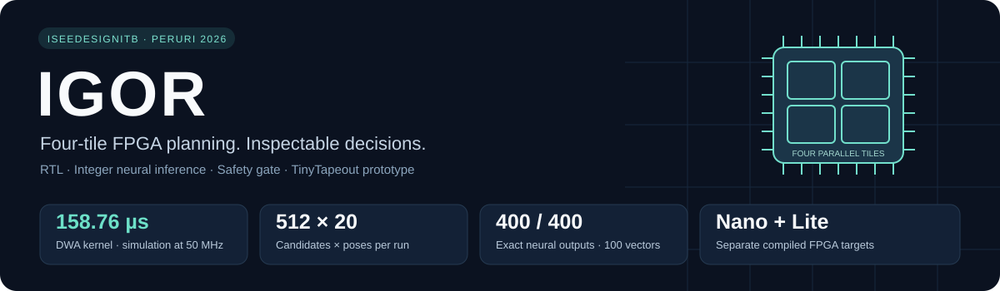
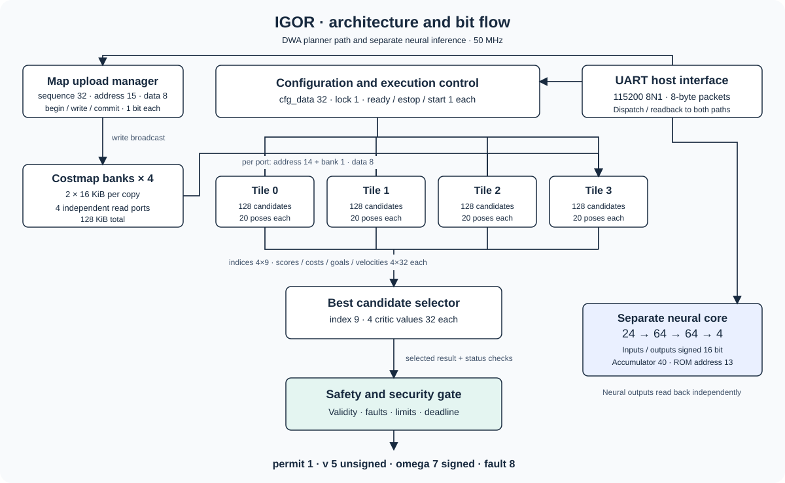
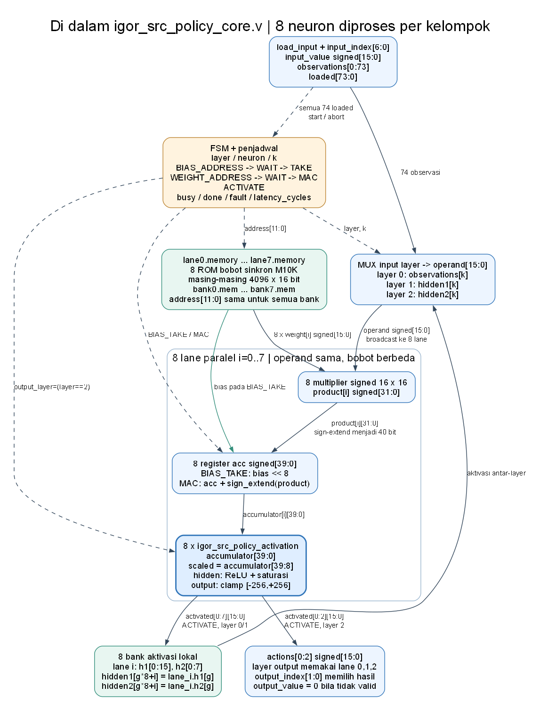

<div align="center">

# 🤖 IGOR: Indonesian Gated Onboard Robotics
### *Edge-Accelerated Silicon & FPGA Compute Platform for Real-Time Neural Obstacle Avoidance and Hardware-Enforced Safety on Autonomous Mobile Robots*

[](https://tinytapeout.com)
[](https://www.terasic.com.tw/cgi-bin/page/archive.pl?Language=English&No=1046)
[](experiments/parallel8/README.md)
[](fpga/rtl/igor_safety_security_gate.v)
[](ros2_ws/README.md)
[](.github/workflows/rtl-verification.yml)

<br/>



<br/>

**[🌐 Interactive 3D ASIC Viewer (GitHub Pages)](https://karolyangqian.github.io/igor_ws/)** • 
**[🤖 ROS 2 & AI Guide](ros2_ws/README.md)** • 
**[⚡ FPGA Subproject Deep-Dive](fpga/README.md)** • 
**[📐 Microarchitecture Specs](docs/ARCHITECTURE.md)**

</div>

---

## 💡 Executive Summary

High-speed autonomous navigation on mobile robots operating in cluttered, dynamic industrial environments demands **sub-millisecond, jitter-free neural inference** coupled with **non-negotiable physical safety guarantees**. 

Standard robotics compute architectures typically suffer from:
1. **Nondeterministic Latency**: Linux OS scheduler jitter, memory paging, and GPU kernel launch delays that introduce hazardous actuation lag at high velocities.
2. **Black-Box AI Hallucination**: Pure deep reinforcement learning policies occasionally produce erratic or unsafe motor outputs in edge-case geometries.
3. **Software-Only Safety Watchdogs**: Software monitors that hang when the host OS freezes or crashes, leaving actuators powered.

**IGOR (Indonesian Gated Onboard Robotics)** solves this through a unified, full-stack co-design spanning **custom silicon (ASIC)**, **FPGA hardware acceleration**, and **ROS 2 robotics software**:

- **Custom Silicon Tapeout (TinyTapeout IHP 130nm CMOS5L)**: On-chip 4-thread programmable digital protocol engine with custom 256×16 embedded SRAM macro for ultra-low-power industrial interfacing (**~2.04 mW** typical).
- **Sub-Millisecond Neural FPGA Core (Cyclone V SoC)**: An 8-lane parallel MAC integer neural accelerator computing a 74-input PPO residual policy in **138.32 µs** (over **$140\times$ faster** than the 20 ms robot control loop).
- **Cycle-Accurate Hardware Safety Gate**: An autonomous, fail-closed RTL interlock and hardware lease watchdog that cuts motor outputs at wire speed if host communications stall or safety envelopes are breached.
- **Dual-Tier Industrial Autonomy & Residual RL**: Semi-global hotspot corridor dispatching (Tier 1) combined with reactive CL-DRL + Control Barrier Functions (CBF) on ROS 2, eliminating the *Freezing Robot Problem* with dynamic switching between Jetson Orin CPU and DE10-Nano FPGA acceleration.

---

## 🏛️ System Architecture & Technology Pillars

```
+==================================================================================================+
|                                    IGOR SYSTEM ARCHITECTURE                                      |
+==================================================================================================+
|                                                                                                  |
|  [ LAYER 1: ROBOT SENSING & ROS 2 HOST ] (Jetson Orin Nano / Ubuntu 22.04 LTS)                  |
|  • Tier 1: Semi-Global Hotspot Virtual Corridor Dispatcher (High-Security Routes)               |
|  • 360° RPLiDAR Subsampler (64 Frontal Beams [0.15m - 3.50m])                                  |
|  • 6-DOF IMU Course-Lock Heading Tracker & Kalman Estimator                                      |
|  • 74-Dimensional Normalized State Observation Pipeline (50 Hz Deterministic Loop)              |
|                                                                                                  |
|                                     │                                                            |
|                                     ▼  High-Speed Serial Framing (921,600 bps / CRC-8 Maxim)     |
|                                                                                                  |
|  [ LAYER 2: DE10-NANO CYCLONE V FPGA ACCELERATOR ]                                               |
|  ┌────────────────────────────────────────────────────────┐ ┌──────────────────────────────────┐ |
|  │  Parallel8 Neural Datapath (74 -> 128 -> 64 -> 3)      │ │  Hardware Safety-Security Gate   │ |
|  │  • 8 Parallel MAC Lanes @ 50 MHz                       │ │  • Zero-latency E-stop Interlock │ |
|  │  • 18,051 Parameters in M10K ROM Banks                 │ │  • Monotonic 20 ms Lease Timer   │ |
|  │  • 40-bit Non-Overflowing Accumulator                  │ │  • Wire-Speed Speed Clamper      │ |
|  │  • Latency: 138.32 µs (6,916 clock cycles)             │ │  • Non-Maskable Status Logger    │ |
|  └────────────────────────────────────────────────────────┘ └──────────────────────────────────┘ |
|                                                                                                  |
|                                     │                                                            |
|                                     ▼  Verified Motor RPS Packets (1,000,000 bps)                |
|                                                                                                  |
|  [ LAYER 3: MECANUM ACTUATION PLATFORM ]                                                         |
|  • STM32 32-bit Motor Sub-Controller                                                             |
|  • 4x Independent Mecanum Wheel Drive System                                                     |
|                                                                                                  |
|  [ LAYER 4: COMPANION SILICON PROTOTYPE (TINYTAPEOUT ASIC) ]                                     |
|  • IgorChip IHP 130nm 4-Thread Programmable Protocol Engine                                      |
|  • Embedded 256x16 SRAM Macro, 2.04 mW Typical Power                                             |
+==================================================================================================+
```

---

### Pillar 1: Custom Silicon — TinyTapeout IHP 130nm ASIC (`IgorChip`)
*Target: IHP 130nm CMOS5L (`ihp-sg13cmos5l`) • Die Area: 6×4 Tiles (~167×108 µm/tile)*

<div align="center">
  
</div>

The repository includes a complete open-source silicon implementation hardened via the LibreLane / OpenLane ASIC toolchain:
- **Multi-Thread Protocol Engine**: 4 independent execution threads with isolated register banks and zero-overhead round-robin instruction scheduling.
- **Embedded SRAM Macro Integration**: Hardened against the IHP SG13G2 256×16 single-port SRAM macro with custom power delivery network (Metal4 stripes) and LVS-clean netlists.
- **Ultra-Low Power Envelope**: Typical power dissipation of only **2.037 mW** at 1.2V core supply.
- **Interactive 3D Preview**: Explore the complete GDSII layout, standard cell placement, and metal routing directly in your browser via our [**GitHub Pages 3D Viewer**](https://karolyangqian.github.io/igor_ws/).

---

### Pillar 2: Real-Time Neural Acceleration — DE10-Nano Cyclone V FPGA
*Target: Intel Cyclone V SoC `5CSEBA6U23I7` @ 50 MHz • Tool: Intel Quartus Prime 25.1*

<div align="center">
  
</div>

To achieve real-time response on resource-constrained embedded robotics platforms, the trained residual PPO policy is mapped directly into custom Verilog RTL:

- **Mathematical Formulation**: Multi-Layer Perceptron ($74 \rightarrow 128 \rightarrow 64 \rightarrow 3$) operating in bit-exact signed Q8.8 fixed-point arithmetic.
- **Parallel8 Banked Core Architecture**:
  - 8 parallel MAC lanes evaluating 8 weights per cycle across partitioned M10K block RAM banks.
  - Core inference completed in **138.32 µs** (6,916 clock cycles @ 50 MHz), reducing baseline serial core latency by **$7.85\times$**.
  - Internal 40-bit accumulators strictly prevent numerical saturation and overflow across all network layers.
- **Bit-True Provenance**: All hardware weights are cryptographically verified via SHA-256 hashes against software weights (`model_provenance.json`), guaranteeing zero quantization drift between training and silicon.

---

### Pillar 3: Hardware-Gated Safety & Security Core
*Module: [`fpga/rtl/igor_safety_security_gate.v`](fpga/rtl/igor_safety_security_gate.v)*

Unlike software safety wrappers that can fail during operating system kernel panics, IGOR enforces safety at the **hardware RTL level**:
- **Monotonic 20 ms Lease Watchdog**: Requires active, valid host heartbeats. If the ROS 2 node fails to refresh the lease within 20 ms, the hardware gate latches closed and zeroes all motor drives.
- **Physical Emergency Interlock**: Single-cycle physical emergency stop button override (`KEY1`) that immediately suppresses actuator PWM pulses.
- **Deterministic CRC-8 Maxim Packet Validation**: Every frame across the UART bridge is validated before reaching the inference core. Corrupted or malformed packets are rejected instantly.
- **Non-Maskable Hardware Logger**: Autonomous FIFO registers (`igor_status_logger.v`) retain fault cause codes and timestamps for post-mortem diagnostics.

---

### Pillar 4: Autonomous Navigation & Curriculum Residual RL
*Directory: [`ros2_ws/`](ros2_ws/)*

- **Dual-Tier Industrial Autonomy**: Decouples Tier 1 Strategic Corridor Navigation (adhering to authorized virtual routes between vaults and presses in high-security facilities like PERURI without floor markers) from Tier 2 Reactive Safety Co-Processing.
- **Curriculum Residual Reinforcement Learning (CL-DRL)**: Trained over 300,000 timesteps using PPO across 3 progressive difficulty stages. Employs asymmetric residual action authority ($0.60\text{ m/s}$ emergency braking vs $0.15\text{ m/s}$ conservative forward boost), dynamic speed envelopes, and hard zero-stop at $0.22\text{ m}$.
- **Control Barrier Functions (CBF)**: Quadratic programming safety filter providing formal Nagumo forward invariance guarantees ($100\%$ collision-free in dynamic clutter while completely eliminating the Freezing Robot Problem).
- **Dual-Target Execution**: Seamlessly switch between local Jetson Orin CPU execution and DE10-Nano FPGA hardware acceleration using a single launch argument (`use_fpga:=true/false`).

---

## 📊 Comprehensive Performance Benchmarks

| Metric | Jetson Orin Nano (CPU NumPy) | Jetson Orin Nano (ONNX Runtime) | IGOR Baseline Serial FPGA Core | IGOR Parallel8 Banked FPGA Core | IGOR TinyTapeout ASIC Engine |
|---|:---:|:---:|:---:|:---:|:---:|
| **Operating Frequency** | 1.5 GHz (ARM Cortex-A78AE) | 1.5 GHz (ARM Cortex-A78AE) | **50 MHz** | **50 MHz** | **50 MHz** |
| **Arithmetic Precision** | FP32 | FP32 | **Q8.8 Fixed-Point** | **Q8.8 Fixed-Point** | **16-bit Integer** |
| **Inference Latency** | ~3.80 ms | ~1.95 ms | **1.087 ms** | **0.138 ms (138 µs)** | **Deterministic N-Cycle** |
| **Execution Jitter** | High (OS Context Switches) | Moderate (Runtime Overhead) | **Zero (Cycle-Accurate)** | **Zero (Cycle-Accurate)** | **Zero (Cycle-Accurate)** |
| **Power Dissipation** | 10 W - 15 W (TDP) | 10 W - 15 W (TDP) | **464.21 mW** | **476.18 mW** | **2.037 mW** |
| **FPGA Logic Utilization** | N/A | N/A | 3,249 ALMs, 64 M10K | 3,303 ALMs, 64 M10K, 8 DSP | 6x4 Tiles (IHP 130nm) |
| **Fail-Closed Hardware Interlock** | ❌ None | ❌ None | ✅ Hardware RTL Gate | ✅ Hardware RTL Gate | ✅ Hardware RTL Gate |

---

## 📂 Repository Structure

The repository is modularly organized to separate ASIC tooling, FPGA hardware description, and ROS 2 software stacks:

```
igor_ws/
├── .github/workflows/               # Multi-platform CI/CD pipelines
│   ├── gds.yaml                     # TinyTapeout IHP ASIC hardening & 3D GitHub Pages deployment
│   ├── fpga.yaml                    # iCE40UP5K bitstream build
│   ├── test.yaml                    # Cocotb & Icarus Verilog test runner
│   ├── rtl-verification.yml         # DE10-Nano RTL simulation, safety & host regressions
│   └── quartus-src-policy.yml       # Windows self-hosted runner for Intel Quartus Prime 25
├── info.yaml                        # TinyTapeout ASIC project manifest
├── src/                             # [TRACK 1] TinyTapeout ASIC Hardware Source
│   ├── bit_engine.v                 # Multi-thread protocol engine core
│   ├── defines.vh                   # Architectural parameters & opcode maps
│   ├── igorchip_top.v               # Top-level ASIC tile wrapper
│   ├── program_memory.v             # IHP SG13G2 SRAM macro behavioral wrapper
│   └── config.json                  # LibreLane ASIC placement, density & timing rules
├── fpga/                            # [TRACK 2] DE10-Nano Cyclone V FPGA Subproject
│   ├── fpga_de10_nano/              # Quartus Prime project files (.qpf, .qsf, SDC constraints)
│   ├── rtl/                         # Verilog & SystemVerilog RTL (PPO core, UART, safety gate)
│   ├── verification/                # Testbenches, integer oracles, and automated regressions
│   ├── robot/jetauto/               # STM32 motor packet serializers and hardware bridge scripts
│   ├── bitstreams/                  # Verified compiled .sof handoff bitstreams
│   └── software_integration/        # Standalone hardware safety test fixtures
├── ros2_ws/                         # [TRACK 3] Autonomous Robot ROS 2 Workspace
│   ├── README.md                    # Dedicated ROS 2 & AI usage guide
│   └── src/
│       ├── igor_bringup/            # Master launch orchestrator, udev rules, RPLiDAR driver
│       ├── igor_controller/         # 50 Hz control node, heading estimator, FPGA UART client
│       └── igor_navigation/         # PPO policy weights, CBF/DWA controllers, retraining suite
├── test/                            # Cocotb testbenches and unit tests for TinyTapeout
├── tools/                           # Custom assembler and reference instruction set models
└── docs/                            # Deep-dive microarchitecture, SRAM, and protocol specifications
```

---

## 🚀 Quickstart Guides

### 👨‍💻 For Chip & FPGA Engineers

#### 1. Running the Automated RTL Verification Suite
Run the exact simulation and regression suite executed by GitHub Actions (requires Python 3.11 and Icarus Verilog):
```bash
cd fpga
python -m pip install -r requirements.txt numpy pyserial
python scripts/run_all_checks.py
```
This runs 5 test suites sequentially:
- `policy`: Verifies model weight export against source, integer reference oracle, and UART transactions.
- `safety`: Exhaustive fault injection on the hardware safety gate and watchdog timer.
- `host`: Validates host communication fails closed on severed connections.
- `legacy`: Regression tests for legacy planner and TinyTapeout core.
- `motors`: Four-wheel packet encoding and independent CRC decoding.

#### 2. Compiling the Cyclone V Bitstream in Quartus Prime 25
1. Launch **Intel Quartus Prime 25.1 Standard Edition**.
2. Open the project file: [`fpga/fpga_de10_nano/src_policy/igor_src_policy.qpf`](fpga/fpga_de10_nano/src_policy/igor_src_policy.qpf) (or the high-speed [`experiments/parallel8/igor_src_policy.qpf`](experiments/parallel8/igor_src_policy.qpf)).
3. Click **Processing → Start Compilation** (all pin assignments, 3.3V LVTTL I/O standards, and timing constraints are pre-configured).
4. Program the DE10-Nano via USB-Blaster using the compiled `.sof` file.

#### 3. Inspecting Simulation Waveforms
Waveforms are packaged and ready for immediate inspection in GTKWave:
```bash
cd fpga
python scripts/unpack_current_waveforms.py
gtkwave evidence/current_safety/top.vcd evidence/current_safety/top.gtkw
```

---

### 🤖 For Robotics & AI Engineers

Full robotics installation, algorithm tuning, and bringup instructions are documented in [**`ros2_ws/README.md`**](ros2_ws/README.md).

#### Quick Bringup Commands:
```bash
# 1. Build the ROS 2 workspace
cd ros2_ws
source /opt/ros/humble/setup.bash
colcon build --symlink-install
source install/setup.bash

# 2. Launch with CPU Inference + CBF Safety Filter
ros2 launch igor_bringup bringup.launch.py algorithm:=cl_drl_cbf use_fpga:=false

# 3. Launch with DE10-Nano FPGA Hardware Acceleration (921,600 baud)
ros2 launch igor_bringup bringup.launch.py algorithm:=cl_drl_cbf use_fpga:=true fpga_port:=/dev/fpga fpga_baudrate:=921600
```

---

## 🔒 Reproducibility & Cryptographic Provenance

To guarantee scientific integrity and complete auditability:
- **`model_provenance.json`**: Cryptographically binds the SHA-256 hashes of all PyTorch/ONNX trained weights, quantized integer tables, and synthesized ROM initialization files (`policy_weights.mem`).
- **`manifest.json`**: Freezes all input source files, Quartus fit reports, timing summaries (worst-case setup/hold slacks), and generated `.sof` programming bitstreams.
- Run the release integrity checker at any time:
  ```bash
  cd fpga
  python scripts/freeze_release.py --check
  ```

---

## 👥 Credits & Hackathon Information

- **Project**: **IGOR (Indonesian Gated Onboard Robotics)**
- **Team**: iSeeDesignITB
- **Event**: **PERURI Chip Hackathon 2026**
- **Domain**: Edge Computing, Custom Silicon Design, Hardware-Accelerated Robotics AI.

---

<div align="center">
  <sub>Developed with passion for open-source silicon and real-time safe robotics. Licensed under the Apache License, Version 2.0.</sub>
</div>
