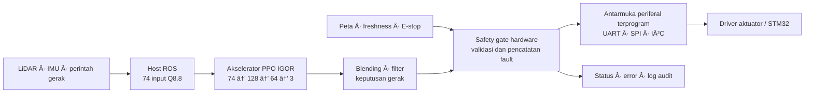

# IGOR — Intelligence, Guarded Outputs, Reconfigurable Interfaces

**Kami menciptakan IGOR: rancangan chip kendali cerdas yang membawa inferensi AI berlatensi mikrodetik, proteksi keluaran di hardware, dan antarmuka industri terprogram ke dalam satu visi produk.**

**138,32 ?s per inferensi core ? 8 jalur komputasi paralel ? 18.051 parameter neural ? memori bobot on-chip ? proteksi operasi yang dapat ditelusuri.**

IGOR dikembangkan untuk robot bergerak yang membaca lingkungan, menghitung koreksi gerak, dan menjaga agar keluaran aktuator mengikuti aturan operasi. Nilai produknya terletak pada tiga kemampuan yang saling melengkapi: **menghitung cepat, mengendalikan keluaran dengan disiplin, dan berkomunikasi dengan periferal secara fleksibel**.

Dokumen ini menyajikan **visi sistem IGOR terpadu** dengan bukti dari blok Verilog yang tersedia. Angka diberi label asalnya: akselerator AI pada FPGA, safety gate pada RTL planner, serta protocol engine pada implementasi ASIC IHP. Diagram berikut adalah arsitektur produk yang dituju; setiap metrik adalah hasil blok terkait, bukan pengukuran satu chip gabungan.

## 1. Satu cerita produk: dari sensor menuju aksi yang terkendali

Dalam visi integrasi ini, akselerator menghasilkan residual AI, host mengolahnya menjadi keputusan gerak, safety gate memberi syarat pelepasan keluaran, dan protocol engine menjadi penghubung periferal. Pemisahan tanggung jawab tersebut memberi dasar yang jelas untuk robot inspeksi, AGV, dan otomasi tepi jaringan.

**Jejak implementasi:** [core neural](rtl/igor_src_policy/igor_src_policy_core.v), [varian Parallel8](experiments/parallel8/README.md), [safety gate](rtl/igor_safety_security_gate.v), [status logger](rtl/igor_status_logger.v), dan [protocol engine ASIC](../src/igorchip_top.v). Penyatuan jalur antarmuka dan pengujiannya merupakan pekerjaan integrasi; dokumen ini tidak mengubah RTL atau bitstream yang sudah tervalidasi.

## 2. Inti IGOR: akselerator AI yang dirancang langsung di RTL

**Jantung komputasi IGOR berada di folder `fpga/`: core PPO Parallel8 dengan delapan jalur multiply?accumulate, memori bobot lokal, dan state machine yang mengatur setiap langkah inferensi.** Jalur datanya menerima **74 observasi**, mengolah dua hidden layer **128 dan 64 neuron**, lalu menghasilkan **tiga residual kendali**. Ini adalah mesin inferensi neural berbasis Verilog yang mengerjakan matematika kebijakan IGOR pada hardware khusus.

| Parameter core AI FPGA | Spesifikasi / hasil | Makna desain |
|---|---:|---|
| Topologi neural | **74 ? 128 ? 64 ? 3** | Input sensor/perintah menuju tiga residual |
| Clock operasi yang divalidasi | **50 MHz** | Periode clock **20 ns** |
| Siklus inferensi | **6.916 clock** | Jadwal komputasi dari start hingga done |
| Latensi inferensi core | **138,32 ?s / 0,13832 ms** | Memenuhi target core di bawah 0,16 ms |
| Parallelisme | **8 lane MAC** | Satu operand dibagikan ke delapan bobot/neuron |
| Format input dan bobot | **signed 16-bit Q8.8** | Resolusi numerik **1/256 = 0,00390625** |
| Hasil perkalian | **signed 32-bit** | Perkalian operand 16 ? 16 bit |
| Akumulator | **8 ? signed 40-bit** | Penjumlahan dot product dengan ruang numerik ekstra |
| Aktivasi hidden layer | **ReLU dengan saturasi** | Aktivasi terdefinisi pada rentang fixed-point |
| Pembatas output | **?256 sampai +256 kode Q8.8** | Residual dalam rentang **?1 sampai +1** |
| Parameter neural berguna | **18.051 word 16-bit** | **17.856 bobot + 195 bias** |
| Memori bobot fisik FPGA | **8 bank ? 4.096 ? 16 bit** | Total alokasi **524.288 bit / 64 KiB** |
| Register hasil/state | **6.277 register fitted** | State, datapath dan kontrol pada hasil implementasi |
| Logika fitted | **3.303 ALM / 41.910** | Pemakaian sekitar **7,88% ALM** DE10-Nano |
| Blok memori fitted | **64 M10K / 553** | Penyimpanan bobot pada embedded block memory |
| Multiplier fitted | **8 DSP / 112** | Jalur perkalian memakai resource DSP hardware |
| PLL fitted | **0 / 6** | Memakai domain clock board 50 MHz |
| Worst setup / hold slack | **+5,647 ns / +0,119 ns** | Hasil timing FPGA positif pada corner yang dilaporkan |

Sumber primer: [Verilog core Parallel8](experiments/parallel8/igor_src_policy_core.v), [proyek Quartus](experiments/parallel8/igor_src_policy.qpf), [hasil acceptance](experiments/parallel8/artifacts/acceptance.json), [Fitter](experiments/parallel8/output_files/igor_src_policy.fit.summary), [timing](experiments/parallel8/output_files/igor_src_policy.sta.summary), dan [CSV metrik](experiments/parallel8/artifacts/metric_evidence.csv).

### Clock-cycle design: setiap fase komputasi mempunyai tugas

State machine core mengatur **alamat ? baca memori sinkron ? MAC ? aktivasi**. Delapan bank bobot menyediakan data untuk delapan neuron dalam satu kelompok. Tahap `WEIGHT_WAIT` menyelaraskan pembacaan memori terdaftar sebelum hasil dipakai.

| Fase RTL | Siklus per kelompok neuron | Tugas |
|---|---:|---|
| `BIAS_ADDRESS ? BIAS_WAIT ? BIAS_TAKE` | **3** | Mengambil bias dan mengisi akumulator |
| `WEIGHT_ADDRESS ? WEIGHT_WAIT ? MAC` | **3 ? jumlah input layer** | Membaca bobot dan menambahkan hasil perkalian |
| `ACTIVATE` | **1** | ReLU/saturasi atau pembatas output, lalu menyimpan hasil |

| Layer | Input ? neuron | Kelompok delapan lane | Perhitungan siklus | Total |
|---|---:|---:|---|---:|
| Hidden 1 | 74 ? 128 | 16 | 16 ? (3 + 3?74 + 1) | **3.616** |
| Hidden 2 | 128 ? 64 | 8 | 8 ? (3 + 3?128 + 1) | **3.104** |
| Output | 64 ? 3 | 1 | 1 ? (3 + 3?64 + 1) | **196** |
| **Satu inferensi** | | **25 kelompok** | 3.616 + 3.104 + 196 | **6.916** |

Pada layer output, tiga lane menghasilkan tiga keluaran berguna. Anggaran siklus tersebut berasal dari urutan state Verilog dan cocok dengan hasil simulasi penerimaan. `latency_cycles` menyediakan counter **32-bit**, sedangkan `busy`, `done`, `fault`, `error_code` dan `saturated` membuat hasil komputasi dapat dipantau.

### Throughput RTL: jelaskan besaran dan cara memperolehnya

| Metrik turunan core | Perhitungan | Nilai |
|---|---|---:|
| Laju ekuivalen dari latensi core | 50.000.000 / 6.916 | **7.229,61 inferensi/detik** |
| MAC berguna per inferensi | 74?128 + 128?64 + 64?3 | **17.856 MAC** |
| Laju MAC berguna ekuivalen | 17.856 / 138,32 ?s | **129,09 MMAC/s** |
| Selisih terhadap anggaran 0,16 ms | 160 ? 138,32 | **21,68 ?s** |

**7.229,61 inferensi/detik adalah kebalikan latensi core**, dengan asumsi pengulangan tanpa overhead. Ini merupakan batas laju ekuivalen komputasi, bukan hasil pengukuran sustained throughput antarmuka. Akuisisi 74 input, reload/start, pengiriman UART dan pemrosesan host dihitung dalam anggaran sistem tersendiri. **129,09 MMAC/s** adalah jumlah MAC neural berguna dibagi waktu inferensi, dengan satu perkalian-penjumlahan dihitung sebagai satu MAC; tidak mencakup bias, aktivasi atau lane padding sebagai operasi berguna.

## 2A. Memori on-chip: bobot dekat dengan datapath

**IGOR menempatkan bobot neural di embedded memory FPGA dan program protokol di SRAM macro ASIC.** Keduanya mempunyai fungsi yang jelas dalam arsitektur produk: bobot melayani komputasi AI; SRAM menyimpan program antarmuka periferal.

| Organisasi memori | Kapasitas / bentuk | Fungsi |
|---|---|---|
| Bank bobot Parallel8 pada FPGA | **8 ? 4.096 word ? 16-bit = 64 KiB alokasi** | Delapan pembacaan bank paralel dengan keluaran terdaftar |
| Isi model yang berguna | **18.051 ? 2 byte = 36.102 byte** | Bobot dan bias; sisa alokasi bank mencakup padding |
| Penyimpanan observasi | **74 ? 16-bit** | Snapshot input untuk satu inferensi |
| Penyimpanan aktivasi hidden | **128 ? 16-bit + 64 ? 16-bit** | Hasil antar-layer lokal pada array RTL |
| Penyimpanan residual | **3 ? 16-bit** | Hasil akhir yang dipilih melalui indeks output |
| SRAM program protocol engine ASIC | **256 ? 16-bit = 4.096 bit / 512 byte** | Instruksi dan literal empat context |

Array observasi/aktivasi adalah organisasi logis RTL; tabel tidak mengklaim semuanya dipetakan ke SRAM. Bobot FPGA diinisialisasi dari `bank0.mem` sampai `bank7.mem` dan dipakai sebagai **ROM bobot** pada blok M10K. Nama M10K adalah resource FPGA; SRAM macro IHP adalah implementasi memori pada blok ASIC yang terkait.

**SRAM ASIC menggunakan macro `RM_IHPSG13_1P_256x16_c2_bm_bist`**, dengan satu port baca/tulis fisik, alamat **8-bit**, data **16-bit**, serta mask tulis byte tinggi/rendah. Pembaruan satu byte mempertahankan pasangan byte dalam word. Pembacaan instruksi dipersiapkan pada sisi clock turun untuk grant eksekusi pada sisi clock naik. Pin BIST tersedia pada macro dan diikat nonaktif dalam wrapper ini.

Host dapat mengunggah dan membaca kembali isi SRAM. Uji mencakup seluruh **256 word**, alamat akhir **255**, pelestarian byte dan warm reset pada model SRAM yang tetap mendapat suplai. Demo UART RX/TX, I?C dan SPI memuat **508 byte** program. Untuk perencanaan cadence ASIC, scheduler memberikan giliran **satu context per eligible clock**, berulang tiap **empat eligible clock** per context; jumlah instruksi selesai bergantung pada opcode, literal dan wait. Angka tersebut adalah aturan RTL, bukan klaim frekuensi silicon ASIC.

Sumber: [banked core FPGA](experiments/parallel8/igor_src_policy_core.v), [pemetaan bank](experiments/parallel8/prepare.py), [wrapper SRAM ASIC](../src/program_memory.v), dan [tes SRAM](../test/test_sram.py). Rujukan tes SRAM yang spesifik juga tersedia dalam [log regression](evidence/chip_highlights/regression.log).

## 2B. Core IGOR dalam `fpga/`: fungsi setiap bagian

| Bagian | Peran dalam kendali IGOR | File utama |
|---|---|---|
| Neural datapath Parallel8 | MAC, bias, aktivasi dan residual tiga sumbu | [core Parallel8](experiments/parallel8/igor_src_policy_core.v) |
| Bank bobot | Parameter neural lokal dan pembacaan sinkron | [bank 0](experiments/parallel8/bank0.mem) hingga [bank 7](experiments/parallel8/bank7.mem) |
| Transport source-policy | Menerima observasi, memeriksa transaksi dan mengirim hasil | [UART policy](rtl/igor_src_policy/igor_src_policy_uart.v) |
| Board wrapper | Integrasi clock, reset, E-stop, UART dan indikator DE10-Nano | [wrapper Parallel8](experiments/parallel8/igor_src_policy_de10_nano.v) |
| Safety planner | Pemeriksaan peta/perintah, batas gerak dan izin keluaran pada jalur planner | [safety gate](rtl/igor_safety_security_gate.v) |
| Pencatatan kejadian | Status gangguan dan jejak diagnosis pada jalur planner | [status logger](rtl/igor_status_logger.v) |

Antarmuka neural default memakai **UART 921.600 baud, 8N1**, dengan frame observasi **153 byte** dan respons **11 byte**. Core menyediakan pemeriksaan kelengkapan **74 input**, penolakan indeks tidak valid, load/start saat sibuk, load dan start bersamaan, serta pembatalan melalui `abort`. Wrapper menyediakan status frame diterima/ditolak dan latensi terakhir. `safety_permit` neural menyatakan validitas/freshness residual pada jalurnya; izin motor dengan pemeriksaan peta merupakan fungsi gate planner. Hubungan keduanya pada diagram merupakan tujuan integrasi sistem.

Bukti pengujian Parallel8 mencatat **54.399 assertion core**, **268 assertion UART**, dan **18 checkpoint board**, seluruhnya PASS pada receipt. Bukti ini menyertai file Verilog, laporan compile, timing, pin planning, waveform dan bitstream dalam paket `fpga/`.

## 3. Security operasional: keputusan harus melewati aturan hardware

**Keunggulan keamanan IGOR adalah menempatkan pembatasan operasi di jalur keluaran.** Pendekatan ini mendukung integritas kendali: data diperiksa, kondisi penghentian mempunyai prioritas, kepemilikan pin dibatasi, dan kejadian dapat ditelusuri.

| Lapisan proteksi | Fungsi yang tersedia | Nilai untuk pengguna industri |
|---|---|---|
| Integritas input neural | Pemeriksaan frame/CRC, domain input, timeout dan freshness pada jalur terkait | Hasil dipakai melalui aturan penerimaan yang eksplisit |
| Safety gate planner | E-stop, peta tidak valid/usang, perubahan konfigurasi, timeout, overflow dan batas gerak menutup gate serta menolkan keluaran | Penghentian dan penolakan perintah berada dekat jalur kontrol |
| Pencatatan fault | Kode gangguan, penghitung kejadian dan penyebab tersimpan pada jalur planner | Diagnosis mempunyai jejak yang dapat dibaca |
| Kepemilikan GPIO ASIC | `pin_mask` per context dan penolakan alokasi yang konflik | Membatasi perebutan kendali antarkonteks |
| Kontrol perubahan program ASIC | Write program dibatasi saat core aktif; penolakan dicatat | Perubahan program mengikuti fase operasi yang jelas |
| Upload dengan readback | `load(..., verify=True)` membandingkan isi program byte demi byte | Konfigurasi dapat diperiksa sebelum dijalankan |
| Kontrol output enable ASIC | Reset/enable dan host halt mengatur pelepasan drive pin | Host memiliki mekanisme kontrol keluaran yang eksplisit |

Safety gate planner didukung **111.210 perbandingan vektor RTL terhadap oracle**, meliputi fault **0–11**, batas aritmetika, freshness, deadline, E-stop dan kasus protokol yang diuji. Protocol engine didukung suite **42 tes PASS**. Kedua bukti menunjukkan kedalaman pengujian pada cakupan masing-masing.

Security yang ditonjolkan di sini adalah **integritas operasi, pembatasan akses I/O dan traceability**. Enkripsi, autentikasi kriptografis dan sertifikasi keselamatan merupakan klaim terpisah yang membutuhkan implementasi serta bukti sendiri.

Bukti: [hasil safety regression](evidence/current_safety/summary.json), [RTL gate](rtl/igor_safety_security_gate.v), [logger](rtl/igor_status_logger.v), [host program](../src/program_host.v), [host driver](../tools/host.py), dan [42 hasil tes](evidence/chip_highlights/results.json).

## 4. Efisiensi: angka energi yang menjelaskan nilai desain

| Blok dan kondisi | Angka | Arti praktis |
|---|---:|---|
| ASIC protocol engine IHP, Typical 1,20 V / 25°C | **2,037372 mW total** | Estimasi post-route untuk komunikasi digital terprogram |
| ASIC, dynamic Typical | **1,9873419 mW** | Aktivitas switching dan internal pada analisis tersebut |
| ASIC, tiga profil analisis | **1,620704–2,662040 mW total** | Daya tercatat pada tiga kondisi library |
| ASIC die area | **0,916214 mm²** | Jejak area implementasi protocol engine |
| FPGA Parallel8, Typical | **50,36 mW dynamic; 476,18 mW total** | Estimasi Quartus untuk akselerator pada fabric FPGA, HPS Off |

Dengan asumsi daya Typical ASIC tetap selama 24 jam, energi protocol engine adalah **2,037372 mW × 24 jam = 0,048897 Wh per hari**. Untuk ilustrasi **1.000 engine**, ekuivalennya **2,037 W** atau **48,897 Wh per hari**, hanya untuk blok dengan profil daya tersebut. Ini membantu menjelaskan peluang node komunikasi yang hemat energi tanpa mengasumsikan seluruh robot memakai daya yang sama.

Estimasi FPGA bersifat vectorless dengan confidence tool Low; angka ASIC berasal dari laporan post-route. **2,04 mW adalah milik protocol engine ASIC; 0,13832 ms adalah milik core AI FPGA.** Daya dan area sistem gabungan memerlukan implementasi gabungan. Dengan penandaan ini, kedua capaian tetap kuat dan dapat ditelusuri.

Bukti dan konversi satuan: [power.md](power.md), [power Typical ASIC](evidence/asic_import/gds_diagnostics_1/raw/runs/wokwi/56-openroad-stapostpnr/nom_typ_1p20V_25C/power.rpt), [199 metrik ASIC](evidence/asic_import/gds_diagnostics_1/final_metrics.csv), dan [power FPGA Typical](experiments/parallel8/artifacts/power/typical/igor_src_policy.pow.summary).

## 5. Antarmuka yang fleksibel: empat context dalam 508 byte

Protocol engine menyediakan **empat context eksekusi**, register state terpisah, scheduler round-robin, host SPI, dan SRAM program **256×16 bit / 512 byte**. Demo berikut berjalan bersama dalam pengujian:

| Context | Program | Ukuran |
|---|---|---:|
| 0 | UART 8N1 RX | 29 word |
| 1 | UART 8N1 TX | 25 word |
| 2 | I²C single-master write | 153 word |
| 3 | SPI mode 0 | 47 word |
| Total | Empat fungsi protokol | **254 word / 508 byte** |

Keunggulannya adalah antarmuka yang dibentuk melalui program: satu engine dapat melayani beberapa bentuk komunikasi periferal. Suite memeriksa I²C open-drain, ACK/NACK, STOP dan clock stretching; UART start glitch, framing dan variasi timing; serta upload/readback dan mask byte SRAM termasuk alamat ujung **255**.

Bukti: [firmware protokol](../tools/protocols.py), [generator demo](../tools/build_demo.py), [tes RTL](../test/test_rtl.py), dan [log 42 tes PASS](evidence/chip_highlights/regression.log).

## 6. Angka bisnis: jalur prototipe IHP130 melalui Tiny Tapeout

Tiny Tapeout memberi akses fabrikasi melalui pembagian area chip antardesain. Untuk perencanaan IGOR, ukuran ASIC protocol engine saat ini adalah **6×4 = 24 tile**, sesuai [info.yaml](../info.yaml). Jumlah tile tersebut berlaku untuk protocol engine yang dilaporkan; estimasi area sistem AI dan safety yang digabungkan harus dihitung dari hasil implementasinya sendiri.

**Tarif kalkulator resmi diperiksa 17 Oktober 2026**, pilihan IHP, digital, 24 tile, 1 PCB/DevKit:

| Komponen biaya prototipe | Academic / Industry | Individual dengan subsidi PCB |
|---|---:|---:|
| Area: 24 tile × €70 | €1.680 | €1.680 |
| 1 DevKit | €300 | €100 |
| Ongkir: 1 × €15 | €15 | €15 |
| **Total aritmetis sebelum pajak/bea** | **€1.995** | **€1.795** |

Harga merupakan snapshot kalkulator, bukan quotation atau bukti pemesanan. Opsi subsidi mengikuti kelayakan dan ketersediaan saat checkout. Pajak, bea, tujuan pengiriman dan ketentuan shuttle perlu tercantum pada quotation final. Konversi IDR dan contoh bisnis dijelaskan pada bagian berikut dengan tanggal kurs yang eksplisit.

Sumber resmi: [kalkulator IHP 24 tile / 1 PCB](https://app.tinytapeout.com/calculator?shuttle=ihp&tiles=24&pcbs=1), [penjelasan harga berdasarkan ukuran dan shuttle](https://tinytapeout.com/), serta [FAQ DevKit dan jumlah chip](https://tinytapeout.com/faq/#how-many-chips-will-i-receive-can-i-order-more). [Snapshot rumus tarif resmi](evidence/chip_highlights/tinytapeout_invoice_snapshot.js) dan [catatan sumber](evidence/chip_highlights/tinytapeout_pricing.json) disimpan agar perhitungan bisa diperiksa ulang.

**Mengapa menarik secara bisnis:** biaya prototipe dapat dipetakan ke luas desain dan kebutuhan board; FPGA mendukung iterasi demonstrasi; programmable engine memungkinkan penyesuaian protokol melalui program. Nilai penawaran IGOR adalah paket IP, firmware, model referensi, verifikasi dan bukti implementasi yang saling mendukung.

Biaya di atas adalah **biaya akses prototipe shared shuttle**, bukan harga produksi massal per unit atau biaya fabrikasi sistem gabungan. Perencanaan komersial memakai quotation terpisah untuk volume, packaging, pengujian, yield dan lisensi IP. Potensi pengurangan komponen atau biaya integrasi diposisikan sebagai tujuan desain sampai ada pembandingan BOM dan pengukuran proyek pelanggan.

## 6A. Contoh anggaran fabrikasi dalam rupiah

**Basis konversi: 1 EUR = Rp20.222,11**, kurs jual transaksi Bank Indonesia tanggal **16 Oktober 2026**, diperiksa 17 Oktober 2026. Kurs jual dipilih sebagai acuan anggaran pembelian EUR. Nilai settlement bank, biaya transfer, pajak dan bea mengikuti transaksi aktual. Sumber: [tabel Kurs Transaksi BI](https://www.bi.go.id/id/statistik/informasi-kurs/transaksi-bi/default.aspx).

Rumus: **biaya IDR = biaya EUR ? Rp20.222,11**, dibulatkan ke rupiah terdekat; total dihitung sebelum pembulatan komponen.

| Komponen prototipe IHP, 24 tile | EUR | Estimasi IDR |
|---|---:|---:|
| Area: 24 ? ?70 | ?1.680 | **Rp33.973.145** |
| DevKit standar, 1 unit | ?300 | **Rp6.066.633** |
| Ongkir dasar kalkulator, 1 PCB | ?15 | **Rp303.332** |
| **Total standar sebelum pajak/bea** | **?1.995** | **Rp40.343.109** |
| Total opsi individual bersubsidi | ?1.795 | **Rp36.298.687** |

Anggaran awal untuk pos shuttle standar dapat dibulatkan menjadi **Rp46,40 juta**, yaitu Rp40,34 juta ditambah **cadangan perencanaan 15%**. Cadangan tersebut bukan tarif pajak dan tidak menjamin seluruh bea/ongkir tujuan tercakup. Konfigurasi serta syarat pengiriman IHP dikonfirmasi melalui quotation sebelum pembayaran. Pembelian DevKit mengikuti jumlah chip/board dalam penawaran Tiny Tapeout; anggaran ini tidak berarti memperoleh 24 chip.

### Contoh anggaran proyek prototipe lengkap

Pos berikut merupakan **asumsi internal untuk proposal**, bukan harga vendor atau biaya yang sudah dikeluarkan. Lingkupnya satu iterasi prototipe protocol engine 24 tile beserta kegiatan rekayasa dan board pendukung; integrasi ASIC AI/safety menggunakan estimasi area dan quotation tersendiri.

| Pos proyek | Asumsi anggaran IDR |
|---|---:|
| Shuttle, DevKit dan ongkir dasar | Rp40.343.109 |
| Rekayasa RTL/firmware dan verifikasi | Rp60.000.000 |
| PCB pendukung, komponen dan perakitan | Rp10.000.000 |
| Fixture pengujian dan kegiatan bring-up | Rp5.000.000 |
| **Subtotal** | **Rp115.343.109** |
| Cadangan proyek 15% dari subtotal | Rp17.301.466 |
| **Total kebutuhan dana ilustratif** | **Rp132.644.575 ? Rp132,65 juta** |

Cadangan dihitung satu kali pada subtotal, tidak ditumpuk dengan cadangan pos shuttle. Gaji, jam kerja, kebutuhan alat, pajak dan ongkir final harus dirinci kembali saat penawaran disusun.

## 6B. Contoh model bisnis IGOR

**Pelanggan awal:** integrator AGV, pembuat robot inspeksi, tim otomasi pabrik dan laboratorium industri. Penawarannya adalah paket akselerasi kendali dan integritas I/O, dilengkapi firmware, integrasi serta bukti uji yang dapat dibaca pelanggan. Performa core 0,13832 ms menjadi parameter teknis penawaran FPGA; fitur safety dan antarmuka dipilih sesuai konfigurasi yang benar-benar diserahkan.

### Model 1 ? jasa pilot dan integrasi

Contoh paket: konfigurasi FPGA IGOR, integrasi sensor/periferal, demo safety gate, pelatihan dan laporan pengujian dalam ruang lingkup kontrak. **Seluruh harga dan biaya berikut adalah asumsi simulasi bisnis**, belum merupakan harga pasar, pesanan atau pendapatan aktual.

| Parameter | Skenario contoh |
|---|---:|
| Harga jasa per proyek pilot | Rp75.000.000 |
| Biaya langsung per proyek: tenaga kerja, perjalanan, alat dan board | Rp40.000.000 |
| **Kontribusi per proyek** | **Rp35.000.000** |
| Rasio kontribusi terhadap pendapatan | **46,67%** |
| Biaya pengembangan awal tetap | Rp150.000.000 |
| Titik impas pengembangan | **5 proyek** |

Perhitungan: `ceil(Rp150 juta / Rp35 juta) = 5 proyek`. Pada **10 proyek**, pendapatan Rp750 juta, biaya langsung Rp400 juta, kontribusi Rp350 juta, dan sisa setelah biaya pengembangan awal **Rp200 juta**, sebelum overhead lain dan pajak. Biaya awal dicatat satu kali; jangan memasukkannya kembali ke biaya langsung proyek.

Contoh arus kas per pilot: **40% / 40% / 20%**, masing-masing **Rp30 juta / Rp30 juta / Rp15 juta**, pada kickoff, penerimaan demo, dan serah terima. Milestone kontrak perlu menyebut konfigurasi, metrik yang diukur, batas lingkup latency core/komunikasi, serta kriteria penerimaan.

### Model 2 ? modul kendali komersial setelah validasi produk

Untuk produk volume, contoh penawaran adalah **modul/board kendali**, bukan bare die Tiny Tapeout. Asumsi berikut menggambarkan cara mengevaluasi kelayakan setelah ada quotation produksi, hasil uji dan BOM produk.

| Parameter | Asumsi IDR |
|---|---:|
| Harga jual per modul | Rp1.500.000 |
| HPP landed per modul: chip, PCB, assembly dan pengujian | Rp900.000 |
| Biaya variabel penjualan/dukungan per modul | Rp100.000 |
| **Kontribusi per modul** | **Rp500.000** |
| NRE/pengembangan tetap | Rp500.000.000 |
| **Titik impas** | **1.000 modul** |

Pada **2.000 modul terjual**, pendapatan Rp3 miliar, HPP Rp1,8 miliar, biaya variabel Rp200 juta, dan sisa setelah NRE **Rp500 juta**, sebelum overhead lain dan pajak. HPP Rp900.000 adalah target skenario yang harus diganti quotation, bukan hasil membagi biaya shuttle dengan jumlah modul. Skenario ini terpisah dari model jasa pilot agar biaya pengembangan tidak dihitung ganda.

Sensitivitas: bila HPP naik menjadi **Rp1.100.000**, kontribusi turun menjadi **Rp300.000** dan titik impas menjadi **1.667 modul**. Rumus umum: `kontribusi = harga jual ? HPP ? biaya variabel`, lalu `unit impas = ceil(biaya tetap / kontribusi)` untuk kontribusi positif.

**Nilai jual yang konkret:** komputasi core berlatensi 138,32 mikrodetik, proteksi operasi yang dapat diuji, satu engine untuk beberapa protokol, dan paket bukti untuk mempercepat evaluasi pelanggan. Penghematan downtime, pengurangan BOM dan ROI pelanggan dihitung dari data pilot masing-masing; angka pendapatan di atas merupakan simulasi perencanaan.

## 6C. Cara membangun alur fabrikasi IGOR

Model operasionalnya **fabless**: tim IGOR mendesain dan memverifikasi IP, shuttle/foundry membuat silicon, mitra assembly/test menyiapkan kemasan atau board, lalu tim menguji fungsi dan menyerahkan produk. Tim tidak perlu membangun fasilitas wafer sendiri untuk menjalankan prototipe ini.

| Tahap | Pekerjaan dan keluaran yang disiapkan | Kriteria melanjutkan |
|---|---|---|
| 1. Tetapkan produk | Pilih protocol engine 24 tile atau lingkup integrasi AI/safety; susun spesifikasi pin, clock, tegangan, protokol, security dan anggaran | Spesifikasi dan kriteria penerimaan disepakati |
| 2. Bekukan desain | Simpan commit RTL, parameter, firmware, model bobot, constraints dan daftar IP | Versi serta hash sumber dapat ditelusuri |
| 3. Verifikasi RTL | Uji nominal, E-stop, frame invalid, timeout, konflik GPIO dan kasus tepi sesuai blok; simpan log/waveform | Seluruh tes wajib pada lingkup desain lulus |
| 4. Implementasi IHP | Jalankan synthesis, floorplan, placement, clock tree dan routing dengan PDK/library yang cocok dengan shuttle | Area, pin, clock dan kebutuhan memori sesuai konfigurasi |
| 5. Sign-off fisik | Periksa DRC, LVS, antenna, timing setup/hold, slew/capacitance, overlap serta power dengan aktivitas representatif | Semua kriteria sign-off shuttle dan desain terpenuhi; tidak mengubah batas agar sekadar terlihat lulus |
| 6. Siapkan paket rilis | GDS/OASIS sesuai permintaan, netlist, constraints, laporan, konfigurasi, pinout, test plan, hash dan provenance | Artefak fabrikasi cocok dengan versi yang diuji |
| 7. Quotation dan pemesanan | Konfirmasi area, shuttle, harga, pajak/bea, pengiriman Indonesia, jumlah chip/board, jadwal dan hak penggunaan | Quotation tertulis dan persetujuan anggaran |
| 8. Fabrikasi dan assembly | Penyedia menjalankan proses wafer, packaging/COB dan perakitan sesuai layanan | Identitas lot/board dan hasil inspeksi tercatat |
| 9. Bring-up dan karakterisasi | Uji rail/clock/reset, host readback, protokol, safety pada konfigurasi terkait, latency serta daya terukur | Hasil silicon memenuhi acceptance produk |
| 10. Pilot pelanggan dan produksi | Uji lapangan, revisi BOM, quotation volume, yield dan test coverage; siapkan dukungan dan pelacakan versi | Produksi dirilis dari hasil pilot dan perhitungan biaya aktual |

Alur kerja tim: **engineering mengelola versi dan sign-off ? procurement mengelola quotation/lot ? manufaktur merakit ? QA melakukan acceptance ? tim bisnis menyerahkan paket produk serta dukungan**. Setiap board mempunyai identitas, versi firmware/program, hasil uji dan catatan pengukuran.

CI membantu mereproduksi simulasi, build, laporan dan pemeriksaan artefak. **Pemesanan, pembayaran dan pengiriman desain untuk fabrikasi dilakukan setelah paket rilis serta quotation disetujui**, terpisah dari push repository biasa. Permintaan ini menyusun rencana bisnis/fabrikasi; tidak menjalankan pemesanan atau pembayaran.

## 7. Bukti yang membuat presentasi meyakinkan

| Pernyataan unggulan | Bukti yang dapat dibuka |
|---|---|
| Core AI di bawah 0,16 ms | [Parallel8 acceptance](experiments/parallel8/artifacts/acceptance.json) dan [waveform/simulasi](experiments/parallel8/artifacts/simulation_acceptance.json) |
| Pemakaian resource dan timing 50 MHz | [Fitter summary](experiments/parallel8/output_files/igor_src_policy.fit.summary), [STA summary](experiments/parallel8/output_files/igor_src_policy.sta.summary) |
| Safety gate diuji pada 111.210 vektor | [Safety summary](evidence/current_safety/summary.json) |
| Protocol engine: 42 tes lokal PASS | [Results dan hash source](evidence/chip_highlights/results.json), [log](evidence/chip_highlights/regression.log) |
| Functional gate-level test terlampir PASS | [results.xml](evidence/asic_import/gatelevel_test_results/raw/results.xml), [waveform FST](evidence/asic_import/gatelevel_test_results/raw/tb.fst) |
| ASIC Typical sekitar 2,04 mW | [Laporan power post-route](evidence/asic_import/gds_diagnostics_1/raw/runs/wokwi/56-openroad-stapostpnr/nom_typ_1p20V_25C/power.rpt) |
| Perhitungan biaya dapat direproduksi | [Snapshot tarif dan sumber](evidence/chip_highlights/tinytapeout_pricing.json) |

## Narasi presentasi

> **IGOR membawa kecerdasan kendali ke hardware: core AI 138,32 mikrodetik, delapan lane MAC, dan memori bobot on-chip.** Arsitektur neural 74 menuju 128 menuju 64 menuju 3 mengolah **17.856 MAC berguna** per inferensi melalui datapath fixed-point dan akumulator **40-bit**. Paket FPGA menyediakan kendali transaksi, diagnosis dan bukti pengujian; safety gate planner didukung **111.210 vektor**. Protocol engine ASIC menambahkan empat context, SRAM program **512 byte**, dan estimasi daya Typical **2,04 mW**. Jalur prototipe 24 tile memiliki acuan anggaran **Rp40,34 juta sebelum pajak/bea**. IGOR menawarkan IP kendali yang terukur, dapat diprogram dan dirancang untuk pengembangan robot serta otomasi industri.

Angka presentasi di atas mengikuti lingkup bukti setiap blok. Keunggulan integrasi dipresentasikan sebagai visi arsitektur produk; validasi satu sistem terpadu mengikuti implementasi dan uji gabungannya.
