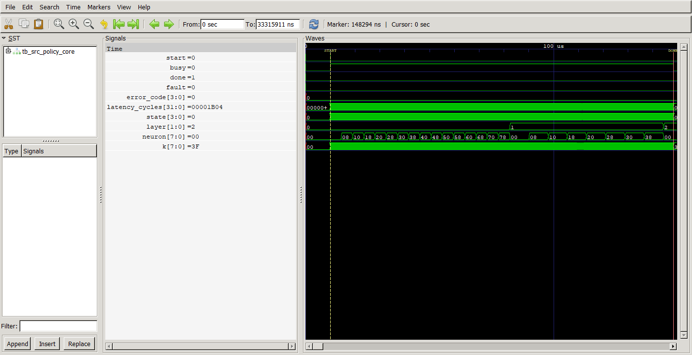
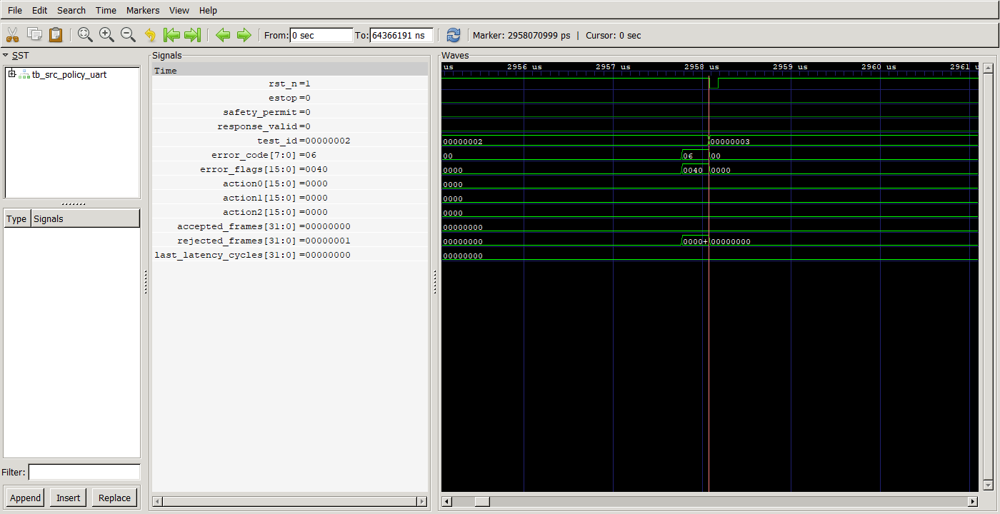

# Audit bukti untuk masukan dosen dan korelasi ISO/IEC 27090:2026

Tanggal penilaian: 18 Oktober 2026. Audit ini membaca bukti yang tersedia;
bukan pengukuran silicon, pengujian board baru, atau sertifikasi ISO.

**Pembaruan setelah audit awal:** instrumentasi Verilator sudah dijalankan.
Core Parallel8 kini mencapai line/block 68/68 (100%), branch 96/96 (100%)
dan toggle 870/908 (95,81%) pada emitted DUT counters tanpa waiver. Tes baru
menyuntikkan state ilegal dan memeriksa recovery; jumlah assertion checks
menjadi 54.401. Angka awal “belum tersedia” di tabel historis di bawah telah
digantikan oleh [hasil coverage](evidence/rtl_coverage/COVERAGE_RESULTS.md).
Lihat [panduan penggunaan](VERIFICATION_GUIDE.md) untuk batas, definisi bin,
kriteria proyek dan cara mereproduksi. Temuan ASIC dan batas ISO tetap berlaku.

## Kesimpulan

Parallel8 kuat pada regresi fungsional, aritmetika bit-exact, resource FPGA
dan timing 50 MHz. Persentase structural code coverage belum dibuktikan.
ASIC protocol engine pada arsip merupakan desain berbeda; belum memenuhi
sign-off fisik dan belum terbukti ekuivalen dengan neural Parallel8.

## Koreksi istilah

Jumlah testcase/assertion tidak sama dengan functional coverage. Functional
coverage membutuhkan model coverage (coverpoint, bin, cross dan target).
Code coverage mengukur statement/branch/expression/toggle/FSM sesuai tool dan
konfigurasi. Bahkan 100% coverage tidak membuktikan desain bebas bug atau
semua input telah diuji. Cabang tidak tercapai dapat merupakan jalur legal
yang kurang dites, jalur fault, atau kondisi memang mustahil.

Cabang tidak dites tidak otomatis menciptakan latch. Latch tersintesis dapat
muncul ketika assignment pada logika kombinasi tidak lengkap; register tanpa
reset adalah persoalan lain. Audit ASIC mencatat inferred latch = 0, tetapi
itu tidak membuktikan semua cabang telah diuji. Default recovery FSM perlu
tes fault injection atau bukti formal, bukan dihapus demi menaikkan coverage.

## Matriks deliverable

| Deliverable | Bukti aktual dan putusan |
| --- | --- |
| Regresi core Parallel8 | PASS: 236 network vectors, 8.364 activation cases, 54.399 assertions; memeriksa 192 hidden activation dan 3 output per vector. Sumber: `experiments/parallel8/artifacts/core.log`. |
| UART dan wrapper | PASS: 184 directed transactions, 268 assertions; board wrapper 18 checkpoints pada 50 MHz/921600. Sumber: `experiments/parallel8/artifacts/{uart,board}.log`. |
| Functional coverage gate | 12/12 outcome bins (100% dari bin yang didefinisikan), 13.078 kasus. Ini gate legacy, bukan coverage seluruh core Parallel8. Sumber: `verification/gate_functional_coverage.json`. |
| Statement/branch/expression/FSM/toggle | Belum tersedia report persentase terinstrumentasi untuk Parallel8. Tidak boleh dinyatakan 100%. |
| GLS | XML terlampir menunjukkan satu testcase `test_project` PASS. Tidak membuktikan semua vector neural lulus pada netlist atau gate coverage. Ringkasan menyatakan tidak ada log anotasi SDF atau hash pengikat netlist/GDS. Sumber: `evidence/asic_import/gatelevel_test_results/summary.json`. |
| Performance Parallel8 | 50 MHz, 6.916 cycles = 138,32 us, baseline 54.348 cycles = 1.086,96 us; percepatan 7,858x. |
| Throughput kernel | Model 74x128 + 128x64 + 64x3 = 17.856 MAC/inference; dibagi 138,32 us = 129,092 MMAC/s. Ideal kernel-only 7.229,61 inference/s, belum termasuk loading/UART. |
| Resource FPGA | 3.303/41.910 ALM; 6.277 registers; 524.288 block-memory bits = 64 KiB; 64 M10K; 8 DSP. Memori ini untuk FPGA, bukan SRAM ASIC. Sumber: `experiments/parallel8/output_files/igor_src_policy.fit.summary`. |
| Power FPGA | Typical total 476,18 mW = dynamic 50,36 + static 413,27 + I/O 12,55. Confidence LOW, vectorless; bukan daya board terukur. Sumber: `experiments/parallel8/artifacts/power/typical/igor_src_policy.pow.summary`. |
| Energy FPGA | Ilustrasi total-power x core-time = 65,87 uJ/inference; dynamic-only = 6,97 uJ. Asumsi daya estimasi berlaku selama kernel; bukan pengukuran energi transaksi UART. |
| FPGA STA | Worst setup +5,647 ns; worst hold +0,119 ns; TNS 0 pada corner yang dilaporkan. WNS sebagai besar pelanggaran negatif = 0, bukan +5,647. Sumber: `experiments/parallel8/output_files/igor_src_policy.sta.summary`. |
| ASIC power | Typical 1,20 V/25 C: internal 1,663574 mW + switching 0,323768 mW + leakage 0,050029 mW = 2,037372 mW. Estimasi post-route protocol engine, bukan neural core FPGA dan bukan silicon terukur. |
| ASIC area | Die 916.214 um2 = 0,916214 mm2; core 0,902417 mm2; 5.316 standard cells dan 1 macro. Total 71.108 instances termasuk 65.791 fill cells, bukan 71.108 logic gates/NAND2 equivalents. |
| ASIC STA | Slow 1,08 V/125 C: setup WNS -2,637272 ns, TNS -258,604708 ns, 253 setup violations. Hold terburuk +0,107577 ns. Belum timing closure 50 MHz semua corner. |
| DRC/LVS | KLayout DRC 0, LVS error 0, route DRC 0; tetapi Magic illegal overlap 42, RUN_MAGIC_DRC=false dan ERROR_ON_ILLEGAL_OVERLAPS=false. Juga 26 slew, 11 cap, 58 fanout violations. Tidak layak disebut clean sign-off. |
| Physical artifact | Arsip berisi 614 member dan laporan final; tidak ada file .gds/.gdsii/.oas di dalam ZIP yang diperiksa. PDK bernama ihp-sg13cmos5l (huruf l), keluarga IHP 130 nm. Laporan saja tidak menggantikan berkas layout final. |
| Numerical integrity | Q8.8, signed 40-bit accumulator, hidden signed16 saturation, ReLU, output clip [-256,256], referensi bit-exact. Tidak membuktikan kualitas model/akurasi navigasi di dunia nyata. |
| Safety/security | Parser menolak framing/CRC/length/range/busy; watchdog, freshness dan KEY inhibit. pin_mask berasal dari ASIC protocol engine; gate fault 0..11 berasal dari safety gate. UART neural memiliki error 1..12, 0 berarti tidak ada error. Jangan menggabungkan ketiganya sebagai satu code map. |

## Identitas arsip dan batas klaim

ZIP pengguna `gds-diagnostics-1.zip` memiliki SHA256
`1e41c73286b1c053fc08f3c031c4424dd7aa44c06dff380925f5e40393589506`,
sama dengan arsip yang sudah diimpor pada
`evidence/asic_import/gds_diagnostics_1/summary.json`. Nilai area, timing,
DRC/LVS dan overlap dicocokkan langsung dengan `runs/wokwi/final/metrics.json`
di ZIP. Top arsip adalah `tt_um_igorchip`, bukan top neural FPGA
`igor_src_policy_de10_nano`. Tidak ada bukti ekuivalensi keduanya.

## Mengapa hasil Parallel8 membaik

Delapan neuron diproses paralel menggunakan delapan multiplier/accumulator
dan bank bobot, dengan broadcast input. Urutan penjumlahan setiap neuron
tetap, sehingga regresi bit-exact dapat dipertahankan. Dibanding baseline:
54 ALM dan 281 register tambahan, DSP 1 menjadi 8, M10K tetap 64.
Percepatan 7,858x mendekati delapan, dengan overhead kontrol yang tersisa.
Typical total power naik 11,97 mW (sekitar 2,58%); karena itu yang membaik
terutama latensi dan estimasi energy per kernel, bukan semua metrik sekaligus.

UART request+response memiliki 164 byte x 10 bit / 921600 = 1,7795 ms wire
time ideal. Ditambah kernel 0,13832 ms menjadi sekitar 1,9178 ms sebelum
overhead lainnya. Angka 138,32 us bukan round-trip Jetson dan tidak membuktikan
throughput robot. Tidak boleh menghitung energy neural ASIC memakai power
2,037372 mW dari protocol engine yang berbeda.

## ISO/IEC 27090:2026

Sumber resmi: https://www.iso.org/standard/27090
Judul: Cybersecurity - Artificial intelligence (AI) - Addressing security
threats and compromises to AI systems. ISO mencatat terbit 14 Oktober 2026.
Standar memberi panduan ancaman AI sepanjang lifecycle, termasuk data
poisoning dan pencurian model, serta melengkapi ISO/IEC 27001 dan 27002.
Pemetaan berikut adalah interpretasi engineering atas cakupan publik,
bukan audit klausul penuh atau pernyataan conformant/certified.

| Risiko | Kontribusi desain | Gap yang masih perlu ditutup |
| --- | --- | --- |
| Input rusak/malformed | Length, CRC, normalized-range check; gagal tidak menghasilkan respons sukses | CRC bukan autentikasi; penyerang dapat membuat CRC valid. Perlu threat model dan pengujian input bermusuhan yang tetap dalam range. |
| Replay/injeksi host | Bridge melatch fault dan menolak retry setelah transaksi gagal | Tidak ada transaction ID, nonce atau MAC kriptografis pada protokol ini; replay/impersonation belum dicegah. |
| Availability/hasil usang | Timeout, busy rejection, result freshness dan abort | Tidak membuktikan ketahanan flooding/DoS atau batas respons fisik sistem. |
| Integritas model | Bobot ROM tetap dan hash bukti mendukung pelacakan versi | Hash file bukan secure boot, signature verification, rollback protection atau kontrol akses JTAG. |
| Data poisoning/update | Aritmetika deterministik memudahkan reproduksi | Belum ada audit provenance dataset, secure training/retraining atau pengujian backdoor. |
| Model theft/side channel | Model berada lokal di FPGA | ROM bukan bukti confidentiality; model extraction melalui query, debug dan side channel belum diuji. |
| Pembatasan dampak | Saturation, clipping dan inhibit membatasi output numerik | Tidak menjamin aksi aman. Safety gate legacy belum terintegrasi penuh dengan residual neural dan motor. |

Klaim presentasi yang dapat dipertanggungjawabkan: desain menerapkan beberapa
kontrol integritas input, fault containment dan freshness yang relevan untuk
mitigasi risiko AI. Belum ada bukti sertifikasi ISO/IEC 27090 atau perlindungan
lengkap terhadap adversarial ML. Standar security tidak menyebabkan speedup;
speedup berasal dari arsitektur paralel, sedangkan kontrol security membantu
menjaga hasil dapat dipercaya dalam threat model yang dibatasi.

## Bukti visual yang sudah tersedia

GTKWave Parallel8 menunjukkan busy/done dan latency_cycles 0x1B04 = 6916.
Ini screenshot simulasi existing, bukan pengukuran board atau report coverage.

Screenshot UART policy menunjukkan error 0x06, rejected_frames naik,
safety_permit=0 dan action=0. Ini bukti ilustratif jalur policy shared,
bukan persentase code coverage seluruh Parallel8.

## Pekerjaan yang diperlukan untuk menutup masukan dosen

1. Jalankan simulator dengan instrumentasi statement/branch/expression/toggle/
   FSM pada top dan source Parallel8 yang sama; laporkan tool/version,
   denominator per modul, excluded code serta source hash.
2. Tinjau setiap uncovered item. Tambahkan directed tests/fault injection
   untuk jalur legal dan recovery; gunakan waiver dengan bukti reachability
   untuk jalur mustahil, jangan mengubah fungsi hanya untuk skor coverage.
3. Jalankan GLS memakai netlist terikat hash/source, library cell/macro yang
   tepat, vector yang sama dan log anotasi SDF jika mengklaim timing GLS.
   Laporkan separately functional GLS, timing GLS, dan structural coverage.
4. Tutup timing ASIC slow corner, overlap, slew/cap/fanout; aktifkan kembali
   pemeriksaan yang dimatikan, ulang DRC/LVS/STA dan hasilkan layout final.
5. Tambahkan threat model, authenticated transport/update sesuai kebutuhan,
   replay tests, provenance model/dataset dan adversarial robustness tests.
   Validasi UART dan fail-safe sistem pada perangkat fisik.
