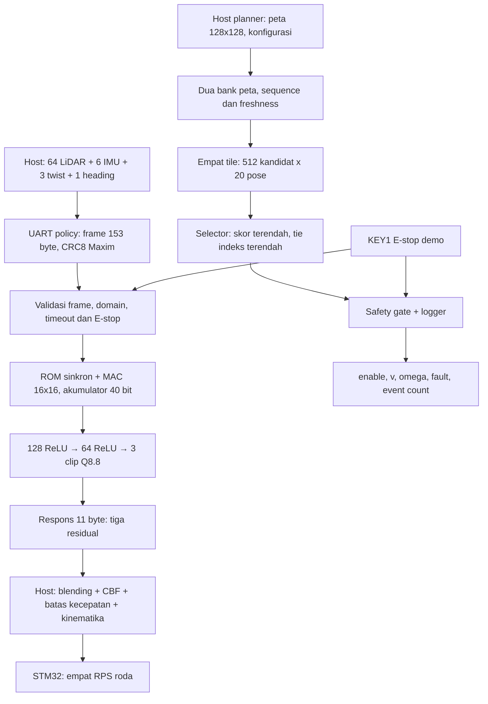

# IGOR FPGA — mulai di sini

Seluruh implementasi dan keluaran baru berada di folder **`igor_ws/fpga`**.
`../src` digunakan sebagai referensi software; `../peruri-iseedesign` digunakan
sebagai referensi rancangan dan checklist. Proyek Quartus, RTL, bobot, pin
planning, bukti simulasi dan software integrasi tersedia di dalam paket ini.

## Resource, area, latensi, kuantisasi dan power

[Bennaya.md](Bennaya.md) merangkum keunggulan IGOR Chip untuk pengendalian
protokol industri, dengan fokus pada efisiensi energi dan proteksi operasi
I/O di hardware. [power.md](power.md) menampilkan estimasi daya ASIC
`tt_um_igorchip` / `ihp-sg13cmos5l`: Typical **2,037372 mW**, lengkap dengan
sumber angka dan bukti functional gate-level **PASS**.

[Keunggulan tambahan chip](CHIP_ADVANTAGES.md) mencakup demo multi-protocol
empat context dalam 508 byte, upload dengan readback, penanganan UART/I²C,
dan bukti **42 tes lokal PASS** tanpa perubahan RTL.

**Varian cepat untuk target core <0,16 ms sudah tervalidasi:** buka
[Parallel8 QPF](experiments/parallel8/igor_src_policy.qpf), dengan
[README dan bukti lengkap](experiments/parallel8/README.md).
Hasilnya **0,13832 ms**, 3.303 ALM, 64 M10K, 8 DSP; semua timing corner dan
13 fitted pins lulus. Power estimasi Typical **476,18 mW**, Maximum/Tj100°C
**937,55 mW**, confidence Low/HPS Off. Handoff:
[`bitstreams/igor_src_policy_parallel8.sof`](bitstreams/igor_src_policy_parallel8.sof).
Angka di bawah tetap menjelaskan baseline serial yang terpisah. Target
0,16 ms adalah inferensi core, bukan round-trip UART.

[Metrik lengkap beserta sumber/baris bukti](docs/METRICS_AND_POWER.md) dan
[CSV provenance](evidence/current_metrics/metric_evidence.csv) tersedia untuk
setiap angka. Policy memakai 3.249 ALM, 64 M10K, 1 DSP; latensi core 1,08696 ms.
Power Analyzer: **464,21 mW Typical**, **812,05 mW Maximum/Tj85°C**,
**925,69 mW Maximum/Tj100°C**, seluruhnya estimasi FPGA ber-confidence Low,
HPS tidak dimodelkan dan bukan pengukuran board. Area ASIC mm² belum tersedia.
[Grafik power](evidence/current_metrics/power_estimates.png) memisahkan static,
dynamic dan I/O; angka dynamic 38,51 mW bukan total power.

## Screenshot, penjelasan RTL dan perbaikan tervalidasi

Hasil review 17 Oktober 2026: [galeri 15 screenshot GTKWave dan dua gambar laporan Quartus](evidence/visual_review/index.html),
[titik penting dan alasan simulasi/kompilasi lulus](docs/SIMULATION_EVIDENCE.md),
[fungsi setiap modul RTL](docs/RTL_MODULE_GUIDE.md), serta
[perbaikan counter dan rencana peningkatan](docs/RTL_IMPROVEMENTS.md).
Gambar Quartus merupakan ekstrak laporan asli berlabel, bukan screenshot GUI.
Perbaikan counter policy sudah lulus 184 transaksi/268 assertion UART,
regresi core/wrapper dan build ulang Quartus; model/latency tetap sama.

## Buka proyek dan pilih bitstream

| Kebutuhan | Proyek Quartus 25 siap dibuka | Image hasil build |
|---|---|---|
| Inferensi software workspace **74 → 128 → 64 → 3** | [igor_src_policy.qpf](fpga_de10_nano/src_policy/igor_src_policy.qpf) | [igor_src_policy.sof](bitstreams/igor_src_policy.sof) |
| Planner peta, safety gate, logger, neural **24 → 64 → 64 → 4** | [igor.qpf](fpga_de10_nano/quartus/igor.qpf) | [igor_planner.sof](bitstreams/igor_planner.sof) |

Kedua proyek menargetkan **DE10-Nano Cyclone V 5CSEBA6U23I7, 50 MHz**.
Source kanonik ada di [rtl/](rtl/). QSF menyertakan pin assignment dan SDC;
lokasi pin tidak perlu diisi ulang. Pertahankan struktur direktori paket.

Klik dua kali `BUKA_POLICY_QUARTUS.bat` atau `BUKA_PLANNER_QUARTUS.bat`, atau
buka QPF dari menu **File → Open Project** pada Quartus 25 yang sudah berjalan.
Untuk programming baca [panduan board](docs/BOARD_PROGRAMMING.md) dan gunakan
`scripts/program_fpga.ps1`. Pemeriksaan awal hanya membaca daftar kabel/JTAG;
operasi programming membutuhkan kabel serta posisi FPGA yang benar di chain.

Hasil kompilasi lengkap tetap ada di masing-masing `output_files/`. Salinan
image yang dipakai untuk handoff ada di [bitstreams/](bitstreams/).
[manifest.json](evidence/current_release/manifest.json) mencatat hash source,
model, bukti, laporan, pin terpasang dan image; periksa sebelum programming:

```powershell
cd fpga
python scripts/freeze_release.py --check
powershell -NoProfile -File scripts/program_fpga.ps1 -Project source_policy
```

## Arsitektur aktual dan kontrak keluaran



**Ada dua jalur FPGA yang berbeda.** Policy baru mengikuti bobot software PPO
74-input dan menghasilkan tiga residual twist. Planner menggunakan costmap dan
menghasilkan izin serta kode v/omega. Frame observasi policy tidak membawa
costmap. Paket ini belum menyatukan policy → pemeriksa peta → gate → motor
seluruhnya di FPGA, dan belum mengubah Jetson menjadi kurir tanpa keputusan.
Butir penerimaan itu tetap terlihat pada checklist, sehingga hasil dua jalur
tidak tercampur menjadi klaim integrasi yang belum diuji.

Policy menggunakan bobot/aktivasi signed16 Q8.8, satu multiplier 16×16,
akumulator signed40, `floor(acc/256)` antar layer, hidden ReLU jenuh 0–32767,
dan tiga output clip -256–256. ROM memuat **18.051 parameter**, dipad menjadi
32.768 word. Inferensi deterministik **54.348 siklus = 1,08696 ms pada 50 MHz**,
di luar waktu UART. [README RTL](rtl/igor_src_policy/README.md) menjelaskan
alamat ROM, state machine, lebar data, CRC, domain input dan error code.

Planner memakai peta dua bank dengan commit atomik. Hasil terikat pada sequence
peta saat START; commit peta baru mencabut izin hasil lama sampai ada run baru.
Empat evaluator memeriksa lintasan sebagai titik pada peta yang sudah diinflasi
host. Gate memeriksa reset, E-stop, protective stop, ready, validitas/freshness
peta, konfigurasi, aritmetika, deadline, hasil, batas kecepatan dan perubahan.
Penolakan menolkan enable/v/omega. Penyebab abort dipertahankan sampai reset;
logger mencatat perubahan fault dan counter jenuh 32 bit. Opcode 15/16 membaca
counter dan last fault. [Arsitektur planner](docs/ARCHITECTURE.md) dan
[kode fault](docs/FAULT_CODES.md) menjelaskan kontrak numeriknya.

## Pin planning dan kabel

Semua sinyal memakai **3.3-V LVTTL**. Pin berasal dari
[manual Terasic melalui Mouser](https://www.mouser.com/datasheet/2/598/DE10_Nano_User_manual_a_b-1108056.pdf)
tabel 3-5/3-7/3-8, gambar 3-20 dan tabel 3-10; perangkat dirujuk pada
[spesifikasi Terasic](https://www.terasic.com.tw/cgi-bin/page/archive.pl?Language=English&CategoryNo=205&No=1046&PartNo=2).

| Sinyal | Ball FPGA | Letak / sambungan |
|---|---|---|
| FPGA_CLK1_50 | V11 | Clock board 50 MHz |
| KEY[0] | AH17 | Reset aktif rendah |
| KEY[1] | AH16 | E-stop demo aktif rendah |
| UART_RX | V12 | JP1 pin 1 / GPIO_0[0] ← TX adapter TTL |
| UART_TX | E8 | JP1 pin 2 / GPIO_0[1] → RX adapter TTL |
| GND | — | JP1 pin 12 atau 30 ↔ GND adapter |
| LED[0..7] | W15, AA24, V16, V15, AF26, AE26, Y16, AA23 | Status; arti LED berbeda menurut proyek |
| SW[0..3], planner saja | Y24, W24, W21, W20 | SW2 inhibit ready, SW3 protective stop; SW0/1 tidak dipakai |

Policy memiliki **13 pin**, UART **921600 8N1**; planner **17 pin**, UART
**115200 8N1**. Kedua protokol dan bitstream tidak saling menggantikan.
USB-UART bawaan HPS bukan UART fabric pada JP1. Gunakan adapter TTL 3,3 V,
bukan RS-232 atau sinyal 5 V. Detail LED, SDC dan pin tersedia pada
[README policy board](fpga_de10_nano/src_policy/README.md) dan
[Pin Planner policy](fpga_de10_nano/src_policy/pin_assignment.tcl).

Untuk pertanyaan GPIO tanpa JTAG, baca [GPIO_AND_HPS.md](docs/GPIO_AND_HPS.md):
UART di JP1 memakai GPIO setelah FPGA terkonfigurasi; pengisian bitstream
melalui HPS/SD memakai jalur konfigurasi tersendiri dan memerlukan image
Linux/bootloader yang sesuai. JTAG fisik ditunda sesuai arahan pengguna.

## Verifikasi dan bukti yang dapat ditelusuri

Jalankan dari `fpga` dengan Python 3.11 dan Icarus Verilog di PATH:

```powershell
python verification/src_policy/run.py --check
python verification/run_board_wrapper.py
python verification/run_safety_regression.py
python verification/run_host_regression.py
python verification/run_lidar_regression.py
python verification/audit_acceptance.py
```

Host/LiDAR memakai NumPy dan fixture ROS/serial; tidak membuka motor fisik.
Suite legacy memakai `requirements.txt` (cocotb 1.9.2). Seluruh rangkaian dan
workflow dijelaskan pada [ci/README.md](ci/README.md).

| Suite | Domain yang diperiksa | Bukti aktual |
|---|---|---|
| Source policy | 236 vektor, seluruh 192 hidden activation dan 3 output; 8.364 batas aktivasi; 54.399 assertion core | `verification/src_policy/artifacts/results.json`, `core.log` |
| UART policy | 184 kasus, 268 assertion; CRC, framing, 148 pelanggaran domain, busy, timeout, E-stop pada beberapa fase | `uart.log`, `uart_checkpoints.csv` |
| Safety | 111.210 perbandingan oracle, seluruh kode 0–11, 111 checkpoint map/config/logger/deadline/UART | `evidence/current_safety/summary.json`, `cases.csv` |
| Wrapper board | 18 checkpoint, UART aktual divider 54, KEY1 latched sampai KEY0 reset | `evidence/current_board_wrapper/summary.json` |
| Host | 29 tes: transport fault, lease, CBF/envelope, IMU/scan invalid atau usang, STOP motor | `evidence/current_host/results.json` |
| LiDAR | 16 tes: parsial/noise, coverage, data beku, tidak mengulang stempel data lama, tanpa mock otomatis | `evidence/current_lidar/results.json` |
| Capture UART | 10 fixture: short write, bracket status/logger, event counter dan retained cause | `verification/test_capture_hardware_safety.py`, `evidence/current_checks/` |

Angka adalah cakupan simulasi/fixture pada hash source yang dicatat. Golden
integer independen dari scheduling RTL; bit-exact berlaku terhadap model Q8.8,
bukan FP32. Galat maksimum terhadap referensi floating pada sampel normalisasi
sekitar **0,014572**. Tidak ada klaim verifikasi seluruh state space, seluruh
peta, metastabilitas, atau sertifikasi keselamatan.

## Titik tepat di GTKWave

```powershell
gtkwave evidence/current_safety/top.vcd evidence/current_safety/top.gtkw
gtkwave evidence/current_safety/gate.vcd evidence/current_safety/gate.gtkw
gtkwave verification/src_policy/artifacts/uart.vcd verification/src_policy/uart.gtkw
```

| Waveform | Waktu | Bukti |
|---|---:|---|
| `current_safety/top.vcd` | 814531 ns | Kontrol positif: enable=1, v=15, fault=0 |
| Sama | 814535 ns | E-stop di antara clock: enable/v/omega langsung nol, fault=2 |
| Sama | 814551 ns | event_count=3, last_fault=2; output tetap nol |
| Sama | 2931031 ns | Peta invalid: output nol, fault=5, last_fault=5 |
| Sama, instance `deadline_core` | 3904291 ns | Deadline: output nol, fault=8 |
| Sama, instance `freshness_core` | 3945471 ns | Peta tepat usang: output nol, fault=5 |
| Sama | 4759921 ns | Commit sequence peta baru: hasil lama ditarik, fault=9 |
| `current_safety/gate.vcd` | 11 ns / 12 ns | Batas kecepatan / perubahan: fault=10 / 11 dan output nol |
| Policy `uart.vcd` | 2958071000 ps | CRC salah: residual nol, permit=0, error=6 |
| Sama | 3494691000 ps | E-stop saat inferensi: residual nol, TX dibatalkan |
| Sama | 7533671000 ps | E-stop di tengah TX: serializer dibatalkan |

CSV dari run yang sama adalah sumber waktu final jika testbench diubah.
Safety memakai kolom `time_ns`; policy memakai `time_ps`. Pada scope
`tb_safety_top.core`, tampilkan enable, v, omega, fault_code, event_count dan
last_fault bersama-sama. [Penjelasan waveform](rtl/igor_src_policy/README.md)
membedakan E-stop, pencatatan pada clock berikut, dan case yang dump-nya
dimatikan selama sweep agar VCD tidak membesar.

Sesudah clone, pulihkan VCD dari arsip `.vcd.gz` yang ikut paket dengan
`python scripts/unpack_current_waveforms.py`. File `.vcd` mentah diabaikan Git
agar bukti berukuran lebih dari 100 MB tetap dapat didistribusikan terkompresi.

## Build, software integrasi, dan batas penerimaan

```powershell
python scripts/build_quartus.py source_policy
python scripts/build_quartus.py planner
python scripts/freeze_release.py
python scripts/freeze_release.py --check
```

Script build menyimpan hash input sebelum/sesudah kompilasi, memeriksa exit
code, seluruh slack timing dan pin terpasang, lalu mencatat hash SOF/laporan
pada `evidence/current_builds/`. Ringkasan resource, timing, warning dan status
programming ada di [BUILD_STATUS.md](BUILD_STATUS.md).

Software yang diperbaiki tersedia pada [software_integration/](software_integration/README.md).
Mode hardware tidak diam-diam berubah menjadi mock. Timeout/CRC salah
menyebabkan STOP seluruh perintah, bukan sekadar residual nol. Transport fault
ditahan karena protokol belum memiliki transaction ID; reset FPGA dan restart
bridge diperlukan sebelum mencoba kembali. Input perintah/scan/IMU yang tidak
valid atau usang, zero operator command, serta hard-stop/envelope diperiksa
kembali setelah inferensi. Mode FPGA mendukung `cl_drl` dan `cl_drl_cbf`;
`cl_drl_dwa` ditolak sampai shield dapat menerima residual hardware.

Pemeriksaan JTAG sesi ini melaporkan **No JTAG hardware available**. Belum ada
programming, bukti roda berhenti, latency fisik, pengukuran daya atau video
robot baru. Balasan policy yang sudah diterima host sebelum E-stop tidak dapat
ditarik kembali lewat protokol residual ini; interlock motor fisik independen
dan integrasi gerbang langsung tetap diperlukan untuk klaim STOP motor segera.

[Checklist implementasi](docs/IMPLEMENTATION_READINESS.md) dan
[penerimaan K1–K7/A/B/D](docs/FINAL_ACCEPTANCE.md) menyebut semua kebutuhan,
artefak yang tersedia, dan pekerjaan fisik yang masih terbuka. Angka bisnis,
68% keberhasilan navigasi, dan 5/5 OOD dalam lampiran adalah klaim referensi
berbeda; angka itu tidak diubah menjadi hasil eksperimen baru dari paket ini.
