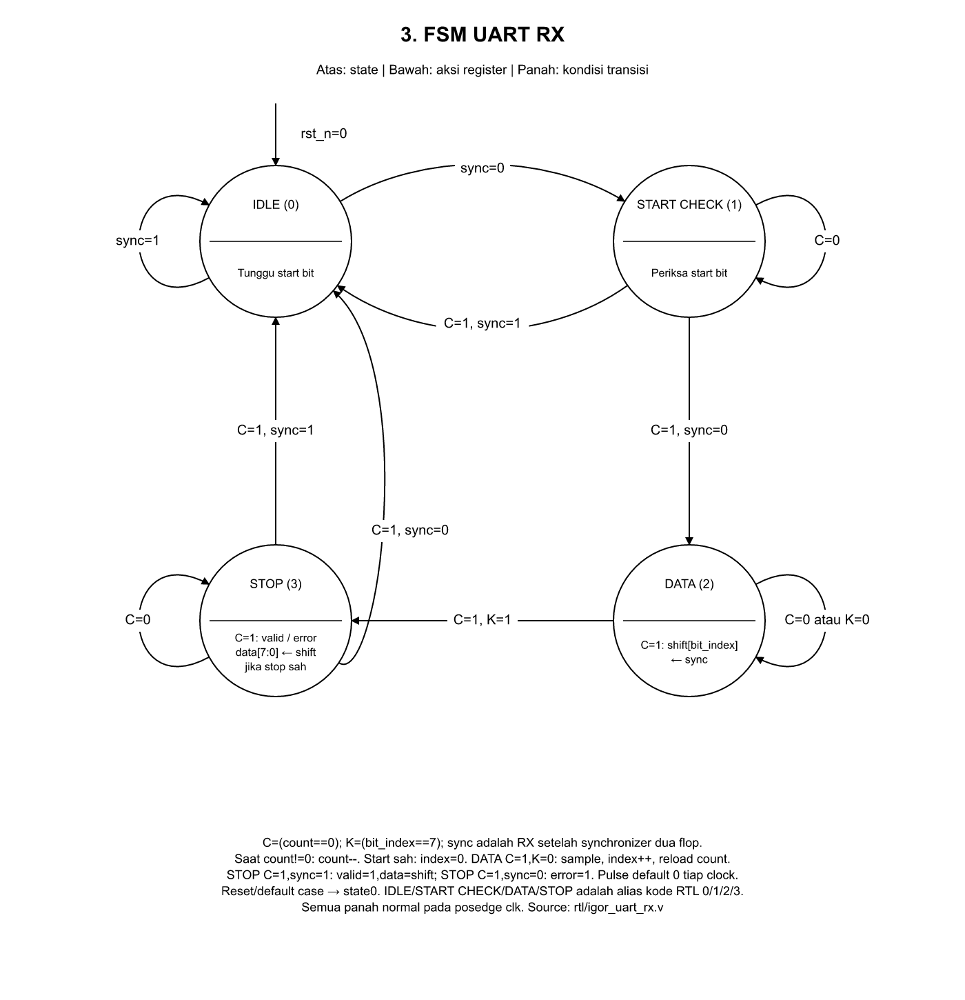

# Tiga FSM sederhana

**[Buka file draw.io: tiga halaman](assets/igor_fsm_3_simple.drawio)**.
Pilih tab Core, Controller Transaksi, atau UART RX di bawah kanvas diagrams.net.
Gaya mengikuti contoh: lingkaran putih, garis hitam, nama state di atas garis,
aksi di bawah garis, kondisi di panah, dan loop ketika state tetap.

| FSM | Draw.io terpisah | PNG |
|---|---|---|
| Core Parallel8: 8 state | [01_core.drawio](assets/igor_fsm_simple/01_core.drawio) | [Core](assets/igor_fsm_simple/01_core.png) |
| Controller transaksi: 10 state | [02_policy.drawio](assets/igor_fsm_simple/02_policy.drawio) | [Controller](assets/igor_fsm_simple/02_policy.png) |
| UART RX: 4 state | [03_uart_rx.drawio](assets/igor_fsm_simple/03_uart_rx.drawio) | [UART RX](assets/igor_fsm_simple/03_uart_rx.png) |

Ini **tiga FSM**, dengan jumlah state asli masing-masing tetap dipertahankan.
Bagian bawah lingkaran adalah ringkasan aksi register ketika state dijalankan,
bukan klaim bahwa setiap output hanya bergantung pada state. Aksi yang
memerlukan input ditandai kondisi; gambar tidak mengubah RTL menjadi Moore murni.

## Membaca kondisi

- Core: `S=start`, `N=(k==input_count-1)`, `G=(neuron+8>=output_count)`,
  `L=(layer==2)`. `1` berarti transisi satu clock tanpa syarat tambahan.
- Controller: `A` berarti frame CRC/domain sah; `I=(load_index==73)`;
  `D=core_done`; `B=tx_busy`; `R=(!tx_busy && !tx_send)`; `F=(tx_index==10)`.
- UART RX: `C=(count==0)`, `K=(bit_index==7)`, dan `sync` adalah RX
  setelah synchronizer. Alias hanya memendekkan label, bukan sinyal RTL baru.

Reset `rst_n=0` berlaku dari seluruh state. Panah normal mengasumsikan
reset/abort/reject prioritas lebih tinggi tidak sedang mengambil alih.
Ringkasan prioritas dan aksi tambahan ada di bawah masing-masing gambar;
detail lengkap tersedia pada [panduan FSM](FSM_CORE_AND_CONTROLLERS.md).
Loop pada state berarti state tetap; datapath/counter masih bisa diperbarui.

Sumber asli: [core](../experiments/parallel8/igor_src_policy_core.v),
[controller transaksi](../rtl/igor_src_policy/igor_src_policy_uart.v), dan
[UART RX](../rtl/igor_uart_rx.v). Source dan hash gambar tersimpan di
[sources.json](assets/igor_fsm_simple/sources.json).
Pembuatan ulang: `python fpga/scripts/render_igor_fsm_simple.py`.
Dokumentasi ini tidak mengubah RTL, bobot atau bitstream board.
