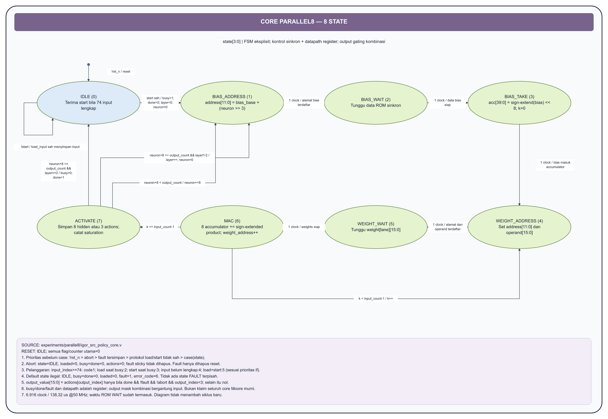

# FSM core IGOR dan controller pendukung

Untuk presentasi singkat, gunakan [versi 3 FSM sederhana](FSM_3_SIMPLE.md)
dengan lingkaran terbagi nama state/aksi seperti contoh pengguna.

**[Buka seluruh 19 halaman draw.io](assets/igor_fsm_all.drawio)** menggunakan
diagrams.net: **File -> Open From -> Device**, kemudian pilih tab halaman di
bawah kanvas. State, panah, kondisi dan catatan berupa objek native yang dapat
diedit. Gaya mengikuti contoh: header ungu, state oval hijau, reset biru, dan
fault/trap merah. [Galeri semua halaman](assets/igor_fsm/contact_sheet.png).

## Isi file

| Tab | Isi | Jenis dan cakupan |
|---|---|---|
| 00 | Peta controller aktif | Hubungan modul, bukan state satu FSM |
| 01 | Core Parallel8 | Delapan state `state[3:0]`, delapan MAC |
| 02 | Controller transaksi policy | Sepuluh state `mode[3:0]` |
| 03 | Parser observasi | `position[7:0]`, fase header/payload/CRC |
| 04 | UART RX | Empat kode `state[1:0]` |
| 05 | UART TX | Fase `busy`, `bit_index[3:0]`, `count[15:0]` |
| 06 | Reset board | `reset_sync[1:0]`, assert asinkron/release sinkron |
| 07 | E-stop board | Raw inhibit, synchronizer dan sticky latch |
| 08 | Validity/lease hasil policy | `result_valid` dan `result_timer[31:0]` |
| 09 | Core source serial | Baseline satu MAC; terpisah dari Parallel8 |
| 10 | Neural legacy | Model 24 -> 64 -> 64 -> 4, kode state numerik |
| 11 | Planner top | IDLE, RUN, RESULT, FAULT |
| 12 | Rollout tile | Enam state; empat instance planner |
| 13 | Sequencer demo board | Init, config, map, start, delay, default trap |
| 14 | Parser UART legacy | Frame delapan byte; CRC 0x07 |
| 15 | Response UART legacy | Delay, snapshot, build, sending |
| 16 | Costmap manager | Loading, valid, fault dan atomic commit |
| 17 | Config manager | Write, lock dan sticky fault |
| 18 | Acuan three-process | Struktur rekomendasi, bukan hasil refactor RTL |

Halaman 00–08 menjelaskan jalur proyek
[Parallel8 QSF](../experiments/parallel8/igor_src_policy.qsf).
Halaman 09–17 melengkapi seluruh FSM/controller operasional pada
`fpga/rtl/`; blok legacy tersebut tidak semuanya ada di image Parallel8.
Fase counter/flag ditandai **implisit** agar tidak dianggap enum yang ada di source.

## Cara membaca state dan panah

- Baris pertama oval: nama/kode state aktual. Alias penjelas diberi kode numerik
  asli, misalnya `state=1 | START_CHECK`; alias itu tidak menambah enum RTL.
- Isi oval: aksi ketika **state sebelum clock edge** adalah state tersebut.
  Assignment nonblocking dan transisi terjadi pada edge yang sama. Aksi tidak
  otomatis diulang sekali lagi saat memasuki state berikutnya.
- Label panah: `kondisi / aksi transisi`. Jika tertulis `1 clock`, perpindahan
  tidak bersyarat pada clock berikutnya setelah prioritas global diperiksa.
- Panah reset menuju state awal mewakili reset **dari seluruh state**, bukan
  hanya dari posisi marker. Catatan prioritas di bawah setiap halaman berlaku
  sebelum transisi normal pada diagram.
- Jika tidak ada kondisi transisi yang terpenuhi dan tidak ada aksi tanpa syarat,
  state ditahan. Counter/datapath tetap bisa berubah menurut aksi dalam state.
- Nama sinyal mengikuti RTL. Contoh `core_output_value[15:0]` adalah bus 16-bit;
  `core_done`, `fault`, `abort`, dan pulse kontrol merupakan sinyal skalar 1-bit.

## FSM core: alur penjelasan singkat

**IDLE -> BIAS_ADDRESS -> BIAS_WAIT -> BIAS_TAKE -> WEIGHT_ADDRESS ->
WEIGHT_WAIT -> MAC -> ACTIVATE**.

BIAS_TAKE menginisialisasi delapan accumulator dari bias. Setiap input memakai
tiga state WEIGHT_ADDRESS/WEIGHT_WAIT/MAC. MAC kembali untuk input berikutnya
atau menuju ACTIVATE setelah input terakhir. ACTIVATE memilih grup delapan
neuron berikutnya, layer berikutnya, atau selesai dengan `done=1`.

Satu grup memerlukan `3 × input_count + 4` clock. Total layer:
`16×226 + 8×388 + 1×196 = 6.916` clock, yaitu **138,32 us pada 50 MHz**.
Sumber angka: [acceptance Parallel8](../experiments/parallel8/artifacts/acceptance.json).
Ini latensi core, bukan round-trip UART.

Core tidak memiliki enum FAULT terpisah. Fault mengeset flag sticky, menutup
output dan membawa kontrol kembali ke IDLE. State ilegal pada `default`
mengeset `error_code=6`. Hanya reset yang membersihkan flag fault. Abort
memiliki prioritas di atas fault tetapi tidak membersihkan flag tersebut.
Kode error core dan kode reject policy adalah dua namespace berbeda; lihat
catatan halaman 01 dan 02 untuk prioritas dan arti masing-masing.

## Moore, Mealy, dan three-process

Moore berarti output merupakan fungsi state; Mealy berarti output bergantung
pada state dan input. Pengertian tersebut tidak menentukan sendiri apakah
output diregister, selalu bebas glitch, atau wajib berbeda satu clock.
Contoh aktual: `busy`/`done` planner adalah decode state, sedangkan permit dan
mask output core/policy juga memeriksa input/fault. Seluruh sistem tidak diberi
label Moore murni hanya karena menggunakan clock.

Halaman 18 memperlihatkan pemisahan state register, next-state combinational,
dan output logic/register. RTL saat ini banyak memakai satu blok clocked yang
menggabungkan pembaruan state dan datapath; dokumentasi ini tidak mengubahnya.
Refactor three-process baru diterima jika mempertahankan prioritas reset,
abort/reject, pulse kontrol, hasil integer, siklus pipeline dan seluruh uji safety.

Dalam blok combinational, semua jalur harus memberi assignment/default untuk
mencegah latch. Dalam blok `always @(posedge clk)`, tidak menulis suatu register
berarti menahan nilai flip-flop, bukan otomatis membentuk latch. Default state
RTL juga bukan jaminan sendiri bahwa hasil encoding synthesis mempunyai
proteksi illegal-state fisik; opsi safe-FSM dan bukti synthesis perlu diperiksa.

Rujukan: [Altera State Machine HDL Guidelines](https://www.intel.com/content/www/us/en/docs/programmable/683082/25-1/state-machine-hdl-guidelines.html),
[template Moore/Mealy](https://www.intel.com/content/www/us/en/support/programmable/support-resources/design-examples/horizontal/ver-state-machine.html),
dan [Safe State Machine pada Quartus Standard](https://docs.altera.com/r/docs/683283/18.1/intel-quartus-prime-standard-edition-user-guide-design-compilation/safe-state-machine).

## Cakupan file tanpa FSM operasional tersendiri

Inventaris mencakup 22 file `fpga/rtl/**/*.v` dan dua file kandidat Parallel8.
Komponen berikut tidak diberi state buatan:

| File/modul | Mengapa tidak memiliki halaman state terpisah |
|---|---|
| `igor_candidate_generator`, `igor_kinematic_step`, `igor_trig_lut` | Logika kombinasi; `case(phase)` LUT bukan register FSM |
| `igor_score_accumulator`, `igor_best_candidate_selector` | Aritmetika/seleksi kombinasi |
| `igor_safety_security_gate` | Gate prioritas kombinasi dengan default output nol |
| `igor_costmap_bank`, `igor_neural_rom`, `igor_src_policy_rom` | Memori sinkron, bukan FSM kontrol operasi |
| `igor_src_policy_activation` | Slice, ReLU/clamp kombinasi; berada dalam file core |
| `igor_status_logger` | Register previous_fault dan counter saturating, bukan FSM operasi terpisah |
| `igor_uart_top` | Decode opcode/response kombinasi dan flag invalid_command sticky; FSM di protocol/core dijelaskan terpisah |
| Wrapper neural / board | Instansiasi dan synchronizer/flag; controller internal ditunjukkan pada halaman terkait |

## Bukti pemeriksaan dokumen

[fsm_sources.json](assets/igor_fsm/fsm_sources.json) memuat nama state, transisi,
catatan, source dan SHA256. Panah normal harus dibaca bersama prioritas global;
diagram bukan pengganti netlist, testbench atau pembuktian formal.
Pemeriksaan dokumen tidak diklaim sebagai simulasi hardware baru.
[document_checks.json](assets/igor_fsm/document_checks.json) mencatat pemeriksaan
XML, setiap transisi, encoding state, prioritas core, handshake byte terakhir,
format gambar, tautan dan hash source. Jalankan ulang dengan
`python fpga/scripts/check_igor_fsm.py`.

Renderer: `python fpga/scripts/render_igor_fsm.py` dari root workspace.
Data yang dapat direview ada pada `fpga/scripts/igor_fsm_data.py`.
Dependensi: Graphviz `dot` dan `resvg-py==0.5.0` pada
`fpga/.runtime/diagram_renderer`. Semua PNG/SVG per halaman ada di
`fpga/docs/assets/igor_fsm/`; RTL, pin assignment dan SOF tidak diubah.
