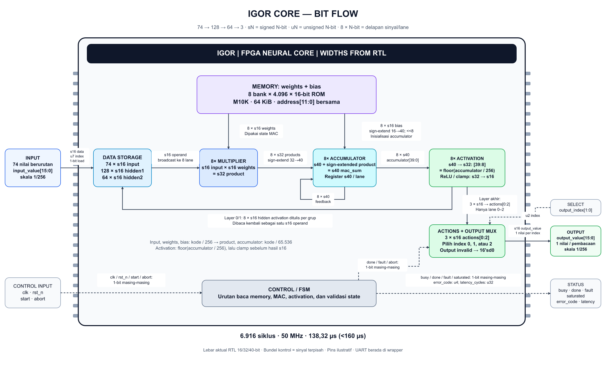

# Block diagram sederhana core IGOR

**[Buka/edit file draw.io](assets/igor_core_simple.drawio)** di diagrams.net
melalui **File -> Open From -> Device**, atau di aplikasi draw.io desktop.
Semua kotak, teks dan panah merupakan objek native yang dapat diedit.
Tersedia juga [PNG](assets/igor_core_simple.png) dan [SVG](assets/igor_core_simple.svg).



Alurnya: **74 input -> data storage -> delapan multiplier -> delapan
accumulator -> activation -> tiga register actions -> output mux 16-bit**. Memory mengirim weights
ke multiplier dan bias ke accumulator. Hidden activation disimpan kembali
sebagai input layer berikutnya; output layer terakhir menjadi tiga residual.
Control/FSM mengatur urutan operasi dan menyediakan status.

## Lebar bit pada setiap panah

Label **sN** berarti signed N-bit; **uN** berarti unsigned N-bit.
`8 × s16` berarti delapan sinyal 16-bit pada delapan lane, bukan satu port
packed bernama 128-bit. Bundel kontrol pada panah putus-putus adalah kumpulan
sinyal terpisah dengan lebar masing-masing.

| Panah | Lebar aktual dan perubahan data |
|---|---|
| Input -> data storage | `input_value`: s16; `input_index`: u7; `load_input`: 1-bit. Sebanyak 74 nilai dimuat berurutan, bukan bus input 74 × 16-bit paralel. |
| Data storage -> multiplier | Satu `operand`: s16, dibroadcast ke delapan lane. |
| Memory -> multiplier | Delapan `weight[lane]`: masing-masing s16; ROM dibaca sinkron dan data dipakai pada state MAC. |
| Memory -> accumulator | Delapan bias: masing-masing s16. Nilai di-sign-extend dan digeser kiri delapan bit dalam representasi s40 saat `BIAS_TAKE`. |
| Multiplier -> accumulator | Delapan product: masing-masing s32 dari perkalian s16 × s16, lalu di-sign-extend ke s40 sebelum penjumlahan. |
| Feedback accumulator | Delapan nilai accumulator s40 disimpan dan dipakai kembali untuk MAC berikutnya. Penjumlahan menghasilkan `mac_sum` s40. |
| Accumulator -> activation | Delapan accumulator: masing-masing s40. Di dalam activation, `[39:8]` menjadi s32 `scaled`; ReLU/clamp menghasilkan s16. |
| Activation -> data storage | Pada layer 0/1, delapan hidden activation s16 ditulis per grup, satu per bank/lane. Pembacaan berikutnya memilih satu s16 sebagai operand. |
| Activation -> actions | Pada layer akhir, hanya lane 0–2 disalin ke `actions[0:2]`, masing-masing s16. |
| Select -> output mux | `output_index`: u2 memilih salah satu dari tiga actions. |
| Actions/mux -> output | `output_value`: satu s16 untuk index yang dipilih. Tiga register total 48 bit penyimpanan, tetapi port output tetap 16 bit. |
| Control input -> control | `clk`, `rst_n`, `start`, `abort`: masing-masing 1-bit. |
| Control/validity -> output gating | `done`, `fault`, `abort`: masing-masing 1-bit; output nol jika tidak valid. `abort` berasal dari input core, tidak dihasilkan FSM. |
| Control -> status | `busy`, `done`, `fault`, `saturated`: masing-masing 1-bit; `error_code`: u4; `latency_cycles`: u32. |

## Pergeseran dan sign-extension yang benar

Pola RTL per lane:

```verilog
// Bias s16 -> accumulator s40: 16 sign bits + 16 bias bits + 8 zero bits.
acc <= {{16{weight[lane][15]}}, weight[lane], 8'd0};

// Product s32 -> s40: ulang sign bit delapan kali, lalu jumlahkan.
mac_sum[lane] = accumulator[lane] + {{8{product[lane][31]}}, product[lane]};

// Accumulator s40 -> scaled s32: buang delapan bit terbawah.
wire signed [31:0] scaled = accumulator[39:8];
```

Weights dan bias berbagi keluaran ROM 16-bit yang sama pada fase berbeda;
dua panah memory adalah dua fungsi pembacaan, bukan dua port ROM independen.
Memory memakai alamat u12 bersama untuk delapan bank. Penjadwalan alamat
disederhanakan di gambar; panah kontrol bukan netlist lengkap.

`accumulator[39:8]` **sudah merupakan** pembagian aritmetika dengan 256
yang dibulatkan ke bawah; tidak ada pembagian kedua setelah slice tersebut.
Misalnya kode accumulator −1 menghasilkan scaled −1, bukan 0.
Pada hidden layer, scaled negatif menjadi 0 dan nilai di atas 32767 menjadi
32767. Pada output layer, scaled di-clamp ke kode −256 sampai 256.
Pemilihan 16 bit hasil dilakukan sesudah pemeriksaan batas tersebut.

Output core mengikuti kondisi persis RTL:
`done && !fault && !abort && output_index < 3`; jika tidak terpenuhi,
`output_value` adalah `16'sd0`. `saturated` menandai saturasi positif hidden
activation pada implementasi saat ini; jangan menafsirkannya sebagai flag
semua kemungkinan clamp, termasuk output layer.

Memory pada diagram mengikuti implementasi Parallel8 saat ini: delapan
bank ROM 4.096 x 16-bit yang dipetakan ke M10K FPGA, total 64 KiB kapasitas
logis. Data storage input/hidden digambar terpisah dari memory weights/bias.
Bias dimasukkan ke accumulator dengan pergeseran delapan bit agar skalanya
sesuai product. Input/output memakai kode integer berskala 1/256.
Teknik penyimpanan 9-bit pada [techniques.md](techniques.md) masih kandidat;
diagram ini menggambarkan desain 16-bit yang telah dibangun.

Bentuk chip dan kaki di tepinya merupakan ilustrasi fungsi core, bukan
pinout fisik atau layout silikon. Interface UART, parser, CRC dan gate pada
wrapper berada di luar cakupan gambar. Tiga residual bukan langsung PWM
atau perintah motor. Angka 138,32 us adalah latensi inferensi core dari
start diterima sampai done, bukan waktu komunikasi UART.

Sumber: [RTL core](../experiments/parallel8/igor_src_policy_core.v),
[receipt validasi](../experiments/parallel8/artifacts/acceptance.json), dan
[ringkasan Fitter](../experiments/parallel8/output_files/igor_src_policy.fit.summary).
Pembuatan ulang: `python fpga/scripts/render_igor_core_drawio.py` dari root.
Renderer PNG menggunakan `resvg-py==0.5.0` pada
`fpga/.runtime/diagram_renderer`; XML draw.io dan SVG dibuat oleh script yang sama.
