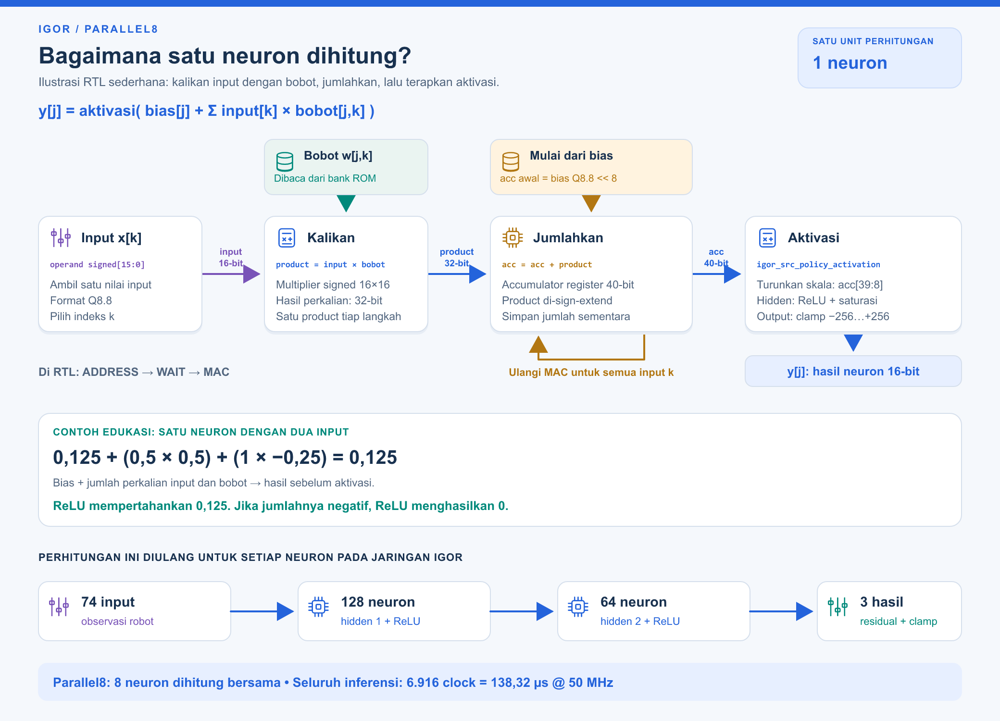

# Cara neural network IGOR menghitung: satu neuron sampai tiga residual



[PNG](assets/parallel8_neural_calculation.png) · [SVG untuk zoom](assets/parallel8_neural_calculation.svg).

**Satu neuron mengalikan setiap input dengan bobotnya, menjumlahkan semua hasil dengan bias, lalu menerapkan aktivasi.** Nilai hasil menjadi input bagi layer berikutnya. Jaringan IGOR memakai urutan **74 input → 128 neuron → 64 neuron → 3 residual**.

## Baca diagram dari kiri ke kanan

1. **Input:** core mengambil satu nilai `operand` dari observasi atau hasil hidden layer.
2. **Kalikan:** multiplier signed 16×16 menghasilkan `product` signed 32-bit, dengan bobot dari bank ROM.
3. **Jumlahkan:** product di-sign-extend menjadi 40-bit dan ditambahkan ke register accumulator. Langkah tersebut diulang untuk seluruh input neuron.
4. **Aktivasi:** hasil diturunkan skalanya. Hidden layer memakai ReLU dan saturasi; layer output memakai clamp residual.

Rumus konseptualnya:

```text
y[j] = aktivasi( bias[j] + Σ input[k] × bobot[j,k] )
```

Rangkaian dalam [Verilog core Parallel8](../experiments/parallel8/igor_src_policy_core.v) memakai kode integer Q8.8:

```text
acc = bias_code << 8
untuk setiap input k:
    product = input_code[k] × weight_code[j,k]   # signed 32-bit
    acc = acc + sign_extend(product)            # signed 40-bit
scaled = floor(acc / 256)

hidden: value = clamp(max(0, scaled), 0, 32767)
output: value = clamp(scaled, -256, +256)
```

`<<8` menyelaraskan skala bias dengan hasil perkalian Q8.8×Q8.8. Pembacaan `accumulator[39:8]` pada aktivasi memakai arithmetic floor, termasuk untuk nilai negatif. Output tetap merupakan kode Q8.8; bagi 256 untuk membaca nilainya sebagai bilangan riil.

## Contoh angka yang mudah diikuti

Contoh **dua input** ini untuk edukasi, bukan pengukuran neuron dari model IGOR. Layer IGOR sebenarnya memakai 74, 128 atau 64 input per neuron sesuai layer.

```text
bias = 0,125
input = [0,5; 1]
bobot = [0,5; -0,25]

jumlah = 0,125 + 0,25 - 0,25 = 0,125
ReLU(0,125) = 0,125
```

| Langkah RTL | Nilai kode integer |
|---|---:|
| Bias 0,125 menjadi kode Q8.8 | 32 |
| Inisialisasi accumulator: 32 << 8 | 8.192 |
| Product 1: kode input 128 × kode bobot 128 | +16.384 |
| Product 2: kode input 256 × kode bobot −64 | −16.384 |
| Accumulator akhir | 8.192 |
| Aktivasi: 8.192 / 256 | 32 |
| Nilai riil output: kode 32 / 256 | **0,125** |

## Di mana delapan lane berperan?

Pada satu kelompok, delapan lane menerima **input yang sama**, tetapi setiap lane membaca **bobot neuron yang berbeda** dan mempunyai accumulator sendiri. Jadi delapan neuron dihitung bersama. Di dalam setiap lane, input diakumulasikan berurutan mengikuti indeks `k`.

ROM sinkron memerlukan urutan **WEIGHT_ADDRESS → WEIGHT_WAIT → MAC**. Delapan MAC diperbarui pada state MAC; diagram sederhana tidak menyatakan satu neuron selesai dalam satu clock.

Seluruh inferensi memakai **6.916 clock / 138,32 µs pada 50 MHz**, sesuai [acceptance](../experiments/parallel8/artifacts/acceptance.json). Angka ini berlaku untuk seluruh core 74→128→64→3, bukan satu neuron atau round-trip UART. [Diagram RTL terperinci](PARALLEL8_BLOCK_DIAGRAM.md) menjelaskan port, memori, jadwal layer dan framing.

Ilustrasi dapat dibuat ulang dengan `python fpga/scripts/render_neural_calculation.py`, menggunakan renderer yang dijelaskan pada dokumentasi diagram utama. Tidak ada perubahan RTL, bobot atau bitstream.
