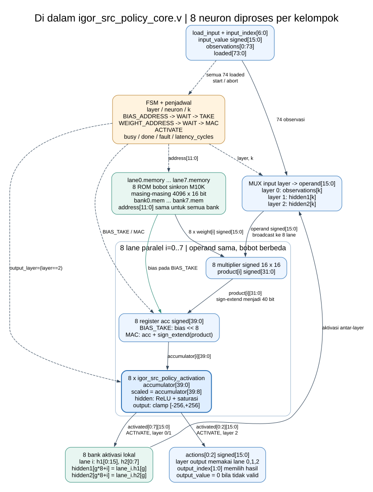
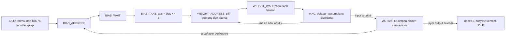
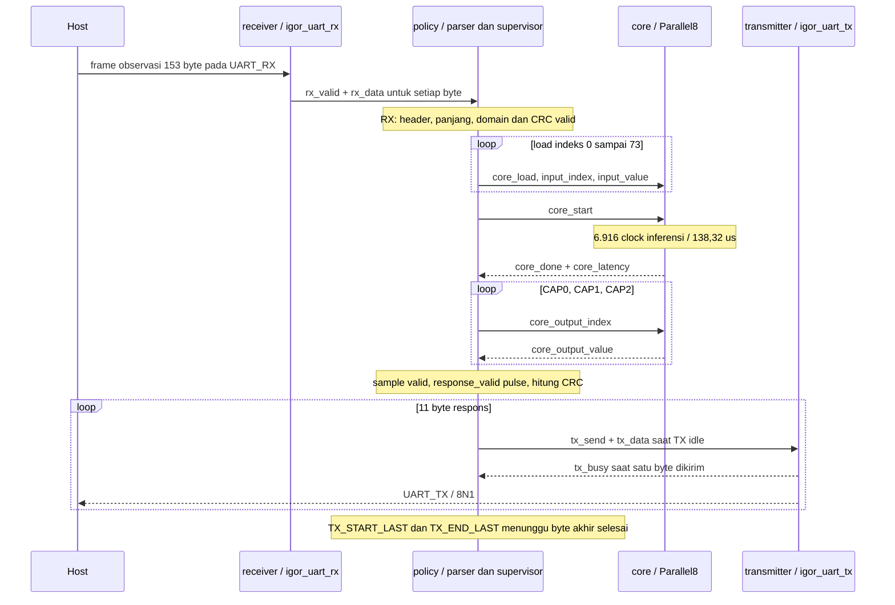

# IGOR Parallel8: block diagram, input/output dan alur RTL

**Chip ini menerima observasi robot melalui UART, memeriksa transaksi, menghitung tiga residual AI di hardware, lalu mengirim hasil melalui UART.** Inti inferensinya mengerjakan jaringan **74 → 128 → 64 → 3** dengan **delapan lane MAC** dalam **6.916 clock = 138,32 µs = 0,13832 ms pada 50 MHz**.

Dokumen ini mengikuti sumber yang benar-benar dipakai oleh [QSF Parallel8](../experiments/parallel8/igor_src_policy.qsf), dengan top `igor_src_policy_de10_nano`. Buka [proyek Quartus Parallel8](../experiments/parallel8/igor_src_policy.qpf). Semua diagram menjelaskan koneksi RTL aktual. Angka di bawah 0,16 ms adalah **start diterima core → done core**, sedangkan transfer UART mempunyai anggaran tersendiri.

## 1. Lihat alurnya terlebih dahulu


[Buka SVG untuk zoom](assets/parallel8_system.svg) · [PNG](assets/parallel8_system.png) · [sumber diagram DOT](assets/parallel8_system.dot).

Kotak biru menunjukkan modul/file komputasi atau serial, hijau menunjukkan bagian parser/hasil di dalam modul `igor_src_policy_uart`, dan jalur putus-putus menunjukkan kontrol/status. Parser dan pengambil hasil bukan file Verilog terpisah; keduanya digambar terpisah untuk menjelaskan tugas dalam satu FSM.

1. **Host menyiapkan input:** 64 nilai LiDAR, 6 IMU, 3 perintah dan 1 heading menjadi **74 word signed 16-bit Q8.8**, lalu dikemas sebagai frame 153 byte.
2. **Receiver memulihkan byte:** `igor_uart_rx.v` menyinkronkan pin RX dan menghasilkan `rx_data[7:0]`, `rx_valid`, atau `rx_error`.
3. **Wrapper memvalidasi transaksi:** `igor_src_policy_uart.v` memeriksa header, opcode, panjang, CRC dan rentang nilai; data disimpan dahulu dalam `frame_observation[0:73]`.
4. **Wrapper memuat core:** 74 observasi diteruskan lewat `core_load`, `core_input_index[6:0]` dan `core_input_value[15:0]`; setelah lengkap, wrapper mengirim `core_start`.
5. **Core menghitung AI:** `igor_src_policy_core.v` mengerjakan 128 neuron hidden pertama, 64 hidden kedua dan tiga output memakai delapan bank bobot serta delapan lane. Setelah **6.916 siklus**, `done=1`.
6. **Wrapper mengambil tiga hasil:** `core_output_index=0,1,2` memilih `core_output_value`; hasil disimpan sebagai `sample0/1/2`, diberi validitas/lease dan CRC respons.
7. **Transmitter mengirim respons:** `igor_uart_tx.v` mengirim **11 byte**. Host memeriksa frame/CRC, lalu menggunakan tiga residual dalam blending, filter dan kinematika pada jalur software integrasi.

**Makna keluaran:** tiga residual adalah koreksi kendali untuk sumbu vx, vy dan omega pada kontrak host; keluaran fisik image ini adalah **UART_TX dan LED**, bukan PWM atau empat RPS roda. Gate planner/peta yang ada di folder RTL merupakan jalur lain; modul tersebut diindeks pada [referensi seluruh RTL](RTL_PORT_REFERENCE.md).

## 2. Pohon instance: file mana memanggil file mana?

```text
igor_src_policy_de10_nano                       [Parallel8/igor_src_policy_de10_nano.v]
└── policy : igor_src_policy_uart               [rtl/igor_src_policy/igor_src_policy_uart.v]
    ├── receiver : igor_uart_rx                 [rtl/igor_uart_rx.v]
    ├── transmitter : igor_uart_tx              [rtl/igor_uart_tx.v]
    └── core : igor_src_policy_core             [Parallel8/igor_src_policy_core.v]
        ├── lane0 ... lane7                    [scope di dalam core.v, bukan delapan file]
        │   ├── memory[0:4095]                 [bank0.mem ... bank7.mem]
        │   ├── product / acc / h1 / h2        [datapath dan register lokal]
        │   └── activation : igor_src_policy_activation [modul pada file core.v yang sama]
        └── FSM, mux operand dan actions[0:2]  [logika di dalam core.v]

igor_src_policy_rom                            [tercantum di QSF, tanpa instance Parallel8]
```

`Parallel8` pada pohon berarti folder `fpga/experiments/parallel8/`. Prefix `rtl/` berarti `fpga/rtl/`. Modul `igor_src_policy_rom` adalah ROM tunggal untuk core source serial yang terpisah. **Bank memori Parallel8 berada langsung di core kandidat**, sehingga tidak ada koneksi fiktif dari modul ROM tunggal ke delapan lane pada diagram.

| File QSF | Modul / peran | Keterlibatan pada hierarchy cepat |
|---|---|---|
| [igor_src_policy_de10_nano.v](../experiments/parallel8/igor_src_policy_de10_nano.v) | Top board, reset, E-stop latch dan LED | Top aktif |
| [igor_src_policy_uart.v](../rtl/igor_src_policy/igor_src_policy_uart.v) | Parser, buffer, supervisor inferensi, validitas dan respons | Instance `policy` |
| [igor_uart_rx.v](../rtl/igor_uart_rx.v) | UART receiver 8N1 | Instance `policy.receiver` |
| [igor_src_policy_core.v](../experiments/parallel8/igor_src_policy_core.v) | FSM neural, bank bobot, delapan MAC dan modul aktivasi | Instance `policy.core`; aktivasi delapan kali |
| [igor_uart_tx.v](../rtl/igor_uart_tx.v) | UART transmitter 8N1 | Instance `policy.transmitter` |
| [igor_src_policy_rom.v](../rtl/igor_src_policy/igor_src_policy_rom.v) | ROM sinkron tunggal, 32.768×16-bit | Source tercantum, tidak diinstansiasi oleh Parallel8 |

Declaration lengkap, arah port dan nama setiap modul ada di [RTL_PORT_REFERENCE.md](RTL_PORT_REFERENCE.md). Seluruh **22 file common `fpga/rtl/` dan dua file kandidat Parallel8** dibahas di sana, dengan penanda mana yang aktif pada proyek cepat.

## 3. Port fisik: dari luar chip menuju wrapper

| Port top | Arah / lebar | Sambungan dan fungsi |
|---|---|---|
| `FPGA_CLK1_50` | Input 1 bit | Clock 50 MHz untuk wrapper, parser, RX/TX dan core |
| `KEY[0]` | Input 1 bit, active-low | Assertion reset asinkron; pelepasan `rst_n` melalui `reset_sync[1:0]` |
| `KEY[1]` | Input 1 bit, active-low | Tombol stop: raw input, sinkronisasi dan `stop_latched` membentuk `stop_active` |
| `UART_RX` | Input 1 bit | Jalur serial dari TX host menuju receiver |
| `UART_TX` | Output 1 bit | Jalur serial transmitter menuju RX host |
| `LED[7:0]` | Output 8 bit | Ringkasan error, stop, respons, reset dan validitas residual |

KEY1 yang tertahan dilatch oleh board wrapper sampai reset KEY0. `stop_active` masuk ke port `estop` policy. Daftar pin lokasi dan standar listrik berasal dari [pin_assignment.tcl](../experiments/parallel8/pin_assignment.tcl); [SDC](../experiments/parallel8/igor_src_policy.sdc) mendefinisikan timing clock. CLK/RX/TX/KEY/LED adalah total **13 fitted pin** pada laporan.

| LED | Persamaan top | Cara membaca |
|---|---|---|
| 0 | `permit` | Residual valid menurut wrapper |
| 1 | `rst_n` | Reset telah dilepas |
| 2 | `response_valid` | Pulse hasil internal siap; bukan konfirmasi host telah menerima seluruh frame |
| 3 | `stop_active` | Stop aktif atau latched |
| 7:4 | `error_code[3:0]` | Empat bit rendah kode fault wrapper |

## 4. Input/output antarmodul yang harus disebut saat presentasi

| Pengirim → penerima | Nama koneksi pada wrapper | Arah port modul / lebar | Makna |
|---|---|---|---|
| Top → policy | `stop_active` | `estop`, 1 bit | Membatalkan transaksi/hasil ketika stop aktif |
| RX → policy | `rx_data`, `rx_valid`, `rx_error` | `data[7:0]`, `valid`, `error` | Byte valid atau framing error |
| Policy → core | `core_load` | `load_input`, 1 bit | Satu input ditulis pada rising edge |
| Policy → core | `core_input_index` | `input_index[6:0]` | Alamat observasi 0–73 |
| Policy → core | `core_input_value` | `input_value`, signed 16-bit | Nilai Q8.8 observasi |
| Policy → core | `core_start` | `start`, 1 bit | Memulai inferensi setelah 74 input lengkap |
| Policy → core | `core_abort \| estop_active` | `abort`, 1 bit | Pembatalan; core membuang status hasil/input parsial |
| Core → policy | `core_busy`, `core_done`, `core_fault` | `busy`, `done`, `fault`, 1 bit masing-masing | Status proses, hasil selesai atau fault internal |
| Core → policy | `core_error` | `error_code[3:0]` | Penyebab fault internal core; wrapper melaporkannya sebagai internal-core error 10 |
| Core → policy | `core_latency` | `latency_cycles[31:0]` | Siklus eksekusi; disalin ke `last_latency_cycles` saat selesai |
| Policy → core | `core_output_index` | `output_index[1:0]` | Memilih residual 0, 1 atau 2 |
| Core → policy | `core_output_value` | `output_value`, signed 16-bit | Hasil terpilih; nol bila validitas core tidak terpenuhi |
| Core → policy | `core_saturated` | `saturated`, 1 bit | Flag akumulatif saturasi positif hidden; tidak digunakan sebagai syarat reject wrapper saat ini |
| Policy → TX | `tx_send`, `tx_data` | `send`, 1 bit; `data[7:0]` | Minta pengiriman satu byte saat TX idle |
| TX → policy | `tx_busy` | `busy`, 1 bit | Serializer sedang mengirim satu byte |
| Policy → TX | `rst_n && !estop_active && !tx_cancel` | `rst_n`, 1 bit | Reset/cancel transmitter saat transaksi dibatalkan |
| Policy → top | `action0/1/2` | signed 16-bit masing-masing | Tiga residual yang dimask oleh validitas |
| Policy → top | `safety_permit`, `response_valid` | 1 bit masing-masing | Validitas residual / pulse hasil siap |
| Policy → top | `accepted_frames`, `rejected_frames`, `last_latency_cycles` | 32-bit masing-masing | Debug internal; tidak otomatis menjadi query UART image ini |
| Policy → top | `error_code`, `error_flags`, `debug_state` | 8 / 16 / 4 bit | Diagnostik internal; LED memakai subset yang ditabelkan |

## 5. Apa yang lewat kabel UART?

Parameter policy adalah `BAUD=921600`. RTL menghitung `BIT_CYCLES=(CLK_HZ+BAUD/2)/BAUD=54`, sehingga pada clock 50 MHz satu bit memerlukan **1,08 µs**, laju aktual sekitar **925.925,93 bit/detik**. RX dan TX memakai **8N1**, satu start, delapan data LSB-first, satu stop.

| Frame | Urutan byte | Panjang |
|---|---|---:|
| Observasi dari host | `5A A5 01 94`, lalu **148 byte** berisi 74 word little-endian, lalu CRC8 | **153 byte** |
| Hasil menuju host | `5A A5 02 06`, lalu **6 byte** berisi tiga word little-endian, lalu CRC8 | **11 byte** |

CRC8 dihitung atas **opcode + length + payload**, tidak memasukkan `5A A5`. Fungsi RTL memakai bentuk reflected Dallas/Maxim dengan konstanta `8'h8c` dan initial 0. Parser membangun word dari `{high_byte, low_byte}`. Misalnya kode Q8.8 **256 = 1,0**; contoh ini menjelaskan encoding dan bukan hasil inferensi suatu skenario tertentu.

Field 0–63 (LiDAR) harus berada pada kode **0…256**. Field 64–73 (IMU/perintah/heading) harus berada pada **−256…256**. Seluruh frame dibuffer sebelum core di-load, sehingga CRC/range yang gagal tidak menjadi observasi inferensi baru.

## 6. Di dalam core: memori dan delapan lane



[Buka SVG untuk zoom](assets/parallel8_datapath.svg) · [PNG](assets/parallel8_datapath.png) · [DOT](assets/parallel8_datapath.dot).

Untuk kelompok neuron dengan base `neuron=g×8`, lane `i` mengerjakan neuron `g×8+i`. Semua lane menerima `operand` yang sama untuk indeks input `k`, sedangkan masing-masing lane membaca bobot berbeda dari banknya. Multiplier menghasilkan signed 32-bit; product di-sign-extend lalu dijumlahkan ke accumulator 40-bit. Urutan penjumlahan setiap neuron tetap mengikuti `k`.

| Penyimpanan / jalur | Ukuran / sinyal | Peran |
|---|---|---|
| `observations` | 74×16-bit | Snapshot input satu inferensi |
| `loaded` | 74 bit | Menandai input mana yang sudah ditulis sebelum start |
| `lane0.memory` … `lane7.memory` | Masing-masing 4.096×16-bit | ROM bobot/bias sinkron; total alokasi **64 KiB** |
| `address` / `weight_address` | 12-bit | Address lokal bank; semua bank memakai alamat yang sama |
| `operand` | signed 16-bit | Mux dari observations / hidden1 / hidden2 menurut layer |
| `product[0:7]` | 8×signed 32-bit | Perkalian paralel operand dan weight |
| `accumulator[0:7]` | 8×signed 40-bit | State dot product tiap lane |
| `lane_i.h1`, `lane_i.h2` | 16×16-bit dan 8×16-bit per lane | Aktivasi hidden lokal; total 128 + 64 neuron |
| `actions[0:2]` | 3×signed 16-bit | Hasil layer output, berasal dari lane 0/1/2 |

Alias hidden memakai `hidden1[g×8+i]=lane_i.h1[g]` dan pola yang sama untuk hidden2. Hidden disimpan pada array register lokal RTL; nama tersebut tidak mengklaim semuanya menjadi SRAM macro. Bobot digunakan sebagai ROM pada blok M10K. **SRAM program 512 byte pada ASIC protocol engine adalah memori blok lain**, bukan bank bobot proyek ini.

Masing-masing lane menjalankan `$readmemh(BANK_FILE,memory)` dengan `bank0.mem` … `bank7.mem`. File bank dihasilkan oleh [prepare.py](../experiments/parallel8/prepare.py), dengan **18.051 word parameter berguna / 36.102 byte** dan padding pada alokasi bank. Parameter `ROM_FILE` masih ada pada interface core untuk kompatibilitas wrapper; bank Parallel8 memakai `BANK_FILE`, sehingga mengganti `ROM_FILE` saja tidak mengganti delapan bank bobot.

### Aktivasi: port modul pada file core yang sama

`igor_src_policy_activation` diinstansiasi **delapan kali**, satu per lane:

| Port | Arah / format | Perilaku |
|---|---|---|
| `accumulator` | Input signed 40-bit | Hasil akumulasi dot product dan bias |
| `output_layer` | Input 1 bit | `layer==2` memilih perlakuan layer output |
| `value` | Output signed 16-bit | Hidden: ReLU/clamp positif; output: clamp kode −256…+256 |
| `saturated` | Output 1 bit | Benar ketika hidden positif melampaui 32767; clamp output tidak menaikkan flag ini |

Aktivasi mengambil `accumulator[39:8]`: pengurangan delapan fractional bit dengan arithmetic floor. Hidden negatif menjadi nol, hidden positif dibatasi ke 32767. Layer output dibatasi ke **−1…+1 dalam Q8.8**. Bias dimasukkan sebagai `bias << 8`, sehingga skala bias selaras dengan hasil perkalian Q8.8×Q8.8 sebelum aktivasi.

## 7. Clock-cycle design: mengapa tepat 6.916 siklus?



Tiga siklus awal mengambil bias, setiap input memakai tiga siklus alamat/wait/MAC, lalu satu siklus aktivasi. Satu kelompok delapan neuron memerlukan **3×Ninput+4** siklus. State WAIT diperlukan agar data ROM terdaftar sudah benar saat dipakai; delapan MAC diperbarui bersama pada state MAC, bukan setiap clock tanpa jeda.

| Layer | Kelompok | Input per kelompok | Rumus | Clock | Waktu @50 MHz |
|---|---:|---:|---|---:|---:|
| 74 → 128 | 16 | 74 | 16×(3×74+4) | **3.616** | **72,32 µs** |
| 128 → 64 | 8 | 128 | 8×(3×128+4) | **3.104** | **62,08 µs** |
| 64 → 3 | 1 | 64 | 1×(3×64+4) | **196** | **3,92 µs** |
| Total | 25 | | 3.616+3.104+196 | **6.916** | **138,32 µs** |

`latency_cycles` menghitung clock ketika `busy` aktif. `done` menyatakan hasil tersedia dan bertahan sampai dibersihkan oleh transaksi/reset/abort; bukan sekadar pulse satu clock. Bukti angka berasal dari [acceptance](../experiments/parallel8/artifacts/acceptance.json), [hasil simulasi](../experiments/parallel8/artifacts/results.json) dan [waveform core](../experiments/parallel8/artifacts/core_latency.png).

Laju ekuivalen dari waktu core adalah **50.000.000/6.916 = 7.229,61 inferensi/detik**, dan **17.856 MAC berguna / 138,32 µs = 129,09 MMAC/s**. Ini perhitungan kapasitas dari latensi core tanpa overhead pengulangan; sustained throughput UART/robot memerlukan pengukuran input/load/komunikasi yang sesuai.

## 8. Urutan transaksi wrapper, dari byte pertama sampai byte terakhir



FSM wrapper: `RX → LOAD → START → RUN → CAP0 → CAP1 → CAP2 → TX → TX_START_LAST → TX_END_LAST → RX`. `accepted_frames` bertambah pada frame CRC/domain valid, sebelum inferensi selesai. `response_valid` pulse pada CAP2, ketika tiga sample siap; byte respons masih perlu dikirim. `last_latency_cycles` disalin dari core saat RUN melihat `core_done`.

**Pemisahan waktu:** RX ideal **153×10×54/50 MHz = 1,6524 ms**, TX ideal **11×10×54/50 MHz = 0,1188 ms**. Serial ideal ditambah core adalah **1,90952 ms**, sebelum overhead parser, handshake, jeda dan host. Dengan demikian, klaim **<0,16 ms** menunjuk jendela komputasi core yang terlihat pada diagram, bukan seluruh perjalanan observasi sampai motor.

## 9. Jalur penolakan dan status: apa yang terjadi ketika input salah?

Persamaan wrapper:

```verilog
safety_permit = result_valid && !estop_active && !core_fault;
action0 = safety_permit ? sample0 : 16'sd0;
action1 = safety_permit ? sample1 : 16'sd0;
action2 = safety_permit ? sample2 : 16'sd0;
```

`reject(code)` menghapus `result_valid`, kembali ke RX, mengirim `core_abort`, membatalkan TX dan mencatat kode/history. Counter reject/accept **32-bit saturating** pada `0xffffffff`; history menyimpan bit 1–12 pada `error_flags`, dengan bit 0 dan 13–15 diikat nol. Hasil yang ditolak tidak dikirim sebagai frame sukses residual nol; host memeriksa timeout/frame/CRC sesuai kontrak integrasi.

| Kode wrapper policy | Pemicu |
|---:|---|
| 1 | E-stop |
| 2 | Framing UART |
| 3 | Header |
| 4 | Opcode |
| 5 | Panjang payload |
| 6 | CRC |
| 7 | Timeout antar-byte, default **1.000.000 clock / 20 ms** |
| 8 | Nilai observasi di luar domain normalisasi |
| 9 | Byte baru saat wrapper bukan RX |
| 10 | Fault internal core / state wrapper tidak valid |
| 11 | Lease residual habis, default **1.000.000 clock / 20 ms** sejak hasil valid |
| 12 | Watchdog inferensi, default **100.000 clock / 2 ms** |

Kode ini milik **policy UART**: E-stop adalah **1**. Gate planner terpisah memakai kode sendiri, termasuk E-stop **2**; kedua namespace tidak digabung dalam penjelasan.

Core mempunyai kode internal **1 indeks, 2 load saat busy, 3 start saat busy, 4 input belum lengkap, 5 load+start bersamaan, 6 state tidak valid**. Fault core bersifat sticky sampai reset. Abort membuang loaded mask dan hasil; abort tidak menghapus fault sticky. Pada board, KEY1 stop latched juga memerlukan reset KEY0 untuk dilepas.

## 10. Bukti, file rilis dan cara menjelaskan dalam satu menit

| Yang ingin diperiksa | Buka |
|---|---|
| File yang benar-benar dikompilasi | [QSF Parallel8](../experiments/parallel8/igor_src_policy.qsf) |
| Simulasi, clock dan cycle | [Acceptance](../experiments/parallel8/artifacts/acceptance.json) |
| Fitter/resource | [fit.summary](../experiments/parallel8/output_files/igor_src_policy.fit.summary) |
| Timing semua corner | [sta.summary](../experiments/parallel8/output_files/igor_src_policy.sta.summary) |
| Waveform start/busy/done/counter | [PNG GTKWave](../experiments/parallel8/artifacts/core_latency.png), [save GTKWave](../experiments/parallel8/artifacts/core_latency.gtkw), [VCD gzip](../experiments/parallel8/artifacts/core.vcd.gz) |
| Catatan parameter sumber/baris/SHA | [metric_evidence.csv](../experiments/parallel8/artifacts/metric_evidence.csv) |
| SOF kandidat | [igor_src_policy_parallel8.sof](../bitstreams/igor_src_policy_parallel8.sof) |
| Deklarasi dan fungsi setiap file common RTL | [RTL_PORT_REFERENCE.md](RTL_PORT_REFERENCE.md) |

**Naskah penjelasan:** “Host mengirim 74 observasi robot. Receiver mengubah bit serial menjadi byte, lalu wrapper memeriksa transaksi dan memuat core. Di dalam chip, delapan bank bobot melayani delapan jalur perkalian dan akumulasi; dua hidden layer dan satu layer output selesai dalam 6.916 clock, atau 138,32 mikrodetik. Wrapper mengambil tiga residual, memeriksa validitasnya dan mengirim frame respons. Reset, E-stop, timeout dan fault dapat membatalkan jalur hasil. File Verilog, diagram, port dan bukti timing menunjukkan dengan jelas tugas setiap bagian.”

Diagram adalah dokumentasi dari RTL tervalidasi; pembuatan dokumen ini tidak mengubah rangkaian, bobot atau bitstream. Sumber diagram disimpan dalam DOT dan dapat dirender ulang dengan Graphviz:

```powershell
dot -Tsvg fpga/docs/assets/parallel8_system.dot -o fpga/docs/assets/parallel8_system.svg
dot -Tpng fpga/docs/assets/parallel8_system.dot -o fpga/docs/assets/parallel8_system.png
dot -Tsvg fpga/docs/assets/parallel8_datapath.dot -o fpga/docs/assets/parallel8_datapath.svg
dot -Tpng fpga/docs/assets/parallel8_datapath.dot -o fpga/docs/assets/parallel8_datapath.png
```
