# Parallel8: RTL explained with native GTKWave evidence

These are unmodified GTKWave exports of fresh Icarus RTL simulations using the accepted Parallel8 sources and eight weight banks. They are not oscilloscope or SignalTap measurements of the board. The user reports that Parallel8 works on hardware; this package independently explains and checks its digital behavior.

The active design is **50 MHz, nominal UART 921600 baud, 8N1, signed Q8.8**. It is the original Parallel8 image, not the 9600-baud variant. SOF SHA256: `cb2e0de357a3865b4058f89d34b54f59ab8604db0865a7ceefff436bd6230b49`.

## Why the design fulfills its purpose

A complete, CRC-correct 74-element observation is accepted once; all 74 words load before inference starts. Eight banked ROM/MAC lanes compute the 74→128→64→3 integer network, completing in **6916 clocks / 138.32 µs**. Three independently verified Q8.8 residuals are captured in order, CRC-protected, and sent as **exactly 11 serial bytes**. Faults cancel the transaction and gate the residuals to zero. `safety_permit` is residual validity, not a motor-enable signal.

The request layout is `5A A5 01 94` + 148 payload bytes + one CRC byte: **153 bytes** total. Every observation is signed int16 little-endian; raw/256 gives its Q8.8 value. LiDAR fields 0–63 must be raw 0…256; fields 64–73 must be -256…256. CRC-8/MAXIM uses reflected polynomial 0x8C, starts at zero and covers opcode, length and payload (not the two synchronization bytes).

For each neuron, `acc = (signed_bias << 8) + Σ(signed_input × signed_weight)`, with a signed 40-bit accumulator and 16 fractional bits. Activation floors `acc/256` back to Q8.8. Each group takes 3 bias cycles + 3 cycles per input + 1 activation cycle. Therefore **16×(3+74×3+1) + 8×(3+128×3+1) + (3+64×3+1) = 6916 clocks**. This explains both the observed latency and why eight neurons finish together.

The independent monitor's `decoded_byte` changes only when a high stop bit commits a byte, and `received` increments with that commit. Its internal shift-assembly values are not shown as completed packets. On a real Jetson, UART reads can return different chunk sizes because the serial interface is a byte stream; software must assemble the 11-byte reply and check its header/CRC.

For the board test's **golden vector 1**, raw outputs are **[-57, 76, 42]**, and the response is **5A A5 02 06 C7 FF 4C 00 2A 00 0F**. This is a different input from the earlier synthetic 0.8 example, whose [-46,60,34] result must not be substituted here.

## Which RTL is actually exercised

| Active module | Purpose | Wave views |
|---|---|---|
| `igor_src_policy_de10_nano` | Clock/reset release, latched KEY1 E-stop, LED status and UART policy instance | 01, 15–17 |
| `igor_uart_rx` | Synchronize RX, validate start/stop and reconstruct LSB-first byte | 02–03, 20 |
| `igor_src_policy_uart` | Header/domain/CRC validation, load/start, result capture, TX handshake, validity/timeout/fault bookkeeping | 04–05, 11–17, 19–26 |
| `igor_src_policy_core` | Eight banked synchronous ROMs, eight signed MACs, layer scheduling and output masking | 05–10 |
| `igor_src_policy_activation` | Arithmetic scaling, hidden ReLU/saturation and output clipping | 09, 18 |

The QSF also lists `rtl/igor_src_policy/igor_src_policy_rom.v`, but **the Parallel8 core does not instantiate that module**. Its synchronous ROM behavior is implemented inside lane0…lane7. It would be incorrect to claim a waveform proves execution of the unused unbanked ROM module. Other FPGA experiments/planners in the repository are not part of this configured image.

## Fresh regression results and evidence limits

* Core: **236 network vectors, 8364 activation cases, 54399 assertions**. All 192 hidden activations and all three outputs are checked for every network vector.
* UART: **184 directed transactions, 268 assertions**, including all 74 observation-field domain boundaries, CRC/framing, busy rejection, E-stop, timeouts, watchdog, counter saturation and reset recovery.
* Production board wrapper: **18 checkpoints**, with real 50 MHz / 54-clocks-per-bit framing, independently decoded response, raw KEY1 inhibition and KEY0 recovery.
* Accepted source/bench/ROM/golden-file hashes are checked before and after the run. Only copied testbench file paths, waveform dump scopes and a passive monitor probe are changed. See `simulation_receipt.json`, each suite's `simulation.log`, and `checked_wave_facts.json`.
* The copied board monitor also exposes a passive `decoded_byte` probe at byte commit. It does not change any DUT logic. For every image, **GTKWave's own values at the primary marker are compared against the VCD**, including signed/hexadecimal display formats; results are saved in `screenshots.json` and each image log.
* Views 19–26 use the accelerated protocol testbench: **8 clocks / 160 ns per serial bit**, with shortened timeout parameters. Their captions give production equivalents. They do not establish production baud timing. Views 01–17 use the production board wrapper.
* Domain-boundary tests are asserted in the UART log/CSV but deliberately not dumped during that long sweep; no nonexistent domain-boundary waveform is claimed. Busy/fault/abort masking, incomplete-load rejection and recovery are also asserted by the core regression.
* RTL waves do not establish analog signal integrity, electrical voltage levels, metastability MTBF, physical pin connectivity or post-route timing. The accepted Quartus build separately reports 8 DSP blocks, minimum setup slack +5.647 ns and minimum hold slack +0.119 ns at 50 MHz. Raising frequency would require a new constrained build and UART divider review; these waves prove only this configuration.

## How to read and reopen the evidence

Click each PNG for full resolution. Signed numerical signals use decimal; byte/CRC/shift/error-mask/loaded-mask buses use hexadecimal. Named vertical markers identify exact bit centers or commit edges. X values before the first reset edge are initialization, not accepted outputs. A screenshot is a selected example; the assertions and checked facts establish the broader claims.

Each image has matching `.gtkw`, `.tcl`, and `.log` files in `images/`. Reopen with GTKWave and the corresponding VCD path recorded in `screenshots.json`; use the `.tcl` to restore the exact zoom and markers. To reproduce everything from the workspace root:

```powershell
python tools/build_parallel8_wave_proof.py
```

To open an interactive viewer at the exact bit zoom (also works after extracting the evidence ZIP):

```powershell
python fpga/evidence/parallel8_wave_proof/open_wave.py 13_tx_exact_bits
python fpga/evidence/parallel8_wave_proof/open_wave.py 08_eight_lanes
```

Use `--list` to list all views; use `--gtkwave /path/to/gtkwave` on another computer. Zoom, pan and move markers normally in GTKWave. The opener restores each view's original signals, zoom range and named markers. Rendering uses GTKWave's native Tcl API; signal data formats follow the [GTKWave save-file format documented by PyVCD](https://pyvcd.readthedocs.io/en/latest/vcd.gtkw.html).

## Eight-lane arithmetic cross-check

At the first MAC update, the script checks every lane directly from the VCD. Accumulators have 16 fractional bits before activation; values below are signed raw integers.

| Lane | Before | Operand | Weight | Before + operand × weight = after |
|---|---:|---:|---:|---:|
| 0 | -512 | 256 | -18 | -5120 |
| 1 | -1280 | 256 | 28 | 5888 |
| 2 | 0 | 256 | -36 | -9216 |
| 3 | -256 | 256 | -1 | -512 |
| 4 | -1024 | 256 | 50 | 11776 |
| 5 | -1024 | 256 | 31 | 6912 |
| 6 | 0 | 256 | -39 | -9984 |
| 7 | 0 | 256 | -8 | -2048 |

Beyond this small table, the VCD checker verifies **all 18,176 MAC accumulator updates and banked ROM weights** during the first inference, and checks its **25 activation groups**. See `checked_wave_facts.json`.

## Screenshot walkthrough

### 01_reset: Reset: asynchronous assertion, release after two clocks

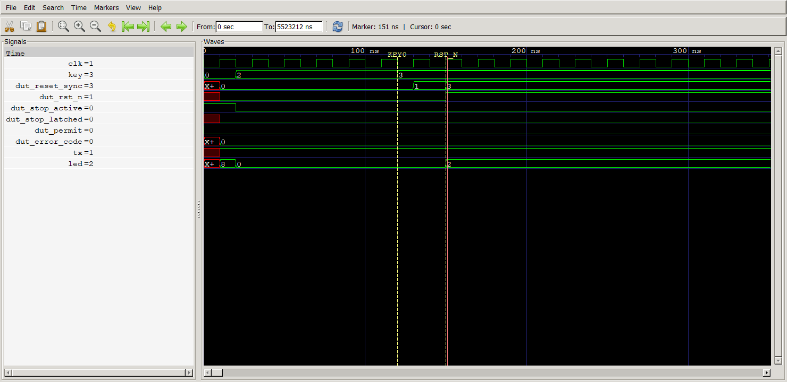

KEY=2 means KEY0 is held low while KEY1 is released. KEY becomes 3 at 120 ns; reset_sync progresses 0 → 1 → 3 at 130/150 ns. rst_n releases at 150 ns, after two rising edges. TX is idle high; permit and error_code remain zero. This prevents a false E-stop at a clean boot.

RTL: `fpga/experiments/parallel8/igor_src_policy_de10_nano.v:11`; `fpga/rtl/igor_src_policy/igor_src_policy_uart.v:137`. Window: 0–350 ns; marker: 151 ns.

### 02_rx_exact_bits: RX: exact 0x5A, LSB first, 8N1

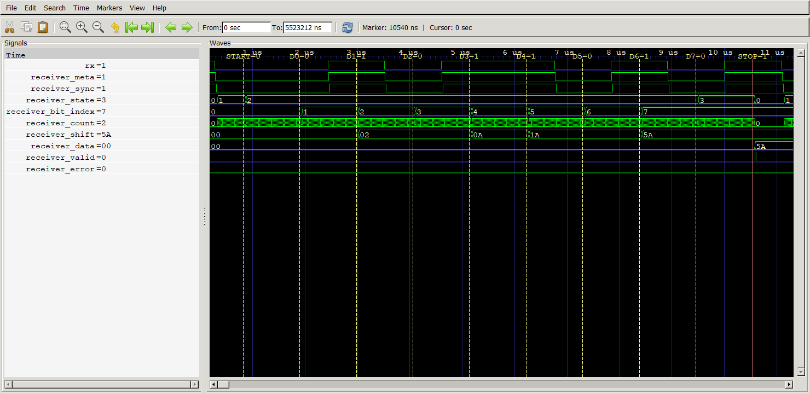

Read the named sample markers left to right: start 0; data D0..D7 = 0,1,0,1,1,0,1,0; stop 1. That is 0x5A. Each bit lasts 54 × 20 ns = 1080 ns. The receiver validates the start at half a bit, samples data once per bit, and pulses valid only after a high stop bit. data becomes 5A; error stays 0.

RTL: `fpga/rtl/igor_uart_rx.v:8`. Window: 180–11280 ns; marker: 10540 ns.

### 03_rx_synchronizer: RX clock crossing: two sampled registers

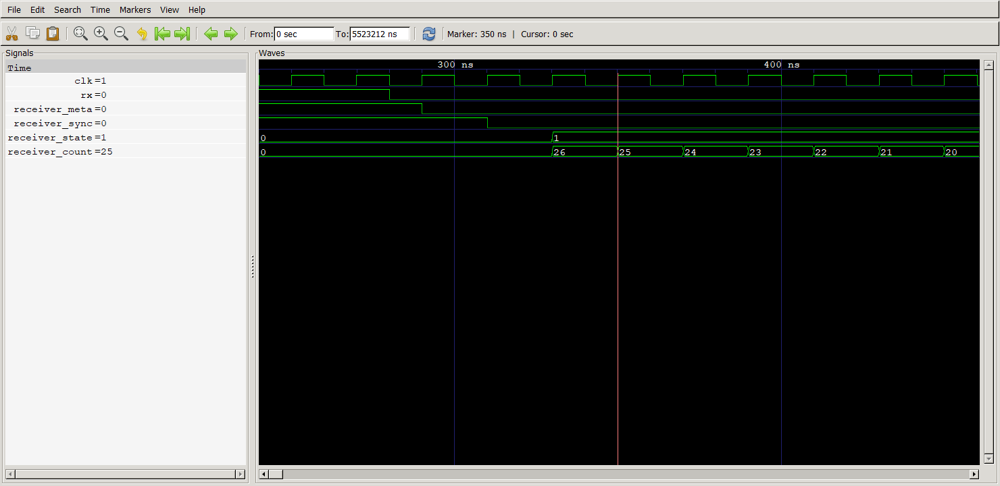

The falling RX edge is followed by meta and then sync on successive 50 MHz rising edges. The state machine reads sync, not the asynchronous pin. This is the intended synchronizer structure; a digital RTL simulation does not model analog metastability or prove its MTBF.

RTL: `fpga/rtl/igor_uart_rx.v:7`. Window: 240–460 ns; marker: 350 ns.

### 04_crc_acceptance: Only the final correct CRC accepts the 153-byte request

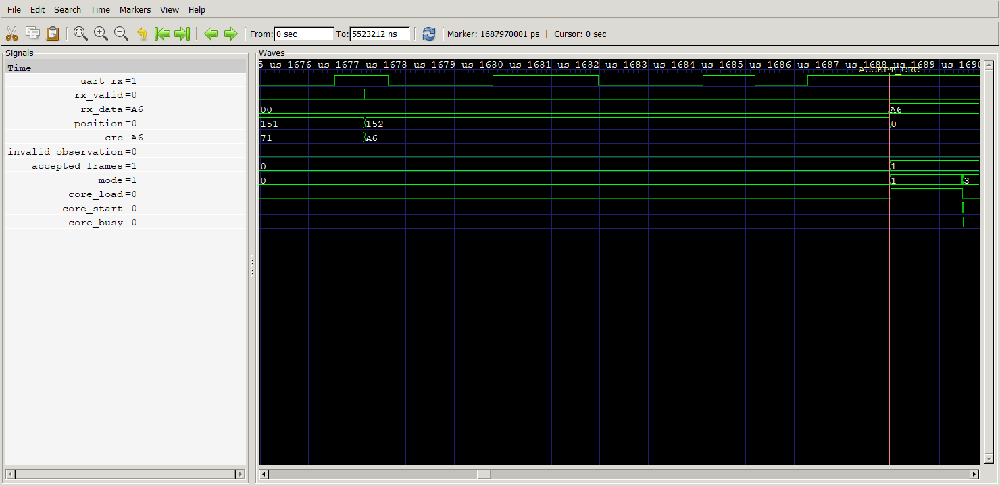

Before the CRC, position is 152 (0x98): 4 header bytes + 148 payload bytes have arrived. accepted_frames and core_busy are still zero. When rx_valid carries the matching CRC, accepted_frames rises once and mode changes RX(0) → LOAD(1). The board bench also explicitly asserts that a partial header and a complete payload without CRC cannot start inference.

RTL: `fpga/rtl/igor_src_policy/igor_src_policy_uart.v:170`; `fpga/experiments/parallel8/tb_board_wrapper.sv:78`. Window: 1.67497e+06–1.68977e+06 ns; marker: 1.68797e+06 ns.

### 05_load_then_start: All 74 inputs are loaded before start


At the marker, loaded is 74 ones. core_input_index reaches 73 (0x49) with core_load asserted. The controller then drops core_load and pulses core_start; busy rises on the following sampling edge. The core rejects incomplete loads or simultaneous start/load, so no neuron runs on a partial observation.

RTL: `fpga/rtl/igor_src_policy/igor_src_policy_uart.v:193`; `fpga/experiments/parallel8/igor_src_policy_core.v:577`. Window: 1.68921e+06–1.68967e+06 ns; marker: 1.68949e+06 ns.

### 06_latency_layers: Parallel8 inference: 6916 cycles = 138.32 µs

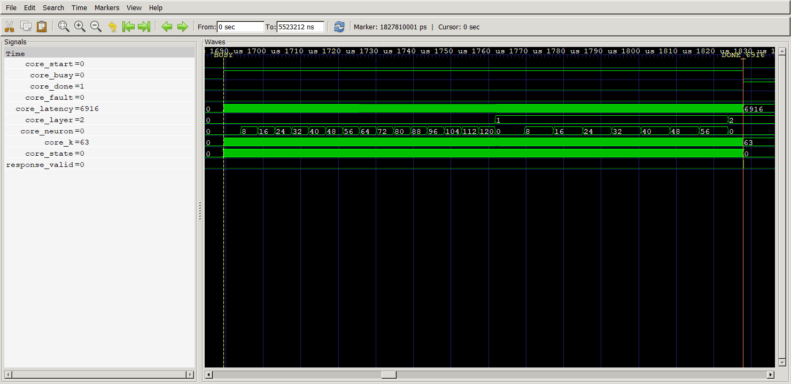

BUSY and DONE markers are exactly 138,320 ns apart: 6916 clocks at 50 MHz. layer advances 0 → 1 → 2. neuron advances by eight for 16 groups in layer 0 and 8 groups in layer 1; only the first three lanes are committed in layer 2. fault remains zero. done is a level held until a new load/reset/abort, not a one-cycle pulse.

RTL: `fpga/experiments/parallel8/igor_src_policy_core.v:593`. Window: 1.68449e+06–1.83581e+06 ns; marker: 1.82781e+06 ns.

### 07_rom_bias_mac: Synchronous ROM and bias alignment before MAC

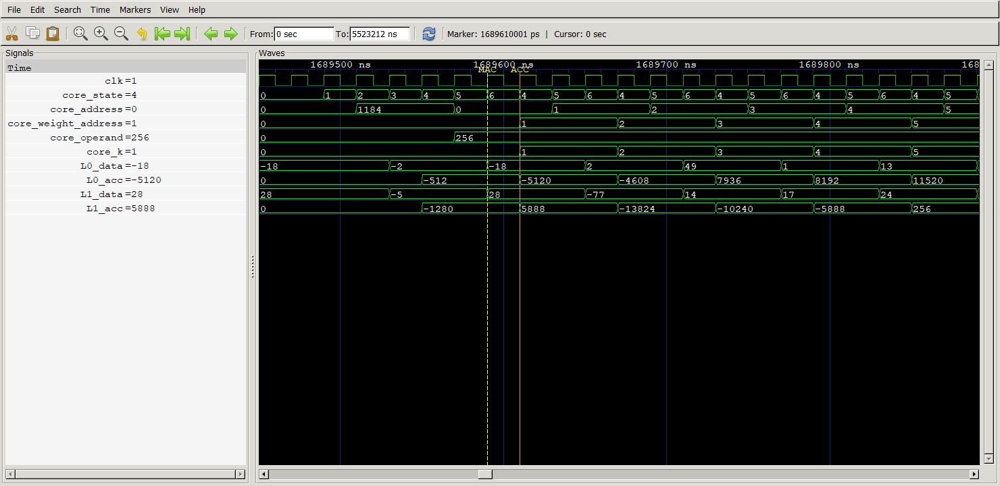

Core states 1/2/3 are BIAS_ADDRESS/WAIT/TAKE; 4/5/6 are WEIGHT_ADDRESS/WAIT/MAC. ROM data updates on a rising edge after address is registered. WAIT prevents use of the previous ROM word. BIAS_TAKE initializes each 40-bit accumulator to signed_bias << 8; each MAC then adds signed_operand × signed_weight. Eight independent bank*.mem files provide eight weights at the same address.

RTL: `fpga/experiments/parallel8/igor_src_policy_core.v:74`; `fpga/experiments/parallel8/igor_src_policy_core.v:602`. Window: 1.68945e+06–1.68989e+06 ns; marker: 1.68961e+06 ns.

### 08_eight_lanes: Eight accumulators update on the same edge

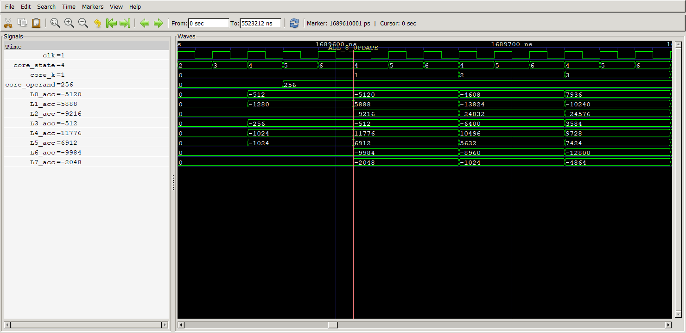

At ACC_UPDATE all eight lane accumulators commit in parallel. The accompanying arithmetic table independently checks each after = before + operand × weight from the VCD. MAC repeats every three clocks because WEIGHT_ADDRESS and WEIGHT_WAIT precede each MAC. Parallel8 means eight neurons share one input operand and use different weights; it does not mean eight input samples per clock.

RTL: `fpga/experiments/parallel8/igor_src_policy_core.v:62`. Window: 1.68951e+06–1.68979e+06 ns; marker: 1.68961e+06 ns.

### 09_relu_group: Hidden layer: activate and store eight neurons per group

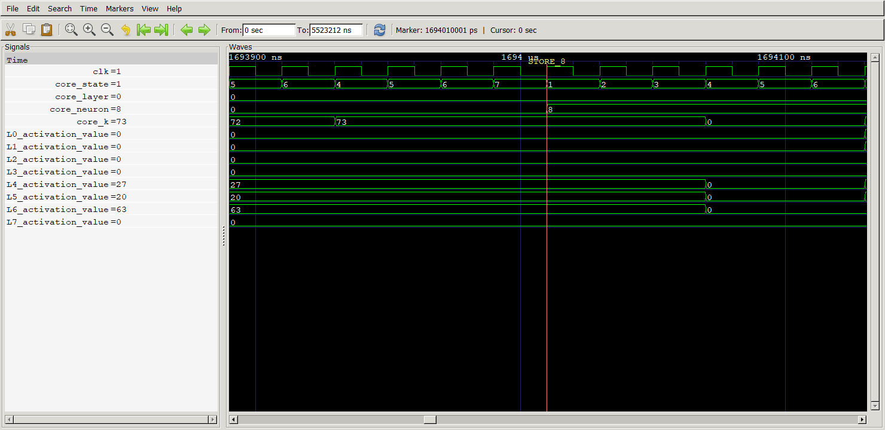

After k=73 has been accumulated, state ACTIVATE(7) commits one Q8.8 activation per lane, then neuron changes 0 → 8 and the next group begins. Activation uses arithmetic floor(acc/256), ReLU to zero for negatives, and saturation at 32767 for hidden outputs. The full core regression compares every one of 128 + 64 hidden values against an independent integer model, not just the three final outputs.

RTL: `fpga/experiments/parallel8/igor_src_policy_core.v:6`; `fpga/experiments/parallel8/igor_src_policy_core.v:84`; `fpga/experiments/parallel8/tb_src_policy_core.sv:112`. Window: 1.69389e+06–1.69413e+06 ns; marker: 1.69401e+06 ns.

### 10_layer1_transition: Layer 0 → 1: correct dimensions and bank offsets


Before the transition, k=73 and the final group starts at neuron=120. ACTIVATE advances layer and resets neuron. Layer 1 consumes 128 hidden1 values for 64 neurons, with weight_address starting at 1200; layer 2 consumes 64 hidden2 values for 3 outputs, starting at 2232. Bias bases are 1184, 2224, 2296. These addresses refer to each lane bank, not the original unbanked ROM.

RTL: `fpga/experiments/parallel8/igor_src_policy_core.v:55`; `fpga/experiments/parallel8/igor_src_policy_core.v:626`. Window: 1.76166e+06–1.76204e+06 ns; marker: 1.76181e+06 ns.

### 10_layer2_transition: Layer 1 → 2: correct dimensions and bank offsets


Before the transition, k=127 and the final group starts at neuron=56. ACTIVATE advances layer and resets neuron. Layer 1 consumes 128 hidden1 values for 64 neurons, with weight_address starting at 1200; layer 2 consumes 64 hidden2 values for 3 outputs, starting at 2232. Bias bases are 1184, 2224, 2296. These addresses refer to each lane bank, not the original unbanked ROM.

RTL: `fpga/experiments/parallel8/igor_src_policy_core.v:55`; `fpga/experiments/parallel8/igor_src_policy_core.v:626`. Window: 1.82374e+06–1.82412e+06 ns; marker: 1.82389e+06 ns.

### 11_capture_q88: Capture three ordered Q8.8 values before constructing CRC

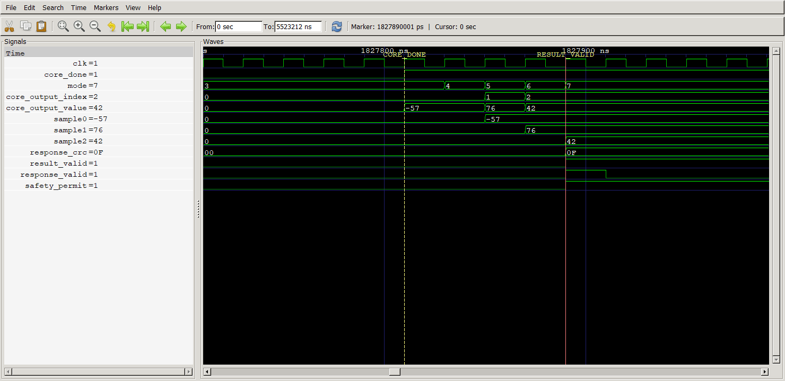

CAP0/CAP1/CAP2 read outputs 0/1/2 on successive clocks, giving raw signed [-57, 76, 42] = [-0.22265625, 0.296875, 0.1640625]. All three match golden vector 1. Only after sample2 is captured does result_valid rise and response_valid pulse. response_crc is 0F. safety_permit here means a valid policy residual; this design has no motor-driver enable output.

RTL: `fpga/rtl/igor_src_policy/igor_src_policy_uart.v:200`. Window: 1.82771e+06–1.82799e+06 ns; marker: 1.82789e+06 ns.

### 12_tx_full_packet: TX: exactly 11 bytes with independent wire decoding


The response on the wire is 5A A5 02 06 C7 FF 4C 00 2A 00 0F. C7 FF = -57, 4C 00 = 76, 2A 00 = 42, in little-endian signed Q8.8. Eleven tx_send pulses produce eleven complete 8N1 bytes; received reaches 11. The monitor decodes the pin without reusing the DUT receiver, and independently checks header, numerical results and CRC.

RTL: `fpga/rtl/igor_src_policy/igor_src_policy_uart.v:212`; `fpga/experiments/parallel8/tb_board_wrapper.sv:12`. Window: 1.82091e+06–1.94781e+06 ns; marker: 1.94713e+06 ns.

### 13_tx_exact_bits: TX zoom: start, all eight bits and full stop bit


The 10-bit shift register is {stop=1, data=0x5A, start=0}; shift[0] drives TX. Named markers show the same 0x5A LSB-first sequence as RX. Each bit is exactly 1080 ns. At 50 MHz, the rounded divider 54 produces 925925.93 baud, +0.4694% relative to nominal 921600. The separately recorded nominal-baud audit passes as well; this screenshot uses an exact-divider host.

RTL: `fpga/rtl/igor_uart_tx.v:9`. Window: 1.82785e+06–1.83893e+06 ns; marker: 1.83819e+06 ns.

### 14_tx_final_stop: Do not return to RX until the CRC stop bit finishes

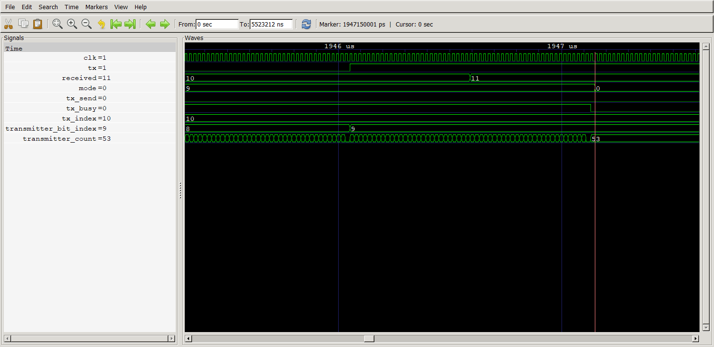

After the last send the mode progresses TX_START_LAST(8) → TX_END_LAST(9), waits for tx_busy to fall after ten full bits, and only then returns to RX(0). tx_send is one clock wide and TX requires both !tx_busy and !tx_send; this avoids duplicate bytes caused by the registered busy handshake. The stop bit remains high for its complete 54 clocks.

RTL: `fpga/rtl/igor_src_policy/igor_src_policy_uart.v:212`; `fpga/rtl/igor_src_policy/igor_src_policy_uart.v:232`. Window: 1.94531e+06–1.94761e+06 ns; marker: 1.94715e+06 ns.

### 15_estop_immediate: KEY1: immediate gating between clocks, then logged once


KEY1 falls at 1,949,003 ns, between rising clock edges. stop_active immediately rises and all three gated residuals plus permit become zero in the same simulation timestamp; TX returns to idle high. On the following rising edge stop_latched sets; error_code becomes 1, error_flags bit 1 is recorded, and rejected increments once. This is an asynchronous inhibition path followed by synchronous bookkeeping.

RTL: `fpga/experiments/parallel8/igor_src_policy_de10_nano.v:24`; `fpga/rtl/igor_src_policy/igor_src_policy_uart.v:155`. Window: 1.9489e+06–1.94922e+06 ns; marker: 1.949e+06 ns.

### 16_estop_latched: Releasing KEY1 does not restart the design

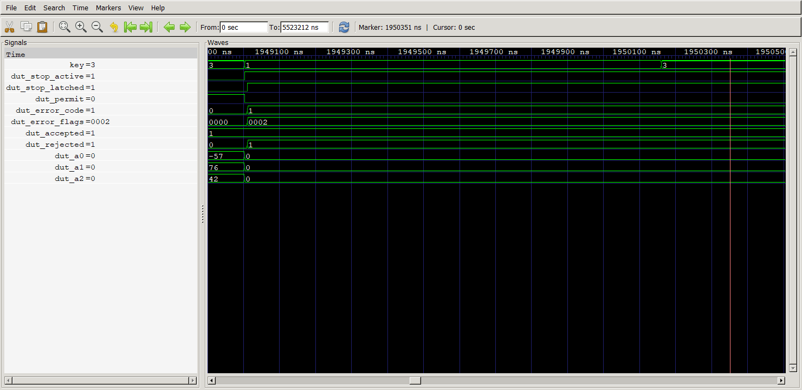

Even when KEY returns to 3, stop_latched and stop_active remain high, all residual outputs remain zero, and rejected stays at 1 rather than incrementing each held clock. A new valid packet while latched is not accepted (separate checkpoint at 3,606,192 ns). KEY0 reset is required to clear the latch and fault history.

RTL: `fpga/experiments/parallel8/igor_src_policy_de10_nano.v:24`; `fpga/experiments/parallel8/tb_board_wrapper.sv:89`. Window: 1.9489e+06–1.9505e+06 ns; marker: 1.95035e+06 ns.

### 17_key0_clears: KEY0 clears result, counters and history asynchronously


Before KEY0 assertion the post-reset transaction has again returned the correct result. At 5,522,460 ns KEY0 falls; reset_sync and rst_n immediately clear, permit and all outputs become zero, and accepted/error history clear. A separate held-KEY1 boot case is recorded as a real stop exactly once, rather than mistaken for a clean boot.

RTL: `fpga/experiments/parallel8/igor_src_policy_de10_nano.v:11`; `fpga/experiments/parallel8/tb_board_wrapper.sv:98`. Window: 5.52238e+06–5.52252e+06 ns; marker: 5.52246e+06 ns.

### 18_activation_edges: Activation arithmetic: floor, ReLU and output clipping

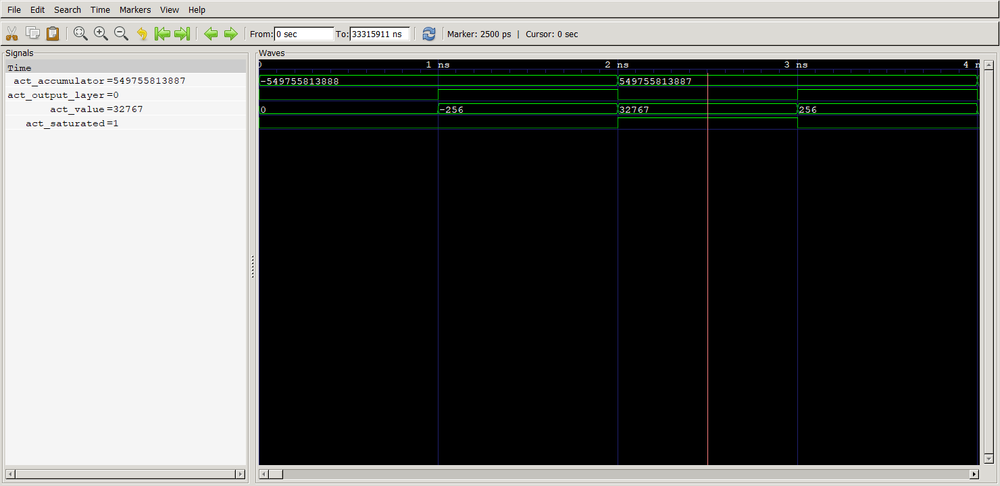

Each 1 ns step is an independent combinational activation test, not an inference clock. At the signed 40-bit minimum (-549755813888), hidden output is zero and output-layer value clips to -256. At the maximum (+549755813887), hidden value saturates to 32767 with saturated=1, while the output layer clips to +256. The regression exercises 8364 activation cases before network inference begins.

RTL: `fpga/experiments/parallel8/igor_src_policy_core.v:6`; `fpga/experiments/parallel8/tb_src_policy_core.sv:98`. Window: 0–4 ns; marker: 2.5 ns.

### 18b_floor_relu: Negative fractions floor before hidden ReLU

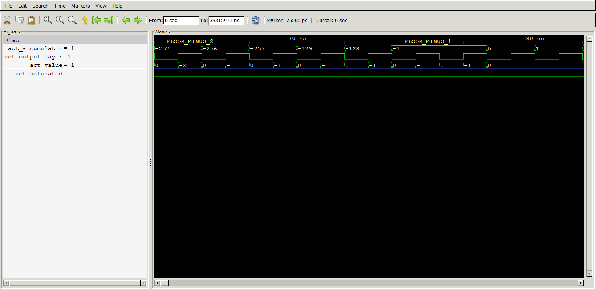

At accumulator=-257 the output-layer result is -2, because arithmetic floor(-257/256)=-2. At -1 the output-layer result is -1, while the hidden-layer result is 0 after ReLU. At accumulator=0 or 1 the scaled value is zero. This proves signed arithmetic floor rather than truncation toward zero. Each test step is 1 ns; it is combinational stimulus.

RTL: `fpga/experiments/parallel8/igor_src_policy_core.v:13`. Window: 64–82 ns; marker: 75.5 ns.

### 18c_hidden_saturation: Hidden saturation threshold is exact

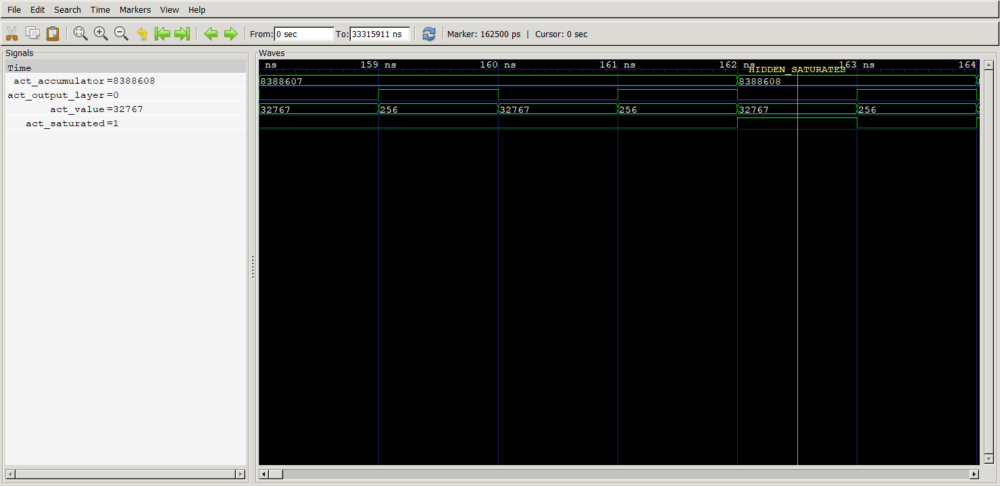

With output_layer=0, accumulator=8388607 scales to 32767 without saturation; 8388608 scales to 32768 and is clamped to 32767 with saturated=1. Switching output_layer=1 gives +256 and clears this hidden-saturation flag. Output clipping and hidden saturation are deliberately different operations.

RTL: `fpga/experiments/parallel8/igor_src_policy_core.v:13`. Window: 158–164 ns; marker: 162.5 ns.

### 19_bad_crc: CRC mismatch rejects without a success reply

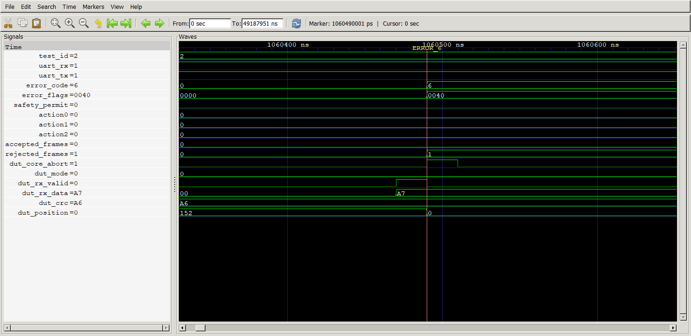

The complete payload has a deliberately corrupted CRC. error_code becomes 6, error_flags gains bit 6, rejected rises once, accepted stays zero, core_abort asserts and all residuals remain zero. No success response is transmitted. This UART protocol bench uses 8 clocks per serial bit (160 ns in simulation); it proves logic/fault behavior, not production 921600-baud timing.

RTL: `fpga/rtl/igor_src_policy/igor_src_policy_uart.v:121`; `fpga/rtl/igor_src_policy/igor_src_policy_uart.v:164`. Window: 1.06033e+06–1.06065e+06 ns; marker: 1.06049e+06 ns.

### 20_framing: A low stop bit is a framing error


The test drives a low stop bit. rx_error causes error 2 and rejection; it cannot be interpreted as a valid data byte or a successful policy response. This UART protocol bench uses 8 clocks per serial bit (160 ns in simulation); it proves logic/fault behavior, not production 921600-baud timing.

RTL: `fpga/rtl/igor_src_policy/igor_src_policy_uart.v:121`; `fpga/rtl/igor_src_policy/igor_src_policy_uart.v:164`. Window: 1.09243e+06–1.09275e+06 ns; marker: 1.09259e+06 ns.

### 21_interbyte_timeout: A stalled partial frame is discarded

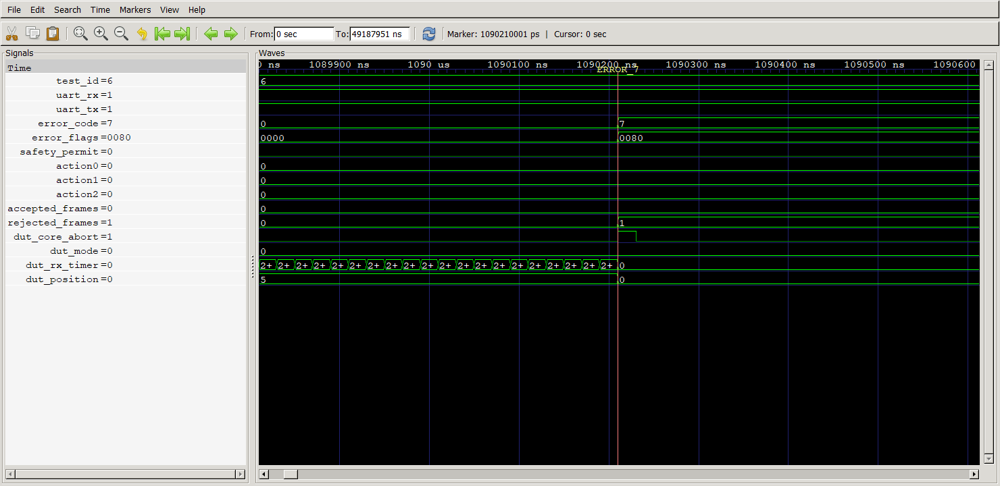

A header plus one payload byte is followed by a stall. At the test threshold of 256 clocks (5.12 µs), the parser rejects with error 7, resets position and aborts the transaction. Production uses 1,000,000 clocks = 20 ms. This UART protocol bench uses 8 clocks per serial bit (160 ns in simulation); it proves logic/fault behavior, not production 921600-baud timing.

RTL: `fpga/rtl/igor_src_policy/igor_src_policy_uart.v:121`; `fpga/rtl/igor_src_policy/igor_src_policy_uart.v:164`. Window: 1.08981e+06–1.09061e+06 ns; marker: 1.09021e+06 ns.

### 22_busy_reject: Bytes during inference cannot corrupt the active calculation


A new byte is deliberately received during RUN. Error 9 aborts the in-flight calculation and cancels transmission; no valid residual escapes. This interface requires one complete request/response at a time. This UART protocol bench uses 8 clocks per serial bit (160 ns in simulation); it proves logic/fault behavior, not production 921600-baud timing.

RTL: `fpga/rtl/igor_src_policy/igor_src_policy_uart.v:121`; `fpga/rtl/igor_src_policy/igor_src_policy_uart.v:164`. Window: 3.04347e+06–3.04379e+06 ns; marker: 3.04363e+06 ns.

### 23_result_lease: A result expires and the residual gate returns to zero

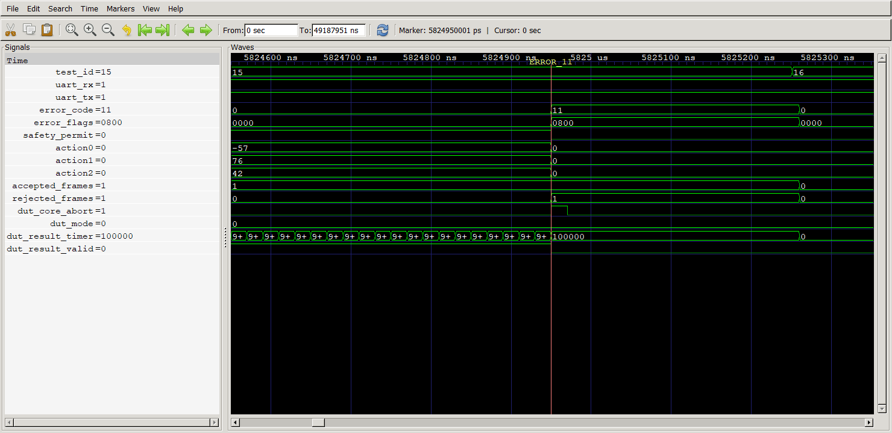

The good result is valid first. At the test lease of 100,000 clocks (2 ms), error 11 invalidates the old residual and all three outputs become zero without emitting a fresh successful packet. Production RESULT_TIMEOUT_CYCLES is 1,000,000 clocks (20 ms). This UART protocol bench uses 8 clocks per serial bit (160 ns in simulation); it proves logic/fault behavior, not production 921600-baud timing.

RTL: `fpga/rtl/igor_src_policy/igor_src_policy_uart.v:121`; `fpga/rtl/igor_src_policy/igor_src_policy_uart.v:164`. Window: 5.82455e+06–5.82535e+06 ns; marker: 5.82495e+06 ns.

### 24_inference_watchdog: A missing done signal cannot leave RUN stuck forever


The testbench deliberately forces core_done=0. At the test watchdog of 60,000 clocks (1.2 ms), error 12 aborts RUN and leaves the residual gate zero. This is fault injection, not a naturally observed core failure; production timeout is 100,000 clocks (2 ms). This UART protocol bench uses 8 clocks per serial bit (160 ns in simulation); it proves logic/fault behavior, not production 921600-baud timing.

RTL: `fpga/rtl/igor_src_policy/igor_src_policy_uart.v:121`; `fpga/rtl/igor_src_policy/igor_src_policy_uart.v:164`. Window: 8.90785e+06–8.90865e+06 ns; marker: 8.90825e+06 ns.

### 25_internal_fault: An internal core fault also closes the gate


The bench forces core_fault=1 while RUN is active. Error 10 rejects the transaction and cancels its response. This view is a deliberate fault-injection test of the wrapper. This UART protocol bench uses 8 clocks per serial bit (160 ns in simulation); it proves logic/fault behavior, not production 921600-baud timing.

RTL: `fpga/rtl/igor_src_policy/igor_src_policy_uart.v:121`; `fpga/rtl/igor_src_policy/igor_src_policy_uart.v:164`. Window: 9.15797e+06–9.15829e+06 ns; marker: 9.15813e+06 ns.

### 26_counter_saturation: Counters saturate rather than wrap through zero

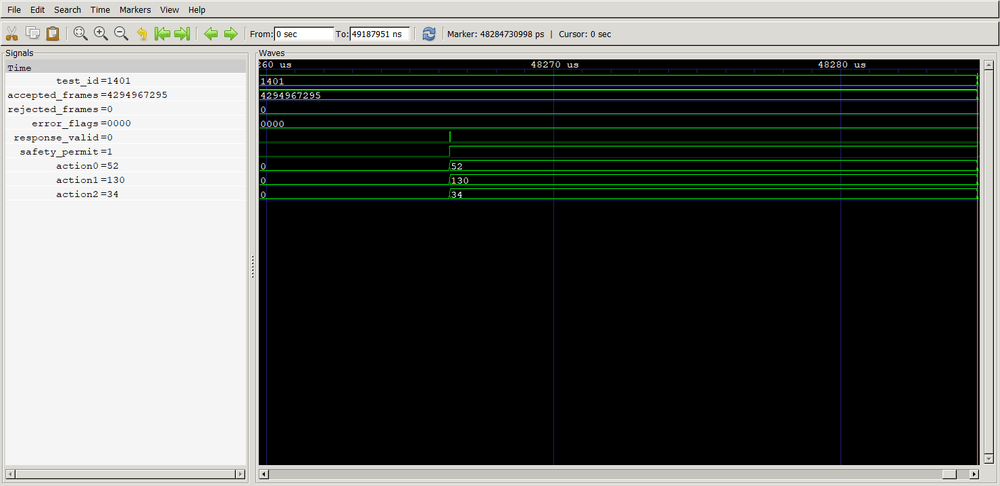

The testbench seeds accepted_frames near 0xFFFFFFFF, then completes valid transactions. The counter reaches its maximum and remains there on the next accepted request; outputs still update correctly. Rejected-counter CRC/E-stop saturation and reset recovery are also asserted in the CSV/log. The seeded value is fault-injection acceleration, not billions of transactions run in real time.

RTL: `fpga/rtl/igor_src_policy/igor_src_policy_uart.v:175`; `fpga/experiments/parallel8/tb_src_policy_uart.sv:224`. Window: 4.82597e+07–4.82847e+07 ns; marker: 4.82847e+07 ns.

