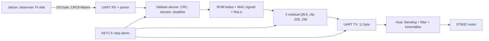

# DE10-Nano: RTL dari software `./src`

Buka **`igor_src_policy.qpf`**, top **`igor_src_policy_de10_nano`**, device
**Cyclone V 5CSEBA6U23I7**, clock **50 MHz**. Proyek memakai source kanonik
`../../rtl/`; pertahankan struktur repository saat memindahkan proyek.

Model yang dipasang ialah PPO residual **74 → 128 → 64 → 3** dari
`src/igor_navigation/igor_navigation/weights/model_weights.json` dan enam MEM
hasil ekspornya. Ini menghasilkan tiga residual twist, bukan empat setpoint
roda. Proyek planner lama `../quartus/igor.qpf` memakai protokol berbeda dan
neural 24 → 64 → 64 → 4; jangan mengirim frame bridge baru ke proyek itu.

## Arsitektur dan batas keselamatan



Core menggunakan akumulator signed 40 bit, satu operasi perkalian signed
16×16, ROM sinkron, hidden activation signed16 jenuh, dan pergeseran aritmetika
8 bit (pembulatan ke bawah). Detail alamat ROM, state machine, batas aritmetika,
dan pembanding independen ada di [README RTL](../../rtl/igor_src_policy/README.md).

`safety_permit` pada proyek ini berarti **residual valid dan masih segar**.
Tidak ada masukan costmap pada protokol observasi 74 dimensi. Pemeriksa peta
dan gerbang motor berada di proyek planner lama; penyatuan keduanya memerlukan
kontrak twist, kinematika dan costmap yang sesuai. Karena itu proyek ini belum
membuktikan AI → pemeriksa peta → gerbang → motor sepenuhnya di FPGA.

KEY1 langsung menghambat residual/TX dan ditahan oleh wrapper sampai KEY0 reset.
Kesalahan frame atau E-stop tidak dikirim sebagai respons sukses bernilai nol:
**residual nol tidak sama dengan STOP motor**. Host akan timeout/menolak frame,
melempar `FPGACommunicationError`, lalu controller mengirim empat RPS nol dan
diagnostik alasan. Watchdog perintah/LiDAR host adalah 0,5 detik. Tombol KEY1
merupakan pengaman demo dan belum merupakan rangkaian E-stop tersertifikasi.

## Pin planning yang sudah ditulis ke QSF

Semua port top berjumlah **13 pin**; lokasi berasal dari
[manual Terasic edisi 1 Februari 2018](https://www.mouser.com/datasheet/2/598/DE10_Nano_User_manual_a_b-1108056.pdf),
tabel 3-5, 3-7, 3-8, serta gambar 3-20/tabel 3-10.
Perangkat juga dirujuk di [spesifikasi Terasic](https://www.terasic.com.tw/cgi-bin/page/archive.pl?Language=English&CategoryNo=205&No=1046&PartNo=2).

| Port | Ball FPGA | Letak fisik/fungsi |
|---|---|---|
| FPGA_CLK1_50 | V11 | Clock board 50 MHz |
| KEY[0] | AH17 | Reset aktif rendah, tekan lalu lepas |
| KEY[1] | AH16 | E-stop demo aktif rendah; reset untuk arm kembali |
| UART_RX | V12 | JP1 pin 1 / GPIO_0[0], sambung TX adapter |
| UART_TX | E8 | JP1 pin 2 / GPIO_0[1], sambung RX adapter |
| LED[0] | W15 | Residual permit |
| LED[1] | AA24 | Reset sudah dilepas |
| LED[2] | V16 | Pulsa respons selesai |
| LED[3] | V15 | Inhibit E-stop aktif |
| LED[4] | AF26 | Error bit 0 |
| LED[5] | AE26 | Error bit 1 |
| LED[6] | Y16 | Error bit 2 |
| LED[7] | AA23 | Error bit 3 |

I/O memakai **3.3-V LVTTL**, UART **921600 baud, 8N1**. Sambung GND adapter ke
**JP1 pin 12 atau 30**. Gunakan adapter TTL 3,3 V; header power 5 V/3,3 V tidak
dipakai untuk sinyal UART. USB-UART bawaan HPS berbeda dari UART fabric ini.
Pin Planner membaca [pin_assignment.tcl](pin_assignment.tcl) melalui QSF.
SDC membuat clock 20 ns dan hanya mengecualikan input asinkron/output tanpa
clock penerima; path komputasi internal tetap dianalisis.

## Reproduksi verifikasi dan kompilasi

Dari folder `igor_ws/fpga`:

```powershell
python verification/src_policy/run.py --check
python verification/run_host_regression.py
python verification/run_safety_regression.py
```

Dari folder proyek ini:

```powershell
& 'D:\Quartus-Program\quartus\bin64\quartus_sh.exe' --flow compile igor_src_policy
```

Log build ada pada `compile.log`; hasil aktual ada pada
`output_files/igor_src_policy.{map,fit,sta}.rpt`, pin terpasang pada
`output_files/igor_src_policy.pin`, dan image pada
`output_files/igor_src_policy.sof`. Status final, hash, resource, dan slack
harus dibaca dari hasil build saat ini, bukan angka proyek legacy pada halaman
utama. Bukti yang dibekukan dicatat di `../../evidence/current_release/`.

Untuk operasi software gunakan workspace yang diperbaiki pada
`fpga/software_integration`, lalu build/source sesuai README di folder itu:

```bash
ros2 launch igor_bringup bringup.launch.py algorithm:=cl_drl_cbf use_fpga:=true fpga_port:=/dev/fpga fpga_baudrate:=921600
```

Mode hardware menolak port yang gagal dibuka. Mock hanya aktif jika diminta
secara eksplisit. Paket rusak, respons salah panjang, residual di luar domain,
atau kabel terputus menghentikan seluruh perintah motor melalui jalur fault.
Latensi UART, inferensi, ROS dan motor berbeda; frekuensi 50 Hz harus diukur
end-to-end pada Jetson sebelum dipakai sebagai klaim kinerja fisik.

## GTKWave dan penerimaan hardware

Buka hasil suite source-policy pada
`../../verification/src_policy/artifacts/`; file `.gtkw` menyimpan pilihan
sinyal, dan `*_checkpoints.csv` menghubungkan nama kasus dengan waktu VCD.
Untuk peta tidak valid, batas gerak, kode error dan event counter gerbang motor,
pakai `../../evidence/current_safety/` dari suite planner, bukan waveform neural.
Petunjuk titik pemeriksaan ada pada README RTL dan README root workspace.

Program image melalui JTAG hanya setelah serial adapter dan fixture motor siap.
Pemeriksaan sesi ini melaporkan **No JTAG hardware available**; belum ada hasil
uji pada board, waktu berhenti roda, konsumsi daya, atau video fisik baru.
Ikuti [checklist lengkap](../../docs/IMPLEMENTATION_READINESS.md) untuk A1–A14,
B1–B6 dan D1–D7; status hardware tetap menunggu bukti fisik.
