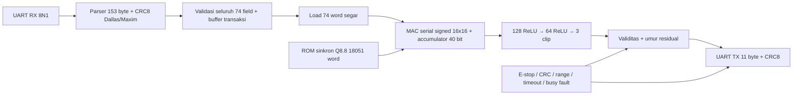

# RTL dari model navigasi `./src`: 74 → 128 → 64 → 3

Target ini mengimplementasikan policy PPO yang benar-benar disediakan oleh
`src/igor_navigation/igor_navigation/weights/model_weights.json`, termasuk enam
file Q8.8 pada direktori `hardware`. Target lama `igor_neural_core.v` memakai
24 → 64 → 64 → 4 dan merupakan model lain; hasil verifikasinya tidak membuktikan
kesesuaian dengan policy ROS 2 saat ini.

## Batas implementasi dan keselamatan

FPGA menerima **observasi yang telah dinormalisasi**, lalu mengembalikan tiga
**residual aksi**. Residual bukan kecepatan roda, bukan keluaran kinematika
Mecanum, dan bukan izin motor. Blending teleop, hard-stop envelope, CBF,
mini-DWA, pemetaan rintangan, serta konversi roda tetap tanggung jawab controller
host di `fpga/software_integration/src`; `igor_ws/src` tetap referensi asli.
Protokol observasi ini tidak membawa peta; karena itu tidak
boleh diklaim telah menguji invalidasi peta melalui target ini. Pengujian peta
berada pada target gate/planner legacy yang terpisah.

Nilai residual nol sendiri **tidak menghentikan robot**: controller dapat tetap
meneruskan perintah operator melalui blending. Karena itu fault/E-stop
menggagalkan transaksi UART dan membatalkan frame sukses yang sedang dikirim.
Host harus memperlakukan timeout/CRC/header/length failure sebagai fault dan
mengirim **kecepatan motor nol**, bukan memakai hasil residual nol sebagai
inferensi sukses. `safety_permit` hanya berarti **residual valid dan masih baru**;
nama port ini tidak menyatakan robot atau motor aman.

E-stop langsung memask `action0/1/2` ke nol secara kombinatorial, membatalkan
inferensi, membuang observasi parsial, dan mereset serializer TX. Pelepasan
E-stop melewati dua flip-flop sinkronisasi. Observasi baru yang lengkap dan sah
diperlukan untuk mendapatkan residual valid kembali. Ini bukan rangkaian E-stop
bersertifikasi; pemutusan daya/enable motor harus independen pada robot fisik.

## Arsitektur dan kontrak numerik



`igor_src_policy_rom.v` menyediakan ROM satu port baca sinkron, diisi saat
konfigurasi FPGA. Memori dipad menjadi 32768 × 16 bit dengan nol; 18051 word
berisi parameter aktif. Bentuk baca kanonik `data <= memory[address]` digunakan
agar Quartus dapat menginferensikan M10K. `igor_src_policy_core.v` memakai satu
jalur perkalian serial, menyimpan 74 observasi, 128 aktivasi pertama, 64 aktivasi
kedua, dan tiga hasil. `igor_src_policy_uart.v` membuffer transaksi terlebih
dahulu; observasi dengan CRC salah tidak pernah dimuat ke core.

| Rentang alamat ROM inklusif | Isi | Dimensi / urutan |
|---|---|---|
| 0–9471 | W1 | 128 × 74, row-major / neuron dahulu |
| 9472–9599 | b1 | 128 bias |
| 9600–17791 | W2 | 64 × 128, row-major |
| 17792–17855 | b2 | 64 bias |
| 17856–18047 | W3 | 3 × 64, row-major |
| 18048–18050 | b3 | 3 bias |
| 18051–32767 | padding | nol |

Bobot dan observasi adalah signed int16 Q8.8. Ekspor mengikuti
`round(x*256)` **ties-to-even**, lalu saturasi int16, sama dengan
`retrain_ai.py`. Akumulator setiap neuron dihitung sebagai
`sum(q_input*q_weight) + q_bias*256` dalam signed 40 bit. Hasil kemudian
dibagi 256 dengan **floor aritmetis** (`>>> 8`, bukan truncation ke nol).
Hidden layer memakai ReLU dan saturasi [0,32767]; flag `saturated` mencatat
saturasi tanpa mengubahnya menjadi fault. Output dibatasi [-256,256], yaitu
[-1,+1] pada Q8.8. Aktivasi final adalah **clip linear**, bukan tanh.

40 bit cukup untuk seluruh domain int16: maksimal 128 produk masing-masing
bermagnitudo ≤ 2^30 ditambah bias×256 tetap jauh di bawah 2^39. Tidak ada
wraparound akumulator untuk input dan bobot yang legal. Floor dan kuantisasi
antar layer memang menimbulkan selisih dari inferensi floating-point.

Inferensi menghabiskan tepat **54348 siklus** sejak `start` diterima sampai
`done`, yaitu **1,08696 ms pada 50 MHz**. Waktu UART tidak termasuk. Dengan
921600 baud, frame TX 153 byte memerlukan sekitar 1,66 ms dan frame respons
11 byte sekitar 0,12 ms. Default integer divider dibulatkan menjadi 54 clock
per bit pada 50 MHz, sehingga baud aktual sekitar 925926 (+0,469%). Pada
115200, 153 byte saja memerlukan sekitar 13,28 ms; host harus memberi budget
waktu yang memadai untuk seluruh transaksi.

Core memerlukan 74 alamat unik sejak transaksi sebelumnya. Duplikasi alamat
boleh memperbarui nilai, tetapi tidak menggantikan alamat yang hilang. `start`
tanpa frame lengkap, alamat ≥74, write ketika busy, start ketika busy, atau
load dan start bersamaan menimbulkan fault reset-only dan output nol. `abort`
membatalkan frame/hasil tanpa menghapus fault sebelumnya. Tidak ada output
yang terlihat sebelum `done`; indeks output 3 selalu menghasilkan nol.

## Protokol host yang benar

| Arah | Byte |
|---|---|
| Host → FPGA, 153 byte | `5A A5 01 94`, lalu 74 signed int16 little-endian, CRC |
| FPGA → host, 11 byte | `5A A5 02 06`, lalu 3 signed int16 little-endian, CRC |

CRC hanya mencakup `opcode,length,payload`, tidak termasuk `5A A5`. CRC8
Dallas/Maxim memakai polinomial reflected `0x8C`, init 0; string ASCII
`123456789` mempunyai check `A1`. Protokol legacy dalam
`igor_uart_protocol.v` memakai frame/CRC lain dan tidak kompatibel.

Field 0–63 adalah LiDAR ternormalisasi [0,256]. Field 64–69 adalah IMU,
70–72 perintah vx/vy/omega, dan 73 heading; semuanya harus dalam [-256,256].
Validasi dilakukan setelah kedua byte signed diterima dan seluruh CRC benar.
Nilai di luar domain ditolak, termasuk -32768/32767 yang tidak boleh wrap ke
nilai legal. NaN/Inf adalah persoalan host sebelum pengodean int16.

Default top UART: clock 50 MHz, baud 921600, inter-byte timeout 20 ms,
umur residual 20 ms, watchdog inferensi 100000 siklus / 2 ms. Batas timeout
dapat diubah lewat parameter. Timer RX menghitung jeda antar byte, bukan
durasi total frame. Header baru langsung mencabut validitas hasil lama.
Byte baru selama load/inferensi/TX ditolak sebagai collision/busy; transaksi
bersifat satu per satu, tanpa FIFO antrean perintah. Noise sebelum `5A`
diabaikan, dan `5A 5A A5` dapat menyinkron kembali.

| `error_code` terakhir | Makna dan respons |
|---|---|
| 0 | Belum ada fault sejak reset |
| 1 | E-stop; output gate nol dan TX dibatalkan |
| 2 | UART stop-bit/framing error |
| 3 | Header kedua salah |
| 4 | Opcode selain `01` |
| 5 | Panjang selain `94` / 148 payload byte |
| 6 | CRC salah |
| 7 | Transaksi parsial / inter-byte timeout |
| 8 | Observasi di luar domain normalisasi |
| 9 | Data baru ketika pipeline/TX busy |
| 10 | Fault kontrol internal core/state machine |
| 11 | Residual kedaluwarsa |
| 12 | Watchdog inferensi |

`error_flags[code]` adalah riwayat sticky; `error_code` menyimpan fault terakhir.
Pemulihan transaksi sah tidak menghapus riwayat. `accepted_frames` bertambah
hanya setelah CRC/range sah; `rejected_frames` menghitung event fault,
termasuk stale/E-stop/watchdog, sehingga bukan hanya jumlah paket salah.
`response_valid` berpulse satu siklus ketika hasil baru selesai dicapture;
pengiriman UART menyusul. `last_latency_cycles` mencatat core latency.
Status debug ini tersedia pada port RTL dan waveform simulasi, bukan respons
opcode status serial tambahan. Build board standar dapat mengoptimalkan node
debug yang tidak terhubung ke LED. Pengukuran dengan SignalTap memerlukan build
instrumentasi tersendiri dengan node tersebut dipertahankan, serta hash SOF baru.

## Regresi mandiri dan hasil numerik

Dari `igor_ws/fpga`:

```powershell
python verification/src_policy/run.py --check
```

Dependensi hanya Python standard library dan Icarus Verilog (`iverilog`,
`vvp`) pada PATH; Windows juga mendeteksi `C:/iverilog/bin`. Opsi tanpa
`--check` mengekspor ulang ROM, lalu menjalankan regresi. `--export-only`
hanya memeriksa/mengekspor bobot dan vektor. Mode `--check` gagal bila ROM
tersimpan sudah tidak sesuai model sumber. Keenam MEM sumber selalu dicek
terhadap JSON, lengkap dengan SHA-256 pada
`verification/src_policy/artifacts/model_provenance.json`. ROM tersimpan
memuat 32768 word: 18051 parameter aktif ditambah 14717 padding nol.
Padding eksplisit ini juga menghindari batas iterasi elaborasi Quartus
saat menginisialisasi ROM; tidak ada loop inisialisasi besar dalam RTL.

Regresi mencakup 236 vektor jaringan; setiap vektor membandingkan **seluruh
128 hidden1, 64 hidden2, dan tiga output**, flag saturasi, dan latency tepat.
Vektor terdiri dari nol, LiDAR clear, seluruh batas normalisasi, ±1 LSB
berjalan pada semua 74 indeks, 64 vektor normal acak dengan seed tetap,
16 vektor int16 acak, serta minimum/maksimum int16. Uji aritmetika terpisah
mengecek **8364 kombinasi** akumulator/aktivasi, termasuk batas 40 bit,
fraction negatif -1/256, ReLU sekitar nol, saturasi hidden, dan clip ±1.

Core juga diuji untuk start tanpa data, frame dengan alamat hilang walaupun
alamat lain diduplikasi, indeks invalid, load/start bersamaan, write/start
ketika busy, fault sticky, cancel di **setiap tujuh state aktif**, reset
di tengah inferensi, dan pemulihan dengan frame baru.

UART diuji pada level bit dengan decoder testbench yang independen: header,
CRC8 check standar dan respons, endian/tiga aksi golden, frame terpotong,
opcode/panjang/header salah, stop-bit salah, E-stop sebelum/mid-parser/
mid-inferensi/sebelum TX/mid-TX, busy collision saat inferensi/TX, stale,
watchdog (fault injection), fault core (fault injection), reset dan recovery,
noise/repeated-header synchronization, beberapa transaksi berurutan, serta
**dua pelanggaran batas pada masing-masing 74 field**. Setiap fault harus
memperlihatkan guarded outputs nol, permit rendah, dan kode/riwayat fault.
Tidak ada respons sukses untuk paket invalid. Pengujian ini merupakan
simulasi RTL; bukti board fisik harus dikumpulkan terpisah.

Golden integer ditulis dengan integer Python tak terbatas, terpisah dari
scheduling/address/register RTL. Karakterisasi floating memakai koefisien
FP32 sumber dalam aritmetika Python double, bukan eksekusi ONNX/FP32.
Pada 153 vektor yang memenuhi domain normalisasi, selisih maksimum aksi
fixed-point terhadap referensi floating adalah sekitar **0,014572** dan
rata-rata maksimum selisih per vektor **0,005331**. Ini karakterisasi sampel,
bukan batas galat formal. Tidak ada klaim bit-identical dengan FP32 atau
bukti bahwa akurasi navigasi robot tetap sama setelah kuantisasi.

## Titik persis di GTKWave

```powershell
cd verification/src_policy
gtkwave artifacts/core.vcd core.gtkw
gtkwave artifacts/uart.vcd uart.gtkw
```

Lokasi berkas utama:

- `verification/src_policy/artifacts/results.json`: hasil suite dan latency.
- `verification/src_policy/artifacts/core.log`, `uart.log`: assertion/pass log.
- `verification/src_policy/artifacts/core_checkpoints.csv`: `cycle,time_ps,test_id,event,busy,done,fault,error_code,output_q8_8,latency_cycles`.
- `verification/src_policy/artifacts/uart_checkpoints.csv`: `cycle,time_ps,test_id,event,estop,residual_valid,last_error,error_flags,action0_q8_8,action1_q8_8,action2_q8_8,accepted,rejected`.

**Gunakan `time_ps` dari baris checkpoint sebagai Go To Time di GTKWave**
(tambahkan unit `ps`). Nilai CSV menggunakan skala VCD 1 ps, walaupun clock
testbench berperiode 20 ns. CSV adalah lokasi pasti yang diregenerasikan dari
run yang sama, sehingga tidak bergantung pada asumsi waktu manual. Waveform
menyimpan dua inferensi awal dan semua fault terarah; sweeping jaringan/
148 range-invalid case dimatikan sementara pada VCD agar ukurannya wajar.
CSV tetap mencatat case saat dump dimatikan; untuk memeriksa waveform sweep,
hapus `$dumpoff`/`$dumpon` terkait dari testbench dan jalankan ulang.

Pada UART view, cari `test_id=10` untuk E-stop ketika inferensi,
`test_id=11` untuk tepat setelah hasil selesai sebelum respons, dan
`test_id=12` untuk E-stop di tengah TX. Periksa bersamaan `estop`,
`safety_permit`, `action0/1/2`, `error_code=01`, `error_flags[1]`, serta
`uart_tx` yang dibatalkan. `test_id=2` menunjukkan CRC salah dengan output
nol dan `error_code=06`; `test_id=15` menunjukkan residual kedaluwarsa
`error_code=0B`. Titik checkpoint UART pada run deterministik bawaan:

| Waktu GTKWave | `test_id` | Bukti yang diperiksa |
|---|---|---|
| `1354971000 ps` | 0 | Respons sah pertama: residual `[0,-3,6]`, valid=1, error=0 |
| `2709731000 ps` | 1 | LiDAR clear: residual `[-57,76,42]`, valid=1 |
| `2958071000 ps` | 2 | CRC salah: semua aksi 0, valid=0, error=6 |
| `3494691000 ps` | 10 | E-stop mid-inferensi: semua aksi 0, error=1 |
| `6186551000 ps` | 11 | E-stop setelah capture: izin dicabut, TX dibatalkan |
| `7533671000 ps` | 12 | E-stop mid-TX: frame sukses dipotong, semua aksi 0 |
| `12465731000 ps` | 15 | Kedaluwarsa: semua aksi 0, valid=0, error=11 |
| `19343591000 ps` | 20 | Watchdog: output 0, error=12 |

CSV adalah sumber otoritatif bila parameter/testbench diubah. Pada core
view, `test_id=0/1` memberi awal/akhir inferensi
dan latency `0xD44C` / 54348; `test_id=1101..1107` membuktikan cancel
pada setiap state aktif. Format Signed Decimal pada sinyal aksi memudahkan
pembacaan Q8.8; bagi nilai raw dengan 256 untuk nilai real.
