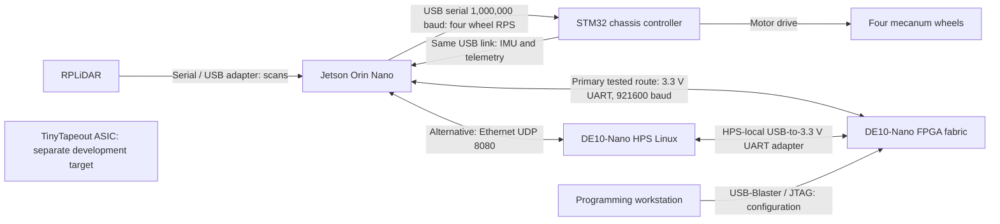
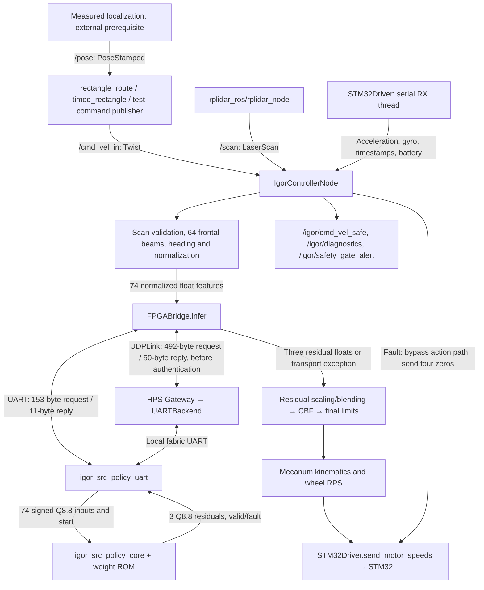

# IGOR repository overview and hardware testing scenarios

Source review: 2026-10-19. These instructions describe tests to perform; they do not claim a completed rectangle or cable-disconnection acceptance test. The latest documented verified inference link is **Jetson GPIO UART `/dev/ttyTHS1`, 921600 baud**, with 98/98 physical requests reported in [the direct UART runbook](docs/direct_uart_runbook.md). Launch defaults alone do not establish what is connected now: `bringup.launch.py` defaults to Ethernet, whereas the supervised rectangle helper explicitly uses direct UART. Confirm the actual hardware and parameters before each run.

## 1. Brief description

IGOR is a JetAuto mecanum robot platform combining ROS 2 navigation on a Jetson Orin Nano, neural residual inference on a DE10-Nano FPGA, and wheel actuation through an STM32 chassis controller. LiDAR and IMU readings support obstacle avoidance and heading correction. Jetson assembles observations, requests inference, applies safety filtering, and converts the resulting body velocity into four wheel speeds.

The repository also contains a separate TinyTapeout/IHP ASIC design, model training/export code, FPGA builds and verification, connection/programming tools, and recorded evidence. The ASIC is a development target; it is not demonstrated inline in the robot control path below.

| Area | Location and purpose |
|---|---|
| Runtime ROS packages | `ros2_ws/src/igor_controller`, `igor_navigation`, `igor_bringup`: control, algorithms, drivers, launches and configuration |
| Waypoints | `ros2_ws/src/waypoint_list`: action interfaces and waypoint client/server packages |
| Training/model assets | `ros2_ws/src/igor_navigation/igor_navigation/retrain_ai.py`, `weights/`: training and exported model assets |
| FPGA | `fpga/rtl`, `fpga/fpga_de10_nano`, `fpga/experiments/parallel8*`: source-policy inference, board projects and variants |
| Software mirror | `fpga/software_integration/src`: integration copy; build the primary `ros2_ws` tree for the tests here |
| ASIC | `src/`, `info.yaml`, hardware flow configuration: programmable engine, program memory and SRAM; consult actual source lists for build membership |
| HPS and wire protocols | `src/igor_pipeline/hps_de10`, `src/igor_pipeline/scripts`: Ethernet gateway and standalone transport validation |
| Testing and evidence | `test/`, `fpga/verification`, `fpga/evidence`, `docs/ethernet_validation`, `tools/` |
| Security | [ISO assessment](security_ISO/IEC_15408.md), [merged report](security_merged.md), [authentication setup](docs/authenticated_transport.md) |

## 2. Features

- 74-feature observation and a `74 → 128 → 64 → 3` neural residual policy, with Q8.8 FPGA input/output and a Parallel8 implementation.
- CPU and FPGA inference modes; CL-DRL, CBF and DWA-related filtering paths, plus CPU APF/DWA alternatives. These scenarios explicitly select `cl_drl_cbf` with FPGA inference.
- Direct UART inference or Ethernet UDP through the DE10 HPS gateway. Neither an Ethernet cable nor programming a SOF alone starts the gateway.
- Sensor/command freshness checks, normalized-domain validation, CRC checking, inference deadlines, transport fault latching and full wheel-zero handling on FPGA errors. Mock operation must be explicitly selected and is excluded here.
- Measured-pose rectangle following and a separate command-estimated rectangle test when localization is unavailable.
- Optional Ed25519 authentication at the host/HPS software boundary, daily traffic-key refresh and a signed-image programming check. The current FPGA fabric UART itself does not verify Ed25519 signatures. See the security documents for the exact boundary.

## 3. Architecture

### Level 0 — communication between hardware



UART and Ethernet are alternatives for inference ownership. The FPGA returns residual actions **to Jetson**, not motor packets directly to STM32. A local FPGA e-stop does not independently establish a direct motor-power cutoff. Keep a chassis-level physical stop available during tests.

Direct UART wiring documented for this robot:

| Jetson header | DE10 JP1 |
|---|---|
| Pin 8 TX | Pin 1 RX |
| Pin 10 RX | Pin 2 TX |
| Pin 9 GND | Pin 12 GND |

Use 3.3 V signalling and the matching programmed UART image. For disconnection testing use an accessible signal connector; keep ground connected and do not short header pins.

### Level 1 — modules and data flow



| Module/interface | Data and behavior |
|---|---|
| `rectangle_route_node.py` / `RectanglePath` | Measured pose, scan and controller readiness → forward legs and left turns. YAML: [`rectangle_5x4_left.yaml`](ros2_ws/src/igor_bringup/config/rectangle_5x4_left.yaml). |
| `timed_rectangle_node.py` / `TimedRectanglePath` | Integrates `/igor/cmd_vel_safe` to estimate segment progress; does not measure traveled distance. Geometry is in Python, not loaded from the rectangle YAML. |
| `controller_node.py` | Nominal velocity + scans + MCU IMU → normalized observation → residual/filtering → safe body velocity → wheel RPS. FPGA transport exceptions return before the normal nonzero motor-send path. |
| Observation | `[0:64]` frontal LiDAR scaled to `[0,1]`; `[64:67]` acceleration divided by `(3,3,9.81)`; `[67:70]` gyro in rad/s divided by 2; `[70:73]` nominal `(vx,vy,wz)` divided by `(.60,.50,2)`; `[73]` normalized heading error. Signed features clipped to `[-1,1]`. MCU gyro conversion occurs before observation assembly. |
| `fpga_bridge.py` | Quantizes each feature to signed int16 Q8.8 (`round(x×256)`). UART request: `5A A5 01 94`, 148 payload bytes, CRC8. Reply: `5A A5 02 06`, six payload bytes, CRC8. Converts residuals back by dividing by 256. Errors latch the bridge; no automatic CPU fallback. |
| FPGA Parallel8 QSF | `fpga/experiments/parallel8/igor_src_policy.qsf` selects `igor_src_policy_de10_nano`, Parallel8 `igor_src_policy_core`, shared ROM/UART controller and UART RX/TX modules. Board top maps reset/e-stop and pins. Check the selected project; other variants have different implementations. |
| `ethernet_protocol.py` / `de10_udp_gateway.py` | Request carries frame ID, timestamp, velocity metadata, 74 floats plus 74 Q8.8 values and CRC32. Response carries identity, status, three residuals, cycle field and CRC32. Gateway uses the local UART backend; cycle count is unknown/zero. Production rejects mock status 6. |
| `authenticated_transport.py` | When configured, signs/envelopes host/HPS traffic and checks pinned peer, time and replay window. Wire lengths increase. Secure UART requires the separate HPS authenticated UART gateway; current direct fabric UART accepts only legacy CRC frames. |
| `STM32Driver` | Sends indexed float32 wheel speeds at 1,000,000 baud; receives IMU/telemetry. Wheel order: front-left, rear-left, front-right, rear-right; right-side signs are handled in the control path. A successful write is not a wheel-motion acknowledgement. |
| ASIC | `src/top.v` wraps `tt_um_igorchip`; program host/memory/SRAM belong to this separate design. No demonstrated ASIC→motor or ASIC→FPGA runtime connection is assumed. |

`/igor/diagnostics` is sampled during healthy operation and is not a raw inference trace. Fault messages can have fewer fields. `/igor/cmd_vel_safe` describes commanded velocity, not measured velocity. The optional collision-projection safety gate and optional watchdog are disabled by default; transport/freshness checks still run. The comprehensive standalone RTL safety gate is not established as integrated in the active source-policy UART path.

## 4. Testing scenarios: preparation and execution locations

### Common preparation

**Jetson terminals**, from the repository root unless otherwise stated:

```bash
cd /home/toyotateamaitb/igor_ws/ros2_ws
source /opt/ros/humble/setup.bash
colcon build --base-paths src --packages-up-to igor_bringup igor_controller
source install/setup.bash
cd /home/toyotateamaitb/igor_ws
```

Repeat the two `source` commands in every new terminal, using the absolute workspace setup path if needed. Installed `rplidar_ros`, Python serial/numpy/cryptography dependencies and required ROS interfaces must be available. Use this persistent build instead of relying on a previous `/tmp` installation. Ensure this workspace is the active package source with `ros2 pkg prefix igor_controller`.

**Programming workstation:** load the accepted Parallel8 **921600** image, identify the board/device correctly and record its image hash. Follow [the UART runbook](docs/direct_uart_runbook.md) and the current programming/signature requirements. KEY1 is FPGA e-stop; release KEY1 and reset using KEY0. Do not reset during the fault observation period.

**Physical test area:** clear the 5 m × 4 m route plus robot footprint and stopping margin. Verify LiDAR mounting and clearance, MCU connection and real sensor updates. Perform initial stop/disconnection checks with wheels raised before floor trials. A supervisor must be able to stop chassis power. Only one process may own each serial device and only one source may command `/cmd_vel_in`.

**Transport selection:** these primary commands use the last verified **direct fabric UART** path. Do not configure the host/HPS authentication variables for that path: the existing fabric image cannot decode authenticated envelopes. If your environment requires authentication, use the HPS topology in [authentication setup](docs/authenticated_transport.md), configure both peers and measure its deadlines instead. Never silently disable a deployment's required authentication just to obtain replies.

**Timing:** the supervised test configuration uses a **150 ms** sensor lease, based on documented physical scan updates around 74 ms. Bringup defaults to 25 ms; a slower LiDAR may correctly prevent motion with that default. The 150 ms setting is a supervised test choice and must be reviewed against speed/stopping distance. The UART inference deadline below is 20 ms; do not increase it to conceal failures.

With no controller running, optional standalone inference preflight on **Jetson**:

```bash
python3 src/igor_pipeline/scripts/uart_test.py \
  --port /dev/ttyTHS1 --baud 921600 --iter 50 --timeout 1
```

Close it before starting ROS. Expected: valid CRC replies and fixture matches; this tests fixed inputs, not the live sensor/control pipeline.

### A. Drive a 5 m × 4 m rectangle

Geometry: 5 m forward → left 90° → 4 m forward → left 90° → 5 m forward → left 90° → 4 m forward → left 90°. Nominal straight speed 0.20 m/s, left turn 0.30 rad/s.

**A1 — measured route, preferred for dimensional acceptance.** Provide an external, independently measured localization source publishing fresh `geometry_msgs/PoseStamped` to `/pose`. The route launch does not start localization. A pose obtained only by integrating requested motor commands cannot establish a measured rectangle.

**Jetson terminal 1:** start controller and physical LiDAR, keeping other command publishers stopped:

```bash
ros2 launch igor_bringup bringup.launch.py \
  algorithm:=cl_drl_cbf use_fpga:=true use_mock_serial:=false \
  fpga_port:=/dev/ttyTHS1 fpga_baudrate:=921600 fpga_timeout:=0.02 \
  mcu_port:=/dev/ttyACM0 lidar_port:=/dev/lidar \
  sensor_freshness_timeout_ms:=150.0 launch_planner:=false
```

The current bringup has its planner node commented out; do not assume `launch_planner:=true` starts it. Start the real localization source separately using its own validated procedure.

**Jetson terminal 2:** after checking scan, pose and diagnostics:

```bash
ros2 launch igor_bringup rectangle_route.launch.py \
  armed:=true measured_pose_confirmed:=true pose_topic:=/pose
```

This loads `rectangle_5x4_left.yaml`; it does not start another hardware controller. `measured_pose_confirmed:=true` is an operator assertion, not a localization check. The node waits for fresh pose/scan, >0.45 m all-around clearance and healthy non-mock FPGA diagnostics. Once started, readiness loss aborts the route.

**Jetson terminal 3:** monitor and record before arming the route:

```bash
mkdir -p docs/testing_runs
ros2 bag record -o docs/testing_runs/rectangle_measured_01 \
  /pose /scan /cmd_vel_in /igor/cmd_vel_safe /igor/diagnostics \
  /igor/safety_gate_alert /igor/rectangle_status
```

Use a new bag name each run. Another terminal may run `ros2 topic echo /igor/rectangle_status`. Pass: final `DONE` without fault, four correct left turns, stopped wheels, and independently measured dimensions/closure meeting tolerances agreed before testing. Internal leg completion is within 0.05 m and turn completion within 0.04 rad; path-deviation rejection at 0.25 m is an abort limit, not a dimensional accuracy guarantee. Save measured corner positions and final heading.

**A2 — no measured localization available.** Run the existing command-estimated supervisor on **Jetson**, with no other bringup/controller/route process active:

```bash
python3 tools/run_timed_rectangle.py \
  --output-dir docs/testing_runs/rectangle_preflight_01
```

This starts physical LiDAR and the controller, publishes zeros for preflight, writes logs/result and sends final STOP packets. After a passing preflight and physical readiness, use a **new directory**:

```bash
python3 tools/run_timed_rectangle.py --run --floor-ready \
  --output-dir docs/testing_runs/rectangle_timed_01
```

It starts its own direct-UART controller and `timed_rectangle` node. Do not also run A1. Inspect `result.json`, `route.jsonl`, `controller.log`, `lidar.log` and `route.log`. Expected: `preflight_pass: true`, `route_final.done: true`, no route fault and final STOP sent. Nominal motion takes about 111 seconds plus pauses; the supervisor has a 190-second route deadline. This result proves only command-estimated completion; physically measure the floor path separately. `--floor-ready` asserts readiness, rather than detecting it.

### B. Monitor live inference inputs and outputs during the rectangle

Do not run `uart_test.py`, `ethernet_test.py` or another serial reader alongside the controller. They generate independent requests or compete for the port. Healthy diagnostics alone do not expose the 74 inputs and three raw residual outputs.

The following **test-only wrapper** instruments the actual controller process and writes JSONL for each inference attempt and each wheel-speed send. It reuses the existing serial owner. It also works with `udp://...` because it wraps `FPGABridge.infer()` above either transport. This is a documented temporary harness, not a new installed ROS executable.

On **Jetson**, create the harness:

```bash
cat > /tmp/igor_trace_controller.py <<'PY'
import json
import os
import time
import numpy as np
from igor_controller.fpga_bridge import FPGABridge
from igor_controller.mcu_driver import STM32Driver

trace = open(os.environ['IGOR_INFERENCE_TRACE'], 'x', buffering=1)
original_infer = FPGABridge.infer
original_motor = STM32Driver.send_motor_speeds
sequence = 0

def emit(data):
    data['monotonic_ns'] = time.monotonic_ns()
    trace.write(json.dumps(data, allow_nan=False) + '\n')

def infer(self, observation, *args, **kwargs):
    global sequence
    sequence += 1
    started = time.monotonic_ns()
    record = dict(event='inference', sequence=sequence, endpoint=self.port,
                  started_ns=started, observation=np.asarray(observation).tolist())
    try:
        action = original_infer(self, observation, *args, **kwargs)
        record['observation_q88'] = [int(round(float(v) * 256)) for v in observation]
        record['residual'] = np.asarray(action).tolist()
        record['residual_q88'] = [int(round(float(v) * 256)) for v in action]
        record['ok'] = self.last_exchange_ok
        return action
    except Exception as exc:
        record.update(ok=False, error=str(exc))
        raise
    finally:
        record['elapsed_ms'] = (time.monotonic_ns() - started) / 1e6
        emit(record)

def motor(self, *rps):
    result = original_motor(self, *rps)
    emit(dict(event='motor_send', sequence=sequence,
              rps=list(rps), write_ok=result is True))
    return result

FPGABridge.infer = infer
STM32Driver.send_motor_speeds = motor
from igor_controller.controller_node import main
try:
    main()
finally:
    trace.close()
PY
```

Start a physical LiDAR **on Jetson terminal 1**:

```bash
ros2 run rplidar_ros rplidar_node --ros-args \
  -p serial_port:=/dev/lidar -p serial_baudrate:=115200 \
  -p angle_compensate:=true -p frame_id:=laser
```

Start the monitored controller **on Jetson terminal 2**, instead of A1 bringup or A2 supervisor:

```bash
mkdir -p docs/testing_runs
IGOR_INFERENCE_TRACE="$PWD/docs/testing_runs/inference_uart_01.jsonl" \
python3 /tmp/igor_trace_controller.py --ros-args \
  -p algorithm:=cl_drl_cbf -p use_fpga:=true -p use_mock_serial:=false \
  -p fpga_port:=/dev/ttyTHS1 -p fpga_baudrate:=921600 -p fpga_timeout:=0.02 \
  -p mcu_port:=/dev/ttyACM0 -p sensor_freshness_timeout_ms:=150.0 \
  -p lidar_yaw_offset:=3.14159265
```

Use a new trace filename; `open(...,'x')` protects previous results. Start the bag recorder from A1 before motion. If measured localization is available, start A1's **route launch only** in another terminal. Otherwise start the standalone timed route after checking healthy calibrated diagnostics and physical clearance:

```bash
ros2 run igor_controller timed_rectangle --ros-args \
  -p armed:=true -p output:="$PWD/docs/testing_runs/rectangle_monitored_01.jsonl"
```

That standalone timed node performs its own readiness checks but does not provide the A2 supervisor's process management or independent final STOP retry. On completion or Ctrl+C, stop the route first, publish zeros, then stop the controller and LiDAR. Keep the physical stop available.

**Jetson monitor terminals:**

```bash
tail -f docs/testing_runs/inference_uart_01.jsonl
```

```bash
ros2 topic echo /igor/diagnostics
```

The trace records the live 74-element input, exact normalized Q8.8 quantization for valid inputs, three raw residuals, elapsed exchange time, exceptions, and wheel RPS/write results. Compare each raw residual with subsequent safe command and wheel outputs; filtering/blending means these quantities need not be equal. File logging adds control-loop load: record deadline misses and scheduling failures rather than claiming production timing from an instrumented run. A successful software motor write is still not physical wheel feedback. No motor ACK or raw wire capture is invented by this harness.

**Ethernet alternative, only if it is the selected working path:** on **DE10 HPS**, with a local adapter wired to the FPGA and a matching 921600 image:

```bash
cd /path/to/igor_ws
python3 src/igor_pipeline/hps_de10/de10_udp_gateway.py \
  --bind 192.168.50.2 --port 8080 --backend uart \
  --serial /dev/ttyUSB0 --baud 921600 --timeout 0.1 \
  --allow-client 192.168.50.1 --log /tmp/igor_gateway_01.jsonl
```

Replace `/dev/ttyUSB0` with the **HPS-local** adapter path. Prepare IP addresses using [the connection instructions](docs/connect_de10.md), and use the current source checkout/dependencies on HPS. Keep the gateway running. On **Jetson**, replace the monitored controller's `fpga_port` with `udp://192.168.50.2:8080` and use a measured suitable timeout, initially `0.3` seconds. Change the trace filename to identify Ethernet. For the separate monitored controller, the illustrated LiDAR yaw offset matches bringup’s documented 180° mounting; verify it against the physical sensor. This timeout can exceed a 50 Hz period; that is a test limitation, not a 50 Hz guarantee. HPS `tail -f /tmp/igor_gateway_01.jsonl` shows Q8.8 request/result/status and gateway elapsed time. Configure authentication on both peers if required; do not use a mock gateway for acceptance. The wrapper exposes parsed inference values, not encrypted/signed wire bytes.

**IMU unit check before floor motion:** `STM32Driver.get_latest_imu()` documents acceleration in g, while the observation code directly divides the received Z value by 9.81 without a g-to-m/s² conversion. The driver unpacks the six incoming floats without scaling. Therefore, establish the actual STM32 firmware units from captured raw telemetry: if stationary Z is near 1 rather than 9.81, the hardware input contract remains inconsistent and dimensional motion acceptance must wait for a verified correction. Matching divisors in training and inference alone does not prove matching physical units.

**Pass criteria for B:** the rectangle meets A's applicable criteria; every accepted inference has 74 finite normalized inputs, three residuals in `[-1,1]`, expected feature units, no transport errors and timing within the configured transaction deadline. At rest on level ground, gravity Z should be near normalized 1, subject to actual calibration/orientation. Compare selected captured Q8.8 frames against the repository model fixtures/reference tooling offline when numerical equivalence is required; do not assume arbitrary live frames match the fixed test vectors.

### C. Drive forward 5 m, then disconnect the FPGA link

Objective: while a forward command is still active, remove the inference connection and prove that Jetson stops accepting actions and sends no further **nonzero** motor commands after detecting failure. STOP packets should continue; requiring complete serial silence would prevent the controller from commanding a stop.

**Setup:** reuse B's monitored controller, physical LiDAR and bag recorder; do not start either rectangle publisher. First perform the same disconnection check with wheels safely raised. For the floor trial, mark a measured 5 m line, provide stopping clearance beyond it, and have a second operator handle the inference connector. Keep MCU USB, sensor links and robot power connected so the intended failure is isolated.

1. Record endpoint, baud, FPGA image hash, timeout, sensor lease, trace/bag names and the expected latency limit. Confirm healthy, non-mock FPGA diagnostics and calibrated heading.
2. On a separate **Jetson command terminal**, command a bounded low-speed forward interval:

   ```bash
   timeout --signal=INT 35s ros2 topic pub --rate 10 \
     /cmd_vel_in geometry_msgs/msg/Twist \
     '{linear: {x: 0.20, y: 0.0, z: 0.0}, angular: {x: 0.0, y: 0.0, z: 0.0}}'
   ```

   Around 25 seconds is the nominal time for 5 m at 0.20 m/s, but use a measured position/physical mark, not elapsed time, to establish distance. If the robot cannot reach 5 m within this bounded interval, end and investigate; do not prolong motion blindly.
3. At the measured 5 m point, **while the publisher is still sending forward commands**, unplug only the inference link. For direct UART, disconnect the accessible TX/RX signal connector between Jetson and FPGA, preserving ground. For Ethernet, unplug the Jetson↔HPS Ethernet cable; an additional variant can disconnect the HPS-local fabric UART. Record which failure was injected.
4. Record the unplug event with video or a shared time reference. A Jetson event marker can accompany it, but its timing uncertainty must be reported:

   ```bash
   python3 -c 'import time; print("FPGA_LINK_REMOVED", time.time_ns(), time.monotonic_ns())' \
     | tee docs/testing_runs/cable_pull_marker_01.txt
   ```

5. Observe the active command for about two seconds after the failure to prove that STOP results from the FPGA fault, rather than the nominal command ending. Then Ctrl+C the command publisher; use the physical stop immediately if motion continues. Send explicit zeros before shutting down the controller:

   ```bash
   ros2 topic pub --once /cmd_vel_in geometry_msgs/msg/Twist '{}'
   ```

6. Leave the cable disconnected long enough to capture repeated fault handling. Reconnect without restarting: motion must not resume automatically. Stop the publisher, restore wiring, reset FPGA as appropriate and restart the affected controller/gateway only after inspection and a fresh zero-command preflight.

**Expected source behavior:** `FPGABridge` times out or reports a link error and latches its fault. `IgorControllerNode._control_loop()` catches `FPGACommunicationError`, sends four zero wheel speeds, publishes a zero `/igor/cmd_vel_safe`, publishes a diagnostic fault beginning `FPGA_TRANSPORT`, and returns before residual blending/normal motor output. Later `infer()` calls fail immediately at the latch; they do not perform new hardware inference. The ROS timer and lightweight preprocessing may continue. The requirement is to stop valid inference and nonzero actuation, not terminate all Jetson computation.

**Required evidence and pass/fail checks:**

| Check | Pass evidence |
|---|---|
| Genuine fault during motion | Pre-pull trace shows successful FPGA exchanges and nonzero motor requests; command publisher remains active at pull; record measured 5 m position. |
| Link failure detection | Failed inference event followed by `FPGA_TRANSPORT` diagnostics, `safety_permit: false`, and the transport-latched error on later attempts. No accepted inference after the first fault. |
| Motor stream inhibition | After the first inference failure, every traced `motor_send.rps` is `[0,0,0,0]`; `write_ok` is true for STOP writes. Never reuse the last action or forward the nominal velocity after failure. |
| ROS output | `/igor/cmd_vel_safe` becomes and remains zero. Diagnostics alone are insufficient to prove the chassis stopped. |
| Physical result | Video/observer or measured wheel feedback establishes all wheels stopped; report stopping time/distance and any rollback or coasting. Use a passive motor-bus capture if wire-level proof is required, rather than opening the active MCU port a second time. |
| Latency | Measure unplug→first STOP request and unplug→physical rest. Direct UART has a configured 20 ms exchange deadline plus scheduling, command/serial write and actuator latency. UDP uses its selected deadline. Agree an engineering acceptance bound before the test; the repo does not establish a certified total stopping bound. |
| Reconnect | No automatic resumption with an active command; recovery requires controller reset/restart, gateway restart when latched, and fresh preflight. |

Fail the test if any nonzero motor request appears after fault detection, CPU/mock fallback occurs, STOP writes fail, or physical motion persists beyond the agreed stopping limit. A missing MCU connection or Jetson power loss is a different fault: this software cannot deliver STOP through a broken motor link, and an independent chassis watchdog/physical stop must be assessed separately.

### Evidence checklist and software checks

For each scenario save: current commit/source status, programmed image SHA-256, node parameters and endpoint, measured geometry, trace and bag files, gateway log if applicable, physical observation/video, timing uncertainty, and pass/fail with the first failing condition. Keep all run names unique. Historical evidence under `docs/ethernet_validation` is useful context, not a substitute for the current trial.

Before hardware trials, run these on a **development Linux workstation or Jetson**, at repository root with test dependencies installed:

```bash
python3 -m unittest discover -s test -p test_rectangle_route.py -q
python3 -m unittest discover -s test -p test_uart_fabric.py -q
python3 -m unittest discover -s test -p test_uart_q88.py -q
python3 -m unittest discover -s test -p test_ethernet.py -q
python3 -m unittest discover -s test -p test_security_auth.py -q
```

Ethernet fixture tests need localhost UDP permission. These tests do not drive the physical robot or replace floor testing. FPGA/ASIC simulation, synthesis and physical-design flows have their own tool dependencies and instructions in [`fpga/README.md`](fpga/README.md) and [`test/README.md`](test/README.md).